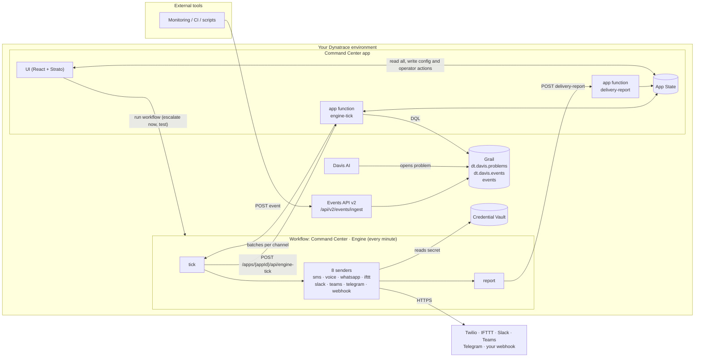

# Command Center for Dynatrace

🌐 **Project page:** https://adrianorafael.github.io/Command-Center-for-Dynatrace/

**Command Center for Dynatrace** is an app created and maintained by [@adrianorafael](https://github.com/adrianorafael) on GitHub.

It is a **NOC event console with on-call management**, built natively on Dynatrace AppEngine. Version 2 turns Davis
problems and events posted to the Dynatrace Events API into **incidents** that operators triage, acknowledge, assign,
snooze and resolve, and it **pages the on-call people** of a team through a Dynatrace **Workflow** (Twilio SMS, voice
and WhatsApp, IFTTT, Slack, Microsoft Teams, Telegram, or a generic webhook). It explores what it takes to replace a
dedicated alerting console such as **Splunk On-Call (VictorOps)**, **Atlassian Opsgenie** or a **Moogsoft-style NOC
console** with an app that lives inside Dynatrace.

This app is **not finished** — it is a **demonstration app** meant to show how easy it is to build your own Dynatrace
App through **vibecoding**, following the official documentation at [developer.dynatrace.com](https://developer.dynatrace.com/)
and using **Strato Design** to style it with Dynatrace's Design System.

> ⚠️ **Disclaimer**
>
> This app is provided by the developer with **no affiliation with Dynatrace** and **no responsibility** for any failures, issues, or consumption of resources and licenses. It is a **study version with no official support**.
>
> Deciding to download and install it in your environment is **at the user's own risk**. You are equally free to improve and expand its features.

> **Paging is a safety-critical function.** Do not make this app the only way your team is woken up at night until
> you have tested every channel end to end in your own environment, and read
> [Limitations and unverified behaviour](#limitations-and-unverified-behaviour).

## Overview

| | |
| --- | --- |
| **Inbound** | Only through Dynatrace: Davis problems (`dt.davis.problems`), optionally Davis events (`dt.davis.events`) and generic events (`events`), read from Grail with DQL. External tools post events to the Dynatrace Events API. |
| **Console** | Triage table with filters, bulk actions and keyboard shortcuts; incident detail with timeline, escalation progress, notification ledger, entities and notes. |
| **On-call** | Teams whose members are **users of your Dynatrace environment** (IAM users, picked from the directory), rotating schedules with layers and overrides, escalation policies with steps and repeats, per-user contact methods and notification rules. |
| **Outbound** | Only through the **Command Center · Engine** workflow, which runs every minute and sends through Twilio (SMS, voice, WhatsApp) and IFTTT by default, plus Slack, Microsoft Teams, Telegram and a generic HTTP webhook for any other tool. |
| **Storage** | Dynatrace App State. No external database, no secrets in the app: provider credentials stay in the Credential Vault. |

Current version: **2.0.0** — see [CHANGELOG.md](CHANGELOG.md). Version 2.0.0 is a full rebuild; nothing from the 1.x
data model carries over (see [Upgrading from 1.x](#upgrading-from-1x)).

## Table of Contents
1. [What it replaces](#what-it-replaces)
2. [Feature tour](#feature-tour)
3. [Architecture](#architecture)
4. [Prerequisites](#prerequisites)
5. [Installation and Configuration](#installation-and-configuration)
6. [Running in Development Mode](#running-in-development-mode)
7. [Publishing to Environment (Deploy)](#publishing-to-environment-deploy)
8. [Publishing to Another Environment](#publishing-to-another-environment)
9. [Required OAuth Scopes](#required-oauth-scopes)
10. [Setting up paging, step by step](#setting-up-paging-step-by-step)
11. [Sending events](#sending-events)
12. [Configuration as code](#configuration-as-code)
13. [Data model and App State](#data-model-and-app-state)
14. [Important Behaviors](#important-behaviors)
15. [Query Cost & Consumption (DPS)](#query-cost--consumption-dps)
16. [Security and privacy](#security-and-privacy)
17. [Troubleshooting](#troubleshooting)
18. [Testing](#testing)
19. [Limitations and unverified behaviour](#limitations-and-unverified-behaviour)
20. [Relevant File Structure](#relevant-file-structure)
21. [Available Scripts](#available-scripts)
22. [Versioning & Changelog](#versioning--changelog)

Detailed guides: [inbound events](docs/guides/inbound-events.md) ·
[outbound notifications](docs/guides/outbound-notifications.md) ·
[on-call setup](docs/guides/on-call-setup.md) · [operations runbook](docs/guides/operations-runbook.md).

## What it replaces

| Capability of a dedicated console | How Command Center does it |
| --- | --- |
| Alert intake API (VictorOps REST endpoint, Opsgenie Alert API, Moogsoft event ingestion) | Dynatrace **Events API v2** and OpenPipeline. Davis turns problem-opening events into problems; Command Center reads them from Grail. |
| Deduplication / correlation | Davis correlation into problems, plus Command Center's dedup key per source. Davis events that belong to a problem are folded into it. |
| Incident timeline and audit | Append-only timeline per incident (who, when, what), actor taken from App State modification info. |
| On-call schedules, rotations, overrides | Schedules with layers (daily, weekly or every N hours), handoff time, time zone, weekday/time restrictions and overrides. |
| Escalation policies | Ordered steps with delays, targets (schedule, user, whole team), optional forced channels, repeats. Stops on acknowledgement. |
| Contact methods and personal notification rules | Per user: SMS, voice, WhatsApp, Telegram, Slack, Teams, IFTTT, webhook, with "priority at or above Px → this method after N minutes". |
| Routing / alert rules | Services plus ordered routing rules (first match wins), with a rule tester. |
| Maintenance and quiet hours | Davis maintenance windows suppress paging (configurable). Per-team quiet hours (hold or downgrade low-priority pages) are supported by the engine but have no editor in 2.0.0 — set them through configuration import. |
| Reports (MTTA, MTTR, noisy services, on-call load) | Reports page built from daily rollups. |
| Outbound integrations | One Dynatrace Workflow with eight sender tasks. Anything not covered by a built-in sender gets a JSON webhook. |

What it does **not** do (yet): two-way acknowledgement from SMS/Slack replies, a mobile app, stakeholder status
pages, conference bridges, or per-user permissions enforced on the server (see [Security and privacy](#security-and-privacy)).

## Feature tour

Screenshots on the [project page](https://adrianorafael.github.io/Command-Center-for-Dynatrace/#screenshots) were taken in
**demo mode** with synthetic data.

### Console (`/`)
- Live incident table: status, priority, title, service, team, assignee, age, escalation level and source.
- KPI strip: open P1, triggered, acknowledged, assigned to me, MTTA today; each card filters the table.
- Filters for status, priority, team, service, source, assignee and escalation level, plus free-text search. Filters live in the URL,
  so a NOC view can be bookmarked.
- Row and bulk actions: acknowledge (with 10-second undo), reassign to a team or a user, snooze (15 minutes to 4 hours
  or a custom time), escalate now, change priority, add a note, resolve.
- Keyboard shortcuts: `j`/`k` move, `a` acknowledge, `r` resolve, `x` select, `/` search, `Shift+R` refresh, `Esc` close
  (can be turned off in Settings → General).
- A banner warns when the paging engine heartbeat is older than 3 minutes, has an error, or has never run.

### Notifications (header bell)

- Pop-ups appear in the bottom-right corner: new triggered P1/P2 incidents (on any screen), confirmations of your own actions (with Undo), errors, and paging-engine health (no engine run for 3 minutes).
- The bell in the header lists the last notifications with an unread count; selecting one opens the incident or page it refers to.
- **Silence** turns pop-ups off: notifications are then only counted on the bell. **Show pop-ups for…** chooses which categories may pop up.
- Preferences are per browser.

### War rooms (`/war-rooms`)

- Open a war room from an incident (**Incident details → Open war room**): paste the meeting link (Teams, Zoom, Meet, Slack huddle; https only).
  Incidents that share the same root cause, or the same service and team, are added automatically; add or remove any.
- Attach notebooks (for example Dynatrace Notebooks) to document the investigation and the post-mortem.
- Rooms are opened and closed by people. While a room is open its link is clickable (**Join**) and the incident shows **Join war room**;
  once closed the link stays visible as plain text but can't be clicked.
- The list shows status and running time, title and link, incidents, notebooks, who opened it, start, end and duration.
  It shows today's rooms by default (opened or closed today, or still open), with In progress, Closed and All filters.
- The **War rooms** tab shows how many rooms are in progress. Rooms are stored as `war.<id>` in App State.

### On-call switch (header)

- When you're on call the header indicator turns green (**You're on call**). **Leave on-call now…** hands the rest of your shift to
  someone else (the next person in the rotation is suggested) through a schedule override, effective immediately.
- When you take part in a schedule but aren't on call, **Take on-call now…** puts you on call until the current shift ends.

### Incident detail (`/incidents/:id`)
Opens beside the console table. Tabs: **Timeline** (every state change, note and notification), **Escalation** (which
step fired, who is next and when), **Notifications** (the delivery ledger: planned, sent, failed, timed out, with the
provider error), **Entities** (affected entities and root cause) and **Notes**. Davis problems link to the Dynatrace
problem page.

### On-call (`/on-call`)
- **Now**: who is on call for every schedule at this moment, until when, who is next, and coverage gaps.
- **Schedules**: layered rotations with a coverage preview (Gantt view) while you edit.
- **Overrides**: temporary replacements ("I take Friday night").

### Teams (`/teams`)
Members are picked from the Dynatrace user directory (type at least 3 characters). Roles: **admin**, **responder**,
**observer**. Each member has contact methods and notification rules. Team detail shows members, the team's on-call and
its default escalation policy.

### Escalations (`/escalations`)
Step editor (delay, targets, forced channels), repeat count, and a **simulation** that shows who would be notified at
T+n minutes.

### Services and routing (`/services`)
Services own a team, an escalation policy and a default priority. **Routing rules** are evaluated top to bottom; the
first match sets service, team, policy, priority and tags, or suppresses the alert. **Test a rule** runs the rules against
recent alerts. **Priority mapping** sets the defaults by Davis severity and category.

### Integrations (`/integrations`)
- **Inbound**: per-source status and ready-to-copy snippets (curl, PowerShell, Python, Workflow JavaScript) with
  placeholders.
- **Outbound**: the eight providers with their Credential Vault entry ID, sender parameters, enable switch and a
  **Send test notification** button.
- **Workflows**: install status of the engine workflow, **Download workflow JSON**, **Run engine now**, recent executions,
  the setup checklist and the External requests allowlist.

### Reports (`/reports`)
MTTA and MTTR over time, incidents per day, load by priority, incidents by team, noisiest services and sources, time to
acknowledge distribution, notification delivery success, and on-call load per person.

### Settings (`/settings`)
General (tenant time zone, auto-refresh default, personal table density and acknowledge target, demo mode), event
sources, routing defaults, paging engine limits, data retention, configuration **export and import** (JSON), required
permissions, deletion of legacy 1.x data, and the app version.

### Help (`/help`)
Get-started checklist that ticks itself from your data, concepts, console workflow, sending events, notifications,
keyboard shortcuts, troubleshooting and privacy notes.

## Architecture



How one minute of the engine works:

1. `tick` calls the `engine-tick` app function. It takes a short lease (`lock.engine`) so overlapping runs do not
   double-page.
2. The function runs the DQL queries for the enabled sources (Q1–Q4 below), normalises the records into alerts,
   copies the `cc.*` properties of each problem's Davis events onto the problem, de-duplicates and routes them.
3. It creates or updates `inc.*` incidents, folds operator actions (`act.*`) written by the UI, un-snoozes due incidents,
   evaluates escalation policies against on-call schedules and plans one notification per person, step, channel and
   attempt in the ledger (`ntf.*`).
4. It returns the planned notifications grouped by channel. Each sender task reads its provider's Credential Vault entry
   and calls the provider. Senders never retry; a notification that is not reported in time is retried by the engine
   (up to 3 attempts by default).
5. `report` hands the delivery results to the `delivery-report` app function, which updates the ledger and the incident
   timeline. The engine writes a heartbeat (`hb.engine`) that the console watches.

The domain logic (routing, schedules, escalation, action folding, notification planning, reports) is pure TypeScript
in `ui/app/domain/` and shared by the UI and the app functions.

## Prerequisites

- Node.js >= 22 (the Dynatrace App Toolkit may recommend Node 24) and npm
- A Dynatrace SaaS environment with Grail, AppEngine and Workflows
- Permission to deploy apps (`npx dt-app deploy`), to create workflows, and — for paging — to manage Credential Vault
  entries and the External requests allowlist (usually an environment admin)
- Accounts at the notification providers you want to use (Twilio and/or IFTTT by default)
- People who build teams must belong to the Dynatrace account that owns the environment and be allowed to view
  users (see [User permissions](#user-permissions-iam-policies))

```bash
npm install
```

## Installation and Configuration

### Step 1 — Configure the target environment in `app.config.json`

```json
{
  "environmentUrl": "https://YOUR-ENVIRONMENT.apps.dynatrace.com/",
  "app": { "id": "my.command.center", "name": "Command Center", "version": "2.0.0" }
}
```

Replace `YOUR-ENVIRONMENT` with your own Dynatrace tenant ID. The environment URL has the form
`https://<tenant-id>.apps.dynatrace.com/` — copy it from the address bar of your Dynatrace environment.

**IMPORTANT:** the app ID must start with `my.` for unsigned apps. IDs without that prefix require digital app signing.
If you change the app ID, the engine workflow must be generated for the new ID (the Integrations page does that for you;
the checked-in template uses `my.command.center`).

Files that carry the `YOUR-ENVIRONMENT` placeholder:

| File | What to change |
| --- | --- |
| `app.config.json` | `environmentUrl` |
| `.vscode/launch.json` | `url` of the "Debug Frontend" configuration (optional, IDE debugging only) |
| `workflow-templates/*.workflow.json` | nothing to change; the engine template uses `my.command.center` and `CREDENTIALS_VAULT-YOUR-…` placeholders that are informational only |

### Step 2 — Authenticate

```bash
npx dt-app auth
```

Opens your browser for Dynatrace login. An "invalid scopes" error means the tenant or your user lacks the IAM grants
for the scopes in [Required OAuth Scopes](#required-oauth-scopes).

## Running in Development Mode

```bash
npx dt-app dev
```

**Open the link printed in the terminal, not `localhost:3000` directly** — the app must run inside the Dynatrace
context. Changes hot-reload. Note that the engine workflow always calls the **deployed** app functions, so paging
cannot be tested from the dev server alone.

Outside Dynatrace (offline preview, tests) the app switches to **demo mode** with synthetic data; you can also force
it with `?demo=1` or Settings → General → Demo mode (stored in this browser only). Demo mode is always indicated in
the app.

## Publishing to Environment (Deploy)

```bash
npx dt-app deploy
```

Builds and publishes to the environment in `app.config.json`. Afterwards the app is available under
**Dynatrace → Apps → Command Center**.

- **App versions must increase monotonically per environment.** A deploy with the same or a lower `app.version` than
  the one installed is rejected; bump `app.version` (SemVer) before every deploy.
- Deploying the app does **not** install or update the engine workflow — see [Step 5](#step-5--install-the-engine-workflow).

## Publishing to Another Environment

Deployment is per environment.

1. Edit `environmentUrl` in `app.config.json`
2. `npx dt-app auth`
3. `npx dt-app deploy`
4. Repeat the paging setup below (workflow, Credential Vault, External requests) — none of it is copied.

**ATTENTION:**
- App State is isolated per tenant — teams, schedules, policies, contacts, incidents and settings do **not** migrate.
  Use **Settings → Export and import** to move the configuration (incidents and history are not exported).
- The target environment needs Grail with `dt.davis.problems` (and `dt.davis.events` / `events` if you enable those
  sources), or the console stays empty.
- The target's administrator must grant users the declared scopes, and the workflow actor its permissions.

## Required OAuth Scopes

| Scope | Purpose |
| --- | --- |
| `storage:buckets:read` | Required for any Grail read |
| `storage:events:read` | Read `dt.davis.problems`, `dt.davis.events` and `events` (engine queries Q1–Q4) |
| `state:app-states:read` | Read configuration, incidents and the notification ledger |
| `state:app-states:write` | Persist configuration, incidents and operator actions |
| `state:app-states:delete` | Remove folded actions and deleted configuration |
| `iam:users:read` | Pick on-call team members from the environment's users and show their names |
| `automation:workflows:read` | Show the engine workflow's install status and recent executions |
| `automation:workflows:run` | **Run engine now**, **Send test notification** and the immediate run after **Escalate now** |

Not requested, on purpose:

- **`automation:workflows:write`** — only apps provided by Dynatrace can hold it. That is why the engine workflow is
  imported by a person (or installed by an admin script) instead of created by the app.
- **No Credential Vault scope** — the app never reads secrets; only the workflow's sender tasks do.
- **No ingest scope** — the app never writes to Grail.

Adding a scope after deployment requires every existing user to re-authorize on next load.

### User permissions (IAM policies)

A declared scope is not enough: the app acts with the **user's** effective permissions, so users also need IAM
policies granting the underlying permissions (Grail read for the event tables, App State, workflow read/run).

**User search (team members).** Team member search calls the IAM API with the signed-in user's session (scope `iam:users:read` declared by the app).
Observed on a trial tenant: the same API returned `403 "User not authorized"` when called with a platform token, even
for the account owner, while service-user listing worked — so scripts should not rely on platform tokens for user
lookup. If the picker shows a 403 inside the app, check that the user belongs to the Dynatrace account that owns the
environment and has account permissions to view users.

## Setting up paging, step by step

The short version is also in the app under **Help → Get started** and **Integrations → Workflows**. Full detail:
[outbound notifications guide](docs/guides/outbound-notifications.md) and [on-call setup guide](docs/guides/on-call-setup.md).

### Step 1 — Decide who the workflow actor is

Every workflow task runs as the workflow **actor**, and the app functions it calls run with the actor's permissions.
A person who edits a workflow becomes its actor unless the actor is a **service user**, so create a **service user**
(Account Management → Identity & access management) for the engine and use it as actor. Give the actor:

| Permission | Why |
| --- | --- |
| `app-engine:apps:run`, `app-engine:functions:run` | Call this app's `engine-tick` and `delivery-report` functions |
| `automation:workflows:read` | `execution()` / `result()` inside the tasks |
| `credential-vault:entries:read` | Read the provider credentials in the sender tasks |
| `storage:buckets:read`, `storage:events:read` | The engine's DQL queries |
| `state:app-states:read`, `:write`, `:delete` | The engine reads and writes this app's App State |

This set has been seen working end to end; the **minimal** set has not been isolated.

### Step 2 — Enable Workflows authorization settings

Open the **Workflows** app → **Settings** → **Authorization settings** and enable the permissions above for the user
who acts as the workflow actor.
Without this, `tick` fails and nobody is paged — the console shows the "paging engine is stale" banner.

### Step 3 — Create Credential Vault entries

One entry per provider you use, created in the platform **Credential Vault** (entry IDs look like
`CREDENTIAL_VAULT_ENTRY-…`; classic `CREDENTIALS_VAULT-…` IDs are also accepted). On each entry:

1. scope **AppEngine** selected;
2. **Allow access without app context** turned **on** (workflow tasks run without app context);
3. **Owner access only** turned **on** — required: the platform rejects an entry that is both public and usable
   without app context;
4. therefore the entry's **owner must be the workflow actor**, because only the owner can read it.

| Provider | Credential type | Contents |
| --- | --- | --- |
| Twilio (SMS, voice, WhatsApp) | Username and password | Account SID (or API key SID) / auth token (or API key secret) |
| IFTTT Webhooks | Token | Your IFTTT Webhooks key |
| Slack | Token | The full incoming-webhook URL |
| Microsoft Teams | Token | The full Teams **Workflows** webhook URL ("When a Teams webhook request is received") |
| Telegram | Token | The bot token (the user's contact address is the chat ID) |
| Generic webhook | Token (or username and password) | The full `https://` URL of your endpoint; optionally an auth header value |

Command Center stores only the entry ID (`CREDENTIAL_VAULT_ENTRY-…` or `CREDENTIALS_VAULT-…`), never the secret.

### Step 4 — Allow the provider hosts (External requests)

**Settings → General → Environment management → External requests** (settings schema
`builtin:dt-javascript-runtime.allowed-outbound-connections`) — add the hosts of the providers you use:

| Provider | Host |
| --- | --- |
| Twilio | `api.twilio.com` |
| IFTTT | `maker.ifttt.com` |
| Slack | `hooks.slack.com` |
| Microsoft Teams | the host of your Teams Workflows webhook URL (copy it from the URL) |
| Telegram | `api.telegram.org` |
| Generic webhook | the host of your endpoint |

The app functions make no external calls; only the workflow's sender tasks do.

### Step 5 — Install the engine workflow

Third-party apps cannot hold `automation:workflows:write`, so the app cannot create the workflow. Two options:

**A. Import (recommended).** In Command Center → **Integrations → Workflows**, select **Download workflow JSON** (it is
generated for your app ID and assigns a workflow ID if none is set). Open the **Workflows** app, upload the file, set the
actor to your service user, and make sure the workflow is deployed. Back in Command Center select **Refresh status**;
if the upload got a new ID, select **Save this ID**. The checked-in
[`workflow-templates/command-center-engine.workflow.json`](workflow-templates/command-center-engine.workflow.json) is the
same definition with placeholders.

**B. Admin script.** With a platform token that has `automation:workflows:read` and `automation:workflows:write`:

```bash
DT_ENVIRONMENT=https://YOUR-ENVIRONMENT.apps.dynatrace.com \
DT_PLATFORM_TOKEN=YOUR-PLATFORM-TOKEN \
node scripts/install-workflow.mjs --app-id my.command.center --actor <service-user-uid>
```

The script is idempotent (update if it exists, restore from trash, otherwise create) and accepts `--dry-run`. Keep the
token in your shell or a secret manager, never in a file in this repository.

The installed workflow runs every minute: `tick` → 8 senders → `report`. Re-import it after upgrading Command Center —
the Workflows tab shows **Update available** when the definition changed.

### Step 6 — Configure the providers

**Integrations → Outbound** → **Configure** each provider: paste the Credential Vault entry ID, fill the non-secret
parameters, enable it and **Send test notification**.

| Provider (default ID) | Parameters |
| --- | --- |
| Twilio SMS / Voice / WhatsApp (`twilio-sms`, `twilio-voice`, `twilio-whatsapp`) | Sender number in E.164 (WhatsApp: the approved sender); optional messaging service SID (SMS), voice and language (calls) |
| IFTTT (`ifttt`) | Event name (default `command_center_alert`); the applet receives `value1` = subject, `value2` = text, `value3` = incident link |
| Slack (`slack`), Microsoft Teams (`teams`) | none — the webhook URL is the secret |
| Telegram (`telegram`) | Parse mode (`HTML` or `MarkdownV2`) |
| Generic webhook (`webhook`) | Optional auth header name; the value comes from a username/password vault entry |

The generic webhook receives `{ "source": "command-center", "version": 1, "notification": { … } }` with the full
notification (incident ID, priority, recipient, subject, text, incident link) — the exit for any tool without a
built-in sender (PagerDuty-style APIs, ITSM, email gateways, chat bots).

### Step 7 — Teams, people, schedules, policies, routing

1. **Teams** → create a team, add members from the user directory, set roles.
2. For each member, add **contact methods** (phone in E.164, Telegram chat ID, a label for Slack/Teams/IFTTT, a routing
   key for the webhook) and
   **notification rules** ("P1–P2: voice immediately, SMS after 5 minutes").
3. **On-call → Schedules** → add layers, rotation type, handoff time and time zone; check the coverage preview.
4. **Escalations** → create a policy: step 1 on-call of the schedule after 0 minutes, step 2 the whole team after 10,
   repeat once. Use the simulation.
5. **Services** → create services (owning team, policy, default priority) and **routing rules**. Use **Test a rule**.
6. **Settings → Routing defaults** → default team and policy for alerts no rule matches.

Details and examples: [on-call setup guide](docs/guides/on-call-setup.md).

### Step 8 — Send a test event

Send an event (next section) or, on a **trial / test environment only**, import
`workflow-templates/command-center-alert-simulator.workflow.json`: it posts one or two synthetic `[SIM] …` alerts every
7 minutes. Never import the simulator into a production environment.

## Sending events

Davis problems arrive automatically. Any other tool sends an event to the Dynatrace Events API; Davis opens a problem
for it, and Command Center picks the problem up on the next engine run.

```bash
curl -X POST "https://YOUR-ENVIRONMENT.live.dynatrace.com/api/v2/events/ingest" \
  -H "Authorization: Api-Token YOUR-TOKEN" \
  -H "Content-Type: application/json" \
  -d '{
    "eventType": "CUSTOM_ALERT",
    "title": "Checkout latency above 2 s",
    "timeout": 30,
    "properties": {
      "cc.service": "checkout",
      "cc.priority": "P2",
      "cc.tags": "team:payments,env:prod"
    }
  }'
```

- **Classic endpoint:** `https://YOUR-ENVIRONMENT.live.dynatrace.com/api/v2/events/ingest` with an **access token** that
  has the `events.ingest` scope (`Authorization: Api-Token …`).
- **Platform endpoint:** `https://YOUR-ENVIRONMENT.apps.dynatrace.com/platform/classic/environment-api/v2/events/ingest`
  with a **platform token** (`Authorization: Bearer …`). Inside a Dynatrace workflow, the relative path
  `/platform/classic/environment-api/v2/events/ingest` is authenticated as the workflow actor.
- `eventType` `CUSTOM_ALERT`, `ERROR_EVENT`, `AVAILABILITY_EVENT`, `PERFORMANCE_EVENT` or `RESOURCE_CONTENTION_EVENT`
  opens a Davis problem. `timeout` (minutes) is how long the event stays open unless you send it again.
- The `properties` land as top-level fields on the Davis event; the engine copies `cc.*` from the events of a problem
  onto the problem for routing.

| Property | Effect (default path: event → Davis problem) |
| --- | --- |
| `cc.service` | Service by ID or name → team and escalation policy |
| `cc.priority` | `P1`–`P5` (a routing rule's priority wins) |
| `cc.tags` | Comma-separated tags for routing rules |
| any other `cc.<name>` | Matchable in routing rules as `fields.cc.<name>` |

On this default path the incident **is the Davis problem**: it resolves when Davis closes the problem (the event times
out or the problem ends), or when an operator resolves it. `cc.dedup_key` and `cc.action` have **no effect** on
problems. They apply only to the optional Davis-events source and to the generic-events convention — see the
[inbound events guide](docs/guides/inbound-events.md) for all three paths.

## Configuration as code

The app function `config` exports and imports the whole configuration (settings, teams, schedules, policies,
services, routing rules, contacts), so you can keep it in Git or seed a new environment from CI.

```bash
# export
curl -X POST "https://YOUR-ENVIRONMENT.apps.dynatrace.com/platform/app-engine/app-functions/v1/apps/my.command.center/api/config" \
  -H "Authorization: Bearer YOUR-PLATFORM-TOKEN" -H "Content-Type: application/json" \
  -d '{"op":"export"}' > command-center-config.json

# validate an import without writing, then import
#   body: {"op":"import","bundle":{ "teams":[…], "schedules":[…], … },"dryRun":true}
```

- **Export** returns `{ ok, bundle: { settings, teams, schedules, policies, services, rules, contacts } }`.
- **Import** takes `{ op: "import", bundle, dryRun }`. Every entity in the bundle is validated (references are checked
  against the bundle plus what already exists) before anything is written; on any error nothing is written and
  `errors[]` lists entity, path and message. `dryRun: true` only validates and returns the counts it would write.
- Import **upserts by ID** and never deletes: entities not in the bundle stay. Settings in the bundle are merged into
  the current settings.
- The function runs with the **caller's** permissions: the token's user needs `app-engine:apps:run` (required for any
  custom app function) and App State read/write.
- The bundle contains contact methods (phone numbers) — treat the file as personal data.

The Settings page's **Export and import** writes a file with the same entities.

## Data model and App State

All state lives in this app's App State in your environment. Keys are lower-case `[a-z0-9._-]`, at most 200 characters;
values are JSON with a `schemaVersion`.

| Key | Written by | Content | Expiry |
| --- | --- | --- | --- |
| `cfg.settings` | UI | Settings (sources, defaults, engine, retention, providers) | — |
| `rules.main` | UI | Ordered routing rules | — |
| `team.<id>` | UI | Team and members (IAM user IDs + roles) | — |
| `sched.<id>` | UI | Schedule, layers, overrides | — |
| `pol.<id>` | UI | Escalation policy | — |
| `svc.<id>` | UI | Service | — |
| `contact.<uid>` | UI | Contact methods and notification rules of one user | — |
| `inc.<incId>` | engine | Incident (timeline capped at 200 entries) | while visible |
| `act.<incId>.<ts>.<rand>` | UI | One operator action (append-only) | 7 days, deleted once folded |
| `ntf.<key>` | engine | Notification ledger entry | 14 days |
| `arc.<yyyymmdd>.<incId>` | engine | Archived resolved incident | `archiveDays` (default 30, max 90) |
| `rpt.<yyyy-mm-dd>` | engine | Daily rollup for Reports | — (~2 KB/day) |
| `hb.engine` | engine | Engine heartbeat and counters | — |
| `lock.engine` | engine | Engine lease | 90 s (`lockTtlSec`) |

Limits of the App State service: **10 MB per value, 50 MB per app** in total, keys up to 200 characters, expiry between
1 minute and 90 days. App State has **no optimistic locking** — the last write wins. That is why operators never write
incidents directly: each action is its own `act.*` key that the engine folds in order, and the UI shows the result of
the same reducer immediately.

Resolved incidents stay on the console for `resolvedVisibleHours` (default 24) and are then archived; Reports use the
daily rollups, so long-term history is aggregated, not per incident.

## Important Behaviors

### The engine is the heart — watch its heartbeat
Nothing is paged unless the engine workflow runs. The console banner appears when `hb.engine` is older than 3 minutes,
reports an error, or has never been written. **Integrations → Workflows** shows the last executions.

### An incident is never resolved because it disappeared
A query that fails or returns nothing is not "all clear". Incidents resolve only on an explicit CLOSED record from the
source (or `cc.action: resolve` on the sources that support it) or by an operator.

### At-least-once paging
The notification ledger is the correctness mechanism, the engine lease only reduces overlap. In rare races (a run that
overlaps a slow previous run, a delivery report that times out) a person can be notified twice. Senders never retry;
retries are planned by the engine with a new attempt number.

### Minute granularity
The workflow runs every minute, so escalation delays and snooze ends are accurate to about one minute (plus the run's
duration).

### Private workflow, owner-only manual runs
The engine workflow is private because its task results contain phone numbers and message texts. A private workflow is
only visible to its owner, so the immediate runs behind **Run engine now**, **Send test notification** and **Escalate now**
work only for users who can see the workflow. An *Escalate now* by anyone else is still recorded and sent by the next
scheduled run (within about a minute). The minute schedule pages everyone regardless.

### Configuration is last-write-wins
Two people editing the same team or schedule at the same time: the later save wins. Edits carry a revision number, but
there is no server-side lock or conflict check.

### Roles are guidance, not enforcement
Any user who can open the app can change any configuration. Control who may open the app with Dynatrace IAM policies.

### Demo mode
Outside Dynatrace, with `?demo=1`, or when switched on in Settings (per browser), the app uses in-memory synthetic data
and never calls Dynatrace APIs. Use it for training and screenshots.

### Upgrading from 1.x
Version 1.x stored acknowledgements in one App State key, `problem-ack-states`. Version 2 does not read it. **Settings →
Export and import → Legacy data** offers to delete it. Users must re-consent to the new scopes on first load.

## Query Cost & Consumption (DPS)

> ⚠️ **Read this before running the app in a production environment.** This app runs live DQL queries against Grail,
> which consumes Dynatrace Platform Subscription (DPS) budget. Understand and measure it to avoid surprises on your bill.

### What drives cost

Unlike 1.x, the **UI runs no Grail queries**. All DQL runs in the `engine-tick` app function, called by the engine
workflow **every minute, all day: 1,440 runs per day** (plus manual runs; the workflow's hourly execution limit is 240).
The queries live in [`ui/app/data/dql.ts`](ui/app/data/dql.ts); [`api/lib/sources.ts`](api/lib/sources.ts) decides which
run on each tick.

| Factor | Effect on cost | Notes |
| --- | --- | --- |
| **Engine schedule (1 min)** | 🔴 **Dominant** — 1,440 runs/day, independent of users | Required for paging. Turning the engine off (Settings → Paging engine) stops paging too. |
| **Enabled sources** | Each extra source adds one query per run | Davis problems (Q1) always; Davis events (Q2) and generic events (Q3) are off by default. |
| **Problems with events** | Q4 adds one query per 100 linked event IDs, at most 5 per run | Only when active problems reference Davis events. |
| **Lookback** | Wider window = more data scanned | Q1 default 72 h (Settings → Event sources); Q2/Q3 fixed 24 h; Q4 uses the problem lookback. |
| **Data volume** | More problems/events = more GB scanned | Environment-dependent. |
| **Open tabs / users** | No Grail cost | Each open tab polls **App State** every 30 s by default (Settings → General → Auto-refresh). |

Queries per run: **1** (Q1 only, no linked events) · **2** (default: Q1 + one Q4) · up to **8** (all sources, five Q4
chunks).

### Rough estimate

```
queries/month ≈ 1,440 runs/day × queries_per_run × 30 days
GB/month      ≈ queries/month × GB_per_query
cost          ≈ GB/month × your DPS "Grail Query – data analyzed" rate
```

| Scenario (illustrative) | Queries/month | GB scanned at 0.5 MB/query* | GB scanned at 5 MB/query* | Est. cost** |
| --- | --- | --- | --- | --- |
| Defaults: Q1 + Q4 (2 per run) | ~86,000 | ~43 GB | ~430 GB | Low–moderate |
| All sources: Q1 + Q2 + Q3 + Q4 (4 per run) | ~173,000 | ~86 GB | ~860 GB | ⚠️ Watch this |
| Worst case: all sources, five Q4 chunks (8 per run) | ~346,000 | ~173 GB | ~1.7 TB | ⚠️ Watch this |

\* Small environments scan well under 1 MB per query on these tables; busy ones more. These are assumptions, not
measurements. \*\* Multiply GB scanned by your contract's *"Grail Query – data analyzed"* rate — the dollar amount
depends entirely on your rate card, so **measure before relying on estimates**.

**Other consumption to check on your rate card** (not measured, billing model not researched here):
- **Workflow executions:** ~1,440 per day (~43,000 per month), each with 10 tasks (`tick`, 8 senders, `report`).
- **App function invocations:** up to 2 per run (`engine-tick` every run, `delivery-report` only when something was sent).
- **App State operations:** each run lists several key prefixes; each open UI tab lists them every 30 s.

### How to measure precisely (recommended)

1. Paste the queries below into a Dynatrace **Notebook** and inspect the scan metadata. Programmatically,
   `queryExecute(...)` returns `metadata.grail.scannedBytes` and `scannedRecords` — the real cost per execution.
2. **Account Management → Cost & usage → Grail Query** confirms the aggregated consumption after a day of running.
   Check the workflow and AppEngine lines on the same page.

### How to reduce cost

- Keep Davis events (Q2) and generic events (Q3) **off** unless you send events that do not open problems.
- Lower the problem lookback (Settings → Event sources) if your problems rarely stay open for days.
- Close tabs you do not use; raise the auto-refresh interval for wall screens (App State polling only).
- Changing the workflow interval reduces runs but makes escalation coarser — not recommended for paging.

### The queries (from `ui/app/data/dql.ts`)

```
// Q1 — Davis problems (always on). ✅ executed on a tenant
fetch dt.davis.problems, from: now() - 72h
| filter not(dt.davis.is_duplicate)
| dedup event.id, sort: { timestamp desc }
| filter event.status == "ACTIVE" or event.end >= now() - 2h
| fields timestamp, event.id, display_id, event.name, event.description, event.category, event.severity,
         event.status, event.start, event.end, dt.davis.last_reopen_timestamp,
         dt.davis.event_ids, dt.davis.affected_users_count, dt.davis.mute.status,
         maintenance.is_under_maintenance, smartscape.affected_entities, root_cause.smartscape_entity,
         affected_entity_ids, affected_entity_names, root_cause_entity_name, entity_tags
| sort event.start desc
| limit 1000
```

```
// Q2 — Davis events (optional; event types from Settings). ✅ executed on a tenant
fetch dt.davis.events, from: now() - 24h
| filter in(event.type, array("CUSTOM_ALERT", "ERROR_EVENT"))
| dedup event.id, sort: { timestamp desc }
| filter event.status == "ACTIVE" or event.end >= now() - 2h
| fieldsKeep timestamp, event.id, event.name, event.description, event.type, event.category, event.severity,
         event.status, event.start, event.end, event.provider, dt.davis.is_frequent_event,
         maintenance.is_under_maintenance, dt.source_entity, entity_tags, "cc.*"
| limit 1000
```

```
// Q3 — generic events convention (optional). ⚠️ parses and runs, not validated with data
fetch events, from: now() - 24h
| filter event.type == "command_center.alert"
| filter isNotNull(cc.dedup_key)
| sort timestamp asc
| summarize { last_action = takeLast(cc.action), title = takeLast(event.name),
              description = takeLast(event.description), priority = takeLast(cc.priority),
              service = takeLast(cc.service), tags = takeLast(cc.tags),
              first_seen = min(timestamp), last_seen = max(timestamp) },
            by: { cc.dedup_key }
| limit 1000
```

```
// Q4 — cc.* properties of the events behind active problems (up to 100 IDs per query). ✅ executed on a tenant
fetch dt.davis.events, from: now() - 72h
| filter in(event.id, array("<event id>", "…"))
| dedup event.id, sort: { timestamp desc }
| fieldsKeep event.id, event.type, event.provider, "cc.*"
| limit 1000
```

## Security and privacy

- **No secrets in the app.** Provider credentials live in the Credential Vault; App State holds only the entry IDs.
  Sender tasks never return secrets or webhook URLs in their results.
- **Contact data is visible to every app user.** Phone numbers, chat IDs and handles in `contact.*` are readable by
  everyone who can open the app (App State has no per-key permissions). Emails are not stored; they are read live from
  IAM. Tell your team before they enter personal numbers.
- **Keep the engine workflow private.** Task results contain phone numbers and message texts and are visible in the
  workflow's execution log to anyone who can see the workflow.
- **Any app user can change any configuration**, and an App State admin can clear all states — export the configuration
  regularly (Settings → Export and import). The export file includes contact methods (phone numbers): store it like
  personal data.
- **Audit identity** comes from App State modification info (`lastModifiedBy`), not from what the browser claims.
- **Outbound traffic** is limited by the External requests allowlist; allow only the provider hosts you use.
- **Inbound tokens:** create ingest tokens with only `events.ingest` (or the equivalent platform permission), store them in
  the sending tool's secret store, and rotate them.
- Message texts include the incident title; do not put sensitive data in event titles if they are sent to third parties.

## Troubleshooting

| Symptom | Cause and fix |
| --- | --- |
| "The paging engine hasn't run yet" / "is stale" banner | The engine workflow is not installed, not deployed, or failing. Open **Integrations → Workflows** and the workflow's execution log. Most often: Workflows **Authorization settings** not enabled for the actor, or the actor lacks `app-engine:functions:run`. |
| `tick` fails with HTTP 403 | The actor lacks a permission (app functions, Grail read, App State). See [Step 1](#step-1--decide-who-the-workflow-actor-is). |
| `tick` fails with HTTP 404 | The workflow was generated for a different app ID. Download the workflow JSON again from Integrations and re-import it. |
| No incidents appear | Check Settings → Event sources, then whether the event reached Grail (`fetch dt.davis.events` in a Notebook) and whether Davis opened a problem. Events below the problem-opening types do not open problems: enable the Davis-events source. |
| Routing ignores `cc.service` | The service name or ID does not match a service in Command Center, or a routing rule with an explicit service matched first. Use **Services → Test a rule**. |
| A notification shows **failed** | Open the incident's **Notifications** tab for the provider error. Usual causes: host missing in **External requests**, vault entry without **Allow access without app context**, vault entry not owned by the workflow actor, wrong vault entry type, phone number not in E.164. |
| A notification shows **timeout** | The `report` task did not run or failed. Check the workflow execution; the engine retries up to 3 attempts. |
| Run engine now / Send test fail, or "Escalation recorded, but the engine didn't start" | You cannot see the private engine workflow (owner-only), the workflow ID in Settings is wrong (use **Save this ID**), or demo mode is on. An escalation is still sent by the next scheduled run. |
| "Update available" on the Workflows tab | The app was upgraded. Download the workflow JSON and upload it over the existing workflow (keep the service-user actor). |
| Deploy rejected because of the version | `app.version` must be higher than the version installed in that environment. |
| "invalid scopes" on `dt-app auth` | The tenant or your user lacks IAM grants for a scope in `app.config.json`. |
| Deploy fails — app must be signed | The app ID must start with `my.` for unsigned apps. |
| User picker finds nobody, or IAM returns 403 "User not authorized" | Type at least 3 characters; only users of this environment are listed. A 403 inside the app: check that the user belongs to the Dynatrace account that owns the environment and has account permissions to view users. Scripts should not rely on platform tokens for user lookup (observed 403 even for the account owner). |
| Vault entry cannot be saved as "without app context" | Turn on **Owner access only**; the platform rejects public entries usable without app context. The owner must be the workflow actor. |
| Configuration lost | An admin cleared App State, or the app was uninstalled. Import your last export (Settings → Export and import). |

More in the [operations runbook](docs/guides/operations-runbook.md).

## Testing

```bash
npm test            # vitest: domain core, repositories, workflow definition and scripts, engine tick
npm run typecheck   # tsc for ui/ and api/
npm run lint        # ESLint incl. security and no-secrets rules
npm run build       # dt-app build (works offline)
npm run check       # all of the above
```

Offline preview in demo mode (no tenant needed):

```bash
npx dt-app build
node scripts/preview-server.mjs --port 4173          # serves dist/ui under /ui/ with a stub runtime
# open http://127.0.0.1:4173/ui/ — the app detects it runs outside Dynatrace and uses demo data
node scripts/screenshot.mjs ./screenshots-out         # optional; one PNG per route; needs playwright and a Chrome binary
```

`node scripts/gen-workflow-templates.mjs --check` fails when the checked-in engine workflow template no longer matches
the definition in code (a unit test checks the same).

What the tests cannot cover: real provider calls (Twilio, IFTTT, Slack, Teams, Telegram) and tenant-specific Grail data.
Test every channel in your environment with **Send test notification** before relying on it.

## Limitations and unverified behaviour

Verified in a Dynatrace environment:

- event ingest through both endpoints, and Davis opening problems for the five event types above;
- `cc.*` properties on Davis events and their copy onto problems; queries Q1, Q2 and Q4;
- the imported engine workflow running `tick` → 8 senders → `report` every minute with Workflows authorization
  settings enabled;
- **end to end:** Events API → Davis problem → engine → routing by `cc.service` (from the Davis event) → schedule
  on-call → **generic webhook** provider via a Credential Vault entry → delivered (status `sent`) → `report` updates
  the ledger;
- the IAM 403 for user lookup with a platform token (even for the account owner), and the vault rule "owner access only" for
  contextless entries.

| Provider | Status |
| --- | --- |
| Generic webhook | ✅ verified live (delivered, ledger updated) |
| Twilio SMS / voice / WhatsApp, IFTTT, Slack, Microsoft Teams, Telegram | Implemented per vendor documentation, **not exercised live** |

Not verified, or only partly:

- ⚠️ **Q3 (generic events)** parses and runs but was not validated with data; the `events` convention is untested end to end.
- **Twilio, IFTTT, Slack, Teams and Telegram senders** were implemented from vendor documentation and not exercised
  live; test each channel you enable with **Send test notification**.
- **Vault entries owned by a service-user actor** — how a service user becomes an entry's owner in your environment
  was not verified; the live test used a person as actor and owner.
- **Minimal actor permission set** — the set in Step 1 works; which items are strictly required was not isolated.
- **Problems open longer than the lookback** (default 72 h) are not returned by Q1; the incident stays open until
  resolved by an operator or a later CLOSED record.
- **IANA time-zone data in the function runtime** is assumed for schedules; schedules are tested in Node.
- **App State list size** — no documented cap on how many keys one list call returns; very large ledgers are untested.
- **Billing** of workflow executions, app functions and App State operations was not researched.
- **Microsoft Teams**: only Teams Workflows webhooks are supported (Office 365 connector webhooks were retired by Microsoft).
- **Two-way replies** (acknowledge by SMS or chat) are not implemented.
- **Team quiet hours** are evaluated by the engine but have no editor in the UI yet (configuration import only).

## Relevant File Structure

```
app.config.json                    app id, version, scopes, environment placeholder
api/
  engine-tick.function.ts          app function called by the workflow's tick task
  delivery-report.function.ts      app function called by the workflow's report task
  config.function.ts               app function: configuration as code (export / import)
  lib/                             engine run, sources (Q1–Q4), lease, delivery report
ui/app/
  domain/                          pure TypeScript core (no React, no SDK)
    contracts.ts                   shared types (frozen; schemaVersion 1)
    alerts/ routing/ schedule/ escalation/ incidents/ notifications/ engine/ reports/ validation/ time/
    demo/fixtures.ts               synthetic demo data
  data/                            platform adapters
    repository.ts                  repository port + App State key schema
    appStateRepository.ts          App State adapter; memoryRepository.ts for demo/tests
    dql.ts                         DQL builders Q1–Q4
    workflows/                     engine workflow definition, task scripts, status/installer
  pages/                           console, oncall, teams, escalations, services, integrations, reports, settings, help
  components/ hooks/               shared UI pieces and the app data context
workflow-templates/                engine workflow template + trial-only alert simulator
scripts/                           install-workflow, gen-workflow-templates, preview-server, screenshot
docs/                              project page (index.html), guides/, screenshots/
specs/command-center-v2.md         specification
design/DESIGN.md                   screen and component design
```

## Available Scripts

| Script | Runs | Description |
| --- | --- | --- |
| `npm run start` | `dt-app dev` | Development mode with hot reload |
| `npm run build` | `dt-app build` | Production build into `dist/` |
| `npm run deploy` | `dt-app deploy` | Build and deploy to the configured environment |
| `npm run uninstall` | `dt-app uninstall` | Remove the app from the environment (App State may be lost — export first) |
| `npm run update` | `dt-app update` | Update `@dynatrace` packages and apply migrations |
| `npm run lint` | `eslint .` | Lint, including security and secret rules |
| `npm run typecheck` | `tsc` | Type-check `ui/` and `api/` |
| `npm test` | `vitest run` | Unit tests |
| `npm run check` | lint + typecheck + test + build | Everything before a release |
| `node scripts/install-workflow.mjs` | — | Admin install/update of the engine workflow via the Automation API |
| `node scripts/gen-workflow-templates.mjs` | — | Regenerate (or `--check`) the engine workflow template |
| `node scripts/preview-server.mjs` | — | Serve the built UI offline in demo mode |
| `node scripts/screenshot.mjs` | — | Screenshot every route of the offline preview (needs playwright) |

## Versioning & Changelog

This app follows [Semantic Versioning](https://semver.org/), where "breaking" means breaking **for the person running
the app**:

| Bump | When |
| --- | --- |
| **MAJOR** | A scope changed (everyone must re-consent) · persisted state format changed without migration · a feature was removed · a default changed in a way that raises cost |
| **MINOR** | New view, chart, filter or setting — nothing existing breaks |
| **PATCH** | Bug fix, copy, styling, dependency bump, query optimized with identical results |

- `app.config.json` → `app.version` is the single source of truth.
- Every release is recorded in [CHANGELOG.md](CHANGELOG.md).
- The same version is never published twice; Dynatrace rejects a deploy whose version is not higher than the installed one.

**Current version:** 2.0.0 (see [`app.config.json`](app.config.json)).

To learn more about the Dynatrace Platform, see [Dynatrace Developer](https://developer.dynatrace.com/).

---

Built following [Development Pattern for Dynatrace](https://github.com/adrianorafael/development-pattern-for-Dynatrace).
