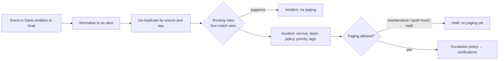

# Alerts reference — sending events to Command Center

Command Center has **no inbound endpoint of its own**. Everything arrives through Dynatrace: Davis problems, Davis
events and generic events stored in Grail. The engine reads them with DQL on every run and turns them into
**incidents**. This page explains the three paths, the JSON formats, every field the app reads and the `cc.*`
properties that act as placeholders for routing.

## The three inbound paths

| Path | Setting (Settings → Event sources) | Default | Grail table |
| --- | --- | --- | --- |
| **1. Davis problems** | *Davis problems* | **on** | `dt.davis.problems` |
| **2. Davis events that don't open a problem** | *Davis events that don't open a problem (Events API v2)* | off | `dt.davis.events` |
| **3. Generic events** | *Generic events (OpenPipeline)* | off | `events` |

| Path | How an incident resolves |
| --- | --- |
| **1. Davis problems** | When Davis closes the problem, or an operator resolves it |
| **2. Davis events that don't open a problem** | When the event closes (timeout) or a new event with `cc.action: "resolve"` and the same `cc.dedup_key` |
| **3. Generic events** | An event with `cc.action: "resolve"` and the same `cc.dedup_key` |

Any monitoring tool, script or CI job uses **path 1** by default: it posts a Davis event, Davis opens a problem, and
the problem becomes the incident. Paths 2 and 3 are for tools that want to control deduplication and resolution
themselves.

An incident is **never** resolved because its alert disappeared from a query. A failed or empty query is not "all
clear": only an explicit CLOSED record, `cc.action: "resolve"` or an operator resolves an incident.

## Path 1 — Davis event → Davis problem (recommended)

**Endpoint** (documented in *OpenPipeline → API ingestion reference*, verified on a trial tenant: HTTP 201 and Davis
opened a problem):

```
POST https://YOUR-ENVIRONMENT.live.dynatrace.com/api/v2/events/ingest
Authorization: Bearer <PLATFORM-TOKEN>
Content-Type: application/json
```

- Token: a **platform token** with the scope `openpipeline:events.davis:ingest`. The same page documents the classic
  alternative (an access token with `events.ingest`, header `Authorization: Api-Token …`).
- The Dynatrace documentation files this endpoint under the *Classic environment API* heading, even though it takes
  a platform token and OpenPipeline processes the events. It is the only documented API that creates Davis events,
  which is why Command Center uses it.
- Inside a Dynatrace workflow, a JavaScript task can call the relative path
  `/platform/classic/environment-api/v2/events/ingest`. It is authenticated as the workflow actor.

**Body**

```json
{
  "eventType": "CUSTOM_ALERT",
  "title": "Checkout latency above 2 s",
  "entitySelector": "type(SERVICE),entityName.equals(checkout)",
  "timeout": 30,
  "properties": {
    "cc.priority": "P2",
    "cc.service": "checkout",
    "cc.tags": "team:payments,env:prod",
    "runbook": "https://wiki.example.com/checkout"
  }
}
```

| Field | Required | Meaning |
| --- | --- | --- |
| `eventType` | yes | `CUSTOM_ALERT`, `ERROR_EVENT`, `AVAILABILITY_EVENT`, `PERFORMANCE_EVENT` or `RESOURCE_CONTENTION_EVENT` open a Davis problem. Other types (for example `CUSTOM_INFO`) do not open one: use path 2 for those. |
| `title` | yes | Becomes the incident title, at most 500 characters. |
| `entitySelector` | no | Attaches the event to entities. They are shown on the incident's **Entities** tab and can be matched by routing rules (`entity.name`, `entity.type`, `entity.id`). |
| `timeout` | no | Minutes the event stays open unless it is sent again. When it expires, Davis closes the problem and the incident resolves. Re-send the same event to keep it open. |
| `properties` | no | Free key/value strings. They land as fields on the Davis event. The engine copies the `cc.*` properties onto the problem (see below), except `cc.action` and `cc.dedup_key`. |

**What happens next:** within one engine interval (1, 2 or 5 minutes, chosen at install), the engine reads the
problem (query Q1), looks up the `cc.*` properties of its events (query Q4) and creates the incident. If that lookup
fails or exceeds its cap (500 event IDs per run), a problem younger than 3 minutes is held back for a later run, so that
it is not routed without its properties.

## Path 2 — Davis events that don't open a problem (optional)

Turn on **Settings → Event sources → Davis events that don't open a problem** and list the event types to read
(default `CUSTOM_ALERT, ERROR_EVENT`). Use the same endpoint and body as path 1 and add:

| Property | Meaning |
| --- | --- |
| `cc.dedup_key` | Same key → same incident. Without it, the Davis `event.id` is the key. |
| `cc.action` | `trigger` (default) or `resolve`. |

Davis events that belong to a problem are folded into that problem's incident, so the same alert is not counted
twice. Events Davis flags as *frequent* (`dt.davis.is_frequent_event`) are dropped.

## Path 3 — Generic events through OpenPipeline (optional)

Turn on **Settings → Event sources → Generic events (OpenPipeline)**. The default event type is
`command_center.alert`.

**Endpoint** (documented in *OpenPipeline → Ingest API → Generic events*, verified on a trial tenant: HTTP 202 and
the event was stored in the `events` table with its `cc.*` fields):

```
POST https://YOUR-ENVIRONMENT.live.dynatrace.com/platform/ingest/v1/events
Authorization: Bearer <PLATFORM-TOKEN>
Content-Type: application/json
```

Token: a platform token with the scope `openpipeline:events:ingest`.

**Trigger**

```json
{
  "event.type": "command_center.alert",
  "event.name": "Disk almost full on db-01",
  "event.description": "Free space 3% on /var/lib/postgresql",
  "cc.dedup_key": "disk-db-01",
  "cc.action": "trigger",
  "cc.priority": "P2",
  "cc.service": "database",
  "cc.tags": "env:prod,tier:data"
}
```

**Resolve** (same key):

```json
{
  "event.type": "command_center.alert",
  "event.name": "Disk almost full on db-01",
  "cc.dedup_key": "disk-db-01",
  "cc.action": "resolve"
}
```

The engine reads the last 24 hours of these events (query Q3), groups them by `cc.dedup_key`, and keeps the latest
action, title, description, priority, service and tags. Only those fields are read on this path. Other properties,
entities, category and severity are not read, so routing rules can match only `title`, `description`, `tag`,
`source` and the `cc.*` fields listed above. A trigger after a resolve re-opens the incident.

## The `cc.*` properties (placeholders)

All three paths understand the same small vocabulary. They are plain strings in the event's `properties` (path 1
and 2) or top-level fields (path 3).

| Property | Values | Effect | Paths |
| --- | --- | --- | --- |
| `cc.service` | Service **ID or name** as defined in **Services** | Picks the service, and through it the team, escalation policy and default priority | 1, 2, 3 |
| `cc.priority` | `P1` … `P5` | Incident priority. A routing rule that sets a priority wins. | 1, 2, 3 |
| `cc.tags` | Comma-separated, for example `team:payments,env:prod` | Incident tags, matchable by routing rules with the field `tag` | 1, 2, 3 |
| `cc.dedup_key` | Any string you choose | Same key → same incident | 2, 3 (ignored on problems) |
| `cc.action` | `trigger` (default) or `resolve` | Opens, re-opens or resolves the incident with that key | 2, 3 (ignored on problems) |
| `cc.category`, `cc.severity` | Category name; `1`–`5` | Used for the default priority when the source has no Davis category or severity | 1, 2 |
| any other `cc.<name>` or property | String | Matchable in routing rules as `fields.<name>`, for example `fields.cc.region` | 1, 2 |

On path 1 the engine copies `cc.*` from the problem's events onto the problem. When several events carry the same
property, the first one found wins. `cc.action` and `cc.dedup_key` are never copied, because they would change the
problem's identity or status.

## How an alert becomes an incident



**Normalised fields** (what routing rules can match):

| Rule field | Comes from |
| --- | --- |
| `title` | `event.name` (Davis problem/event title, generic `event.name`) |
| `description` | `event.description` |
| `category` | `event.category` or `cc.category`. Known values: `AVAILABILITY`, `ERROR`, `SLOWDOWN`, `RESOURCE_CONTENTION`, `CUSTOM_ALERT`, `MONITORING_UNAVAILABLE`, `INFO`. Anything else becomes `OTHER`. |
| `severity` | `event.severity` or `cc.severity`, 1 (most severe) … 5 |
| `source` | `davis-problem`, `davis-event` or `generic-event` |
| `sourceStatus` | `ACTIVE` or `CLOSED` |
| `displayId` | Davis display ID, for example `P-26112613` |
| `entity.name`, `entity.type`, `entity.id` | Affected entities. Several values: the condition matches when any value matches. |
| `tag` | Entity tags plus `cc.tags` |
| `rootCause.name`, `rootCause.id` | Davis root-cause entity |
| `fields.<name>` | Any other top-level field of the record as a string, for example `fields.cc.region` or `fields.event.provider` |

**Operators:** `equals`, `contains`, `in` (comma-separated list) are case-insensitive. `regex` is case-insensitive,
at most 500 characters, and patterns that could hang are rejected. `exists` means the field has a value. `lte` and
`gte` compare numbers. Every condition can be negated, and a rule matches on **all** or **any** of its conditions.

**Routing decision**

| Decision | Order (first that applies wins) |
| --- | --- |
| Service | rule *then service* → `cc.service` |
| Team | rule *then team* → service's team → *Settings → Routing defaults → Default team* |
| Escalation policy | rule *then policy* → service's policy → team's default policy → *Default escalation policy* |
| Priority | rule *then priority* → `cc.priority` → service's default priority → priority by **severity** → priority by **category** → *Fallback priority* (P3) |
| Tags | alert tags + rule *add tags* |
| Suppress | a rule with *suppress*: the incident is created and shown, but nobody is paged |

Default priority mapping (**Services → Priority mapping**): severity 1–5 → P1–P5. By category: `AVAILABILITY` P1,
`ERROR` P2, `MONITORING_UNAVAILABLE` P2, `SLOWDOWN` P3, `RESOURCE_CONTENTION` P3, `CUSTOM_ALERT` P3, `INFO` P5,
`OTHER` P4.

**Paging gates**

- **Maintenance windows:** a Davis problem under maintenance is not paged unless *Page during maintenance windows*
  is on (Settings → Event sources).
- **Quiet hours** (Teams → team → Quiet hours): incidents less urgent than the chosen priority are either **held**
  (no paging until the window ends) or paged **low urgency** (Slack, Teams, Telegram, IFTTT and webhook only, never
  SMS, voice or WhatsApp).
- **Muting** a Davis problem does not stop paging in Command Center. Use a routing rule with *suppress* for that.

## Incident identity and limits

- Incident ID: `dp-…` (Davis problem), `de-…` (Davis event) or `ge-…` (generic event), derived from the source key.
  The same key always maps to the same incident.
- Title up to 500 characters, description up to 4,000. At most 120 extra fields of up to 500 characters are kept per
  alert. Tags are limited to 100 per alert.
- Problems older than the problem look-back (default 72 hours, Settings → Event sources) are no longer read. An
  incident still open then stays open until an operator resolves it.

## Testing an event end to end

1. Send the path 1 example with `cc.service` set to one of your services.
2. Wait one engine interval. Then check **Integrations → Inbound**: the source shows *Receiving*.
3. Open the **Console**: the incident appears with the priority, service and team chosen by routing.
4. **Services → Test a rule** shows which rule matched recent alerts and why.

If nothing appears, see *Troubleshooting* in the [operations guide](operations.md).
