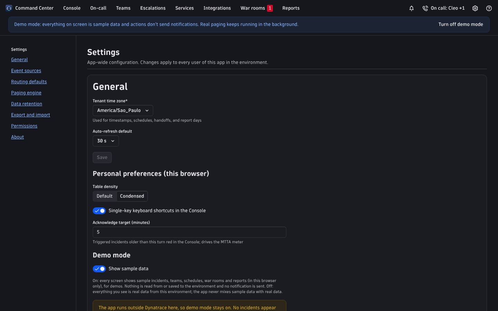

# Configuration reference — every setting, app function and stored key

Settings are **app-wide**: a change applies to every user of the app in the environment. The only exceptions are the
items marked *this browser*, which are saved immediately. The General, Event sources, Routing defaults, Paging engine
and Data retention sections each have their own **Save** button. Validation runs before saving and names the field
that needs a fix.



## General

| Setting | Default | Range | Effect |
| --- | --- | --- | --- |
| Tenant time zone | The browser's time zone | IANA zones | Timestamps, schedules, handoffs and report days |
| Auto-refresh default | 30 s | Off, 15 s, 30 s, 1 min, 5 min | How often open pages reload App State. No Grail cost: the UI runs no DQL. |
| Table density *(this browser)* | Condensed | Default, Condensed | Row height of the tables |
| Single-key keyboard shortcuts in the Console *(this browser)* | On | On, Off | `j`/`k`, `a`, `r`, `x`, `/`, `Shift+R`, `Esc` |
| Acknowledge target (minutes) *(this browser)* | 5 | 1–240 | Incidents older than this without an acknowledgement turn red in the Console. Drives the MTTA meter. |
| Demo mode → Show sample data *(this browser)* | Off | On, Off | On: sample data everywhere. Nothing is read from or saved to the environment, and no notification is sent. Off: only real data. The page reloads when you switch. |

Why is demo mode per browser? A shared setting would replace the real console of every operator with sample data
while real paging continues in the background. With a per-browser switch, a presenter can demo on their own screen
without affecting anyone on call.

## Event sources

| Setting | Default | Range | Effect |
| --- | --- | --- | --- |
| Davis problems | On | | Reads `dt.davis.problems` (query Q1) and the `cc.*` properties of their events (Q4) |
| Look back (hours) | 72 | 1–336 | How far back Q1 and Q4 read. A problem older than this is no longer seen. |
| Page during maintenance windows | Off | | Off: problems under a Davis maintenance window create incidents but page nobody |
| Davis events that don't open a problem (Events API v2) | Off | | Reads `dt.davis.events` of the listed types (Q2, last 24 h) |
| Davis event types | `CUSTOM_ALERT, ERROR_EVENT` | Comma-separated | Event types read by Q2 |
| Generic events (OpenPipeline) | Off | | Reads the `events` table (Q3, last 24 h) |
| Generic event type | `command_center.alert` | | `event.type` read by Q3 |

The formats and fields are in the [alerts reference](alerts-reference.md).

## Routing defaults

Used when no routing rule, event property or service decides.

| Setting | Default | Effect |
| --- | --- | --- |
| Default team | none (ticked by default when you create the first team) | Team for incidents that no rule or service assigns. Problems that Davis detects on its own carry no team: without a default team or routing rules they page nobody. Also set from a team (**New team**, **Edit team**, or the checklist's *Receive all unrouted alerts*). Deleting the default team clears it. |
| Default escalation policy | none | Policy when neither the rule, the service nor the team has one. Without a policy nobody is paged. |
| Fallback priority | P3 | Last step of the priority order |

The priority mapping by severity and category is edited in **Services → Priority mapping**.

## Paging engine

| Setting | Default | Range | Effect |
| --- | --- | --- | --- |
| Engine enabled | On | | Off pauses **all** paging. The engine still runs on schedule but does nothing. |
| Engine workflow ID | Filled in by Integrations → Workflows | UUID | Lets the Workflows tab find and link the workflow. The interval (1, 2 or 5 minutes) is chosen at install; the app reads it back from the installed workflow. With the optional *Engine on problem* workflow installed, 5 minutes is enough for most teams. |
| Max notifications per run | 100 | 1–500 | Notifications beyond this are planned again on the next run |
| Delivery report timeout (seconds) | 180 | 30–3600 | A notification without a delivery result after this is marked *timeout* and retried |
| Delivery attempts | 3 | 1–10 | Attempts per notification before it is marked failed |
| Engine lock lease (seconds) | 130 | 30–180 | Prevents two runs from paging twice. The engine always uses a value between 130 and 180. |

## Data retention

| Setting | Default | Range | Effect |
| --- | --- | --- | --- |
| Keep resolved incidents visible (hours) | 24 | 1–720 | Then the incident is archived and leaves the Console |
| Archive resolved incidents for (days) | 30 | 1–90 | How long archived incidents are kept. App State allows at most 90 days. |

The section shows an estimate of the App State used by the data loaded in this page (archives excluded). App State
allows 50 MB per app.

## Export and import

- **Export configuration** downloads settings, teams, schedules, policies, services, routing rules and contacts as
  JSON. Incidents, war rooms and history are not included.
- **Import configuration** validates the whole file first, including references between the entities. If anything is
  wrong, nothing is written and you get the list of errors. Teams, schedules, policies, services and contacts are
  **added or updated by ID** and never deleted. The routing rules in the file **replace** the current rules, and a
  provider list in the file replaces the current providers. Other settings are merged.
- The file contains phone numbers, chat IDs and Credential Vault entry IDs in plain text: store it like personal data.
- **Legacy data**: version 1 stored acknowledgements in the App State key `problem-ack-states`. Version 2 doesn't read
  it, and this button deletes it.

## Permissions and About

**Permissions** lists the app scopes and what each one enables (same list as in
[getting started](getting-started.md#step-2--understand-the-permissions)). Team roles (*Team admin*, *Responder*,
*Observer*) are guidance for people. App State has no per-key permissions, so any user of the app can change the
configuration. Your IAM policies decide who can open the app.

**About** shows the app version, the data schema version and whether the app is connected to the environment or
running in demo mode.

## App functions (automation and scripts)

Each function is called with `POST https://YOUR-ENVIRONMENT.apps.dynatrace.com/platform/app-engine/app-functions/v1/apps/my.command.center/api/<name>`
and runs with the **caller's** permissions. The caller needs `app-engine:apps:run` plus the permissions of the data it
touches.

| Function | Body | Returns | Verified |
| --- | --- | --- | --- |
| `config` | `{"op":"export"}` or `{"op":"import","bundle":{…},"dryRun":true}` | Export: `{ok, bundle}`. Import: counts, or `errors[]` with entity, path and message. | Yes (export, import, dry run) |
| `engine-run` | `{"reason":"manual"}` or `{"reason":"test","testRequest":{"providerId","channel","address"}}` | `{ok, sent, failed, deferred, counts, errors, skipped?}`. If a scheduled run holds the lease, it waits up to about 20 seconds. | Yes |
| `status` | `{}` | `{heartbeat, lease, openIncidents, triggered}` — for external health checks | Yes |
| `incidents` | `{}` or `{"status":"triggered"}` | The newest 200 incident summaries, without contact data or timeline | Yes |
| `directory` | `{"query":"ana"}` or `{"uids":[…]}` | Users from IAM | With a platform token the IAM API answered *User not authorized* (also when called directly, even for the account owner). It answers for a signed-in user's session. |

```bash
curl -X POST "https://YOUR-ENVIRONMENT.apps.dynatrace.com/platform/app-engine/app-functions/v1/apps/my.command.center/api/config" \
  -H "Authorization: Bearer <PLATFORM-TOKEN>" -H "Content-Type: application/json" \
  -d '{"op":"export"}' > command-center-config.json
```

## What is stored, and where

Everything lives in this app's **App State** in your environment. There is no external database. Keys are lower-case,
at most 200 characters, and values are JSON with a `schemaVersion`.

| Key | Written by | Content | Expiry |
| --- | --- | --- | --- |
| `cfg.settings` | UI | Settings, including providers (vault entry **IDs** only) | none |
| `rules.main` | UI | Ordered routing rules | none |
| `team.<id>`, `sched.<id>`, `pol.<id>`, `svc.<id>` | UI | Teams, schedules, policies, services | none |
| `contact.<uid>` | UI | One person's contact methods and notification rules | none |
| `war.<id>` | UI | War room | none |
| `inc.<id>` | engine | Incident (timeline capped at 200 entries) | archived after the visible period |
| `act.<incId>.<time>.<rand>` | UI | One operator action (acknowledge, note…) | 7 days, deleted once applied |
| `ntf.<key>` | engine | Notification ledger entry | 14 days |
| `arc.<yyyymmdd>.<id>` | engine | Archived incident | *Archive resolved incidents for* |
| `rpt.<yyyy-mm-dd>` | engine | Daily rollup for Reports | 90 days |
| `hb.engine` | engine | Heartbeat: last run, duration, counts, last error, storage estimate | none |
| `lock.engine` | engine | Engine lease | released at the end of each run |

**Why operators never write incidents.** App State has no optimistic locking: the last write wins. So each operator
action is its own `act.*` key. The engine applies these actions in order on the next run, and the UI shows the result
immediately with the same logic. Configuration edits (teams, schedules…) are last-write-wins: if two people save the
same team at the same time, the later save wins.
