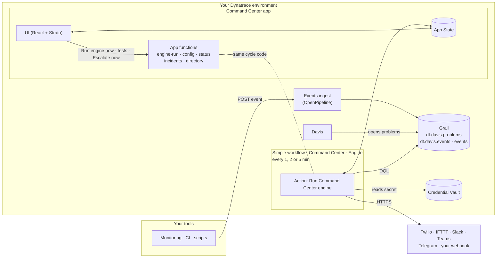

# Operations — architecture, cost, troubleshooting and limits

🌐 **English** · [Português (BR)](../pt-BR/operations.md) · [Español](../es/operations.md)

## Architecture



**One engine cycle** (the action, or `engine-run` on demand):

1. Take the engine lease (`lock.engine`) so that two runs never page twice. If another run holds it, this run is
   skipped (counted as `skippedLocked` in the heartbeat).
2. Run the DQL queries of the enabled sources (Q1–Q4), normalise the records into alerts, de-duplicate and route them.
3. Create or update incidents, apply operator actions in order, end snoozes that are due, evaluate escalation policies
   against the schedules, plan notifications and retries (failed or without a result) in the ledger, archive old
   resolved incidents and update the daily rollup. Write the heartbeat (`hb.engine`) and release the lease.
4. Read each needed provider secret from the Credential Vault and send (or run your custom workflow). Write `sent` or
   `failed` into the ledger.

All routing, schedule, escalation and planning logic is plain TypeScript in `ui/app/domain/`. The UI uses the same
code, so what the Console shows right after an action matches what the engine will do.

## Why one simple workflow

| Design | Workflow hours | Function invocations | Verdict |
| --- | --- | --- | --- |
| Version 2 before this change: a **standard** workflow `tick` → 8 senders → `report` | 1 per hour of the workflow's lifetime, whether or not it does anything | Measured: about 690 per hour (≈ 11.5 per minute) | Replaced |
| One **simple** workflow per built-in integration, triggered by events | none | One invocation per notification, plus an event ingest per notification to trigger it | Not used for the built-in providers: they need no workflow at all, and an integration that is off has nothing to install. Offered as the optional **Custom workflow** integration, run directly by the engine (no event ingest). |
| **One simple workflow, one action, interval trigger** (current) | **none** | Measured: **1 per run** (60 per hour at 1 minute) | ✅ |

Sources: *Create a simple workflow* ("without consuming workflow hours") and *Workflows concepts* (simple workflows "do
not generate any consumption of workflow hours") in the Dynatrace documentation. Simple workflows allow exactly one
task, and that task cannot be *Run JavaScript*, *Run workflow* or an approval. That is why the engine is a custom app
action (`actions/run-engine.action.ts`) and not a script.

Measured on the trial environment, from the billing events in `dt.system.events` (`AppEngine Functions - Small`):

| 10-minute window (UTC) | Old engine still installed | New engine only |
| --- | --- | --- |
| Invocations | 00:50 → 105, 01:00 → 120, 01:10 → 114 | 01:30 → 21, 01:40 → 11, 01:50 → 18 |
| of which `ACTION` (the engine) | — | 10 per window = 1 per minute |

The remaining invocations in the new column are the trial-only alert simulator (a standard workflow running
JavaScript) and our own test calls to the app functions.

Workflow hours, from the `Automation Workflow` billing events: for the hour 01:00–02:00 UTC only the alert simulator
(a standard workflow) was billed. The simple-workflow engine, which ran every minute in that hour, produced no workflow
billing event.

## Cost and consumption

> Read this before running the app in production. The engine runs all day, independently of how many people use the
> app.

| Item | Per month at 1 min | at 2 min | at 5 min |
| --- | --- | --- | --- |
| Engine runs = function invocations (`ACTION`) | ≈ 43,200 | ≈ 21,600 | ≈ 8,640 |
| Workflow hours | 0 | 0 | 0 |
| Grail queries | 1–8 per run (below) | same | same |

**Grail queries per run**: Q1 problems (when the Davis problems source is on, the default), Q4 event properties of the problems Q1 returned (one per 100 event IDs, at most
5), Q2 Davis events and Q3 generic events (only when turned on). The UI runs **no** DQL: open tabs read only App State.

| Factor | Effect |
| --- | --- |
| Run interval | Linear in runs. A longer interval also means coarser escalation timing. |
| Enabled sources | Q2 and Q3 add one query each per run |
| Problem look-back (72 h) | A wider window scans more data |
| Data volume | More problems and events, more bytes scanned |
| Open browser tabs | No Grail cost. Each tab reads App State every 30 s by default. |

How to measure in your environment:

- Billing events: `fetch dt.system.events | filter event.kind == "BILLING_USAGE_EVENT"`, grouped by `event.type`
  and, for functions, by `function.type`.
- **Account Management → Cost & usage** for Grail queries, AppEngine functions and workflows after a day of running.
- The Dynatrace documentation notes that simple workflows, while consuming no workflow hours, can still trigger other
  billable capabilities: here the function invocations and the Grail queries.

How to reduce cost: keep Q2 and Q3 off unless you send events that don't open problems; lower the look-back; choose
a 2- or 5-minute interval if your escalation delays are long.

**The queries** (`ui/app/data/dql.ts`, all executed on the trial environment):

```
// Q1 — Davis problems
fetch dt.davis.problems, from: now() - 72h
| filter not(dt.davis.is_duplicate)
| dedup event.id, sort: { timestamp desc }
| filter event.status == "ACTIVE" or event.end >= now() - 2h
| fields timestamp, event.id, display_id, event.name, event.description, event.category, event.severity,
         event.status, event.start, event.end, dt.davis.last_reopen_timestamp, dt.davis.event_ids,
         dt.davis.affected_users_count, dt.davis.mute.status, maintenance.is_under_maintenance,
         smartscape.affected_entities, root_cause.smartscape_entity, affected_entity_ids,
         affected_entity_names, root_cause_entity_name, entity_tags
| sort event.start desc
| limit 1000

// Q2 — Davis events (optional)
fetch dt.davis.events, from: now() - 24h
| filter in(event.type, array("CUSTOM_ALERT", "ERROR_EVENT"))
| dedup event.id, sort: { timestamp desc }
| filter event.status == "ACTIVE" or event.end >= now() - 2h
| fieldsKeep timestamp, event.id, event.name, event.description, event.type, event.category, event.severity,
             event.status, event.start, event.end, event.provider, dt.davis.is_frequent_event,
             maintenance.is_under_maintenance, dt.source_entity, entity_tags, "cc.*"
| limit 1000

// Q3 — generic events (optional)
fetch events, from: now() - 24h
| filter event.type == "command_center.alert"
| filter isNotNull(cc.dedup_key)
| sort timestamp asc
| summarize { last_action = takeLast(cc.action), title = takeLast(event.name),
              description = takeLast(event.description), priority = takeLast(cc.priority),
              service = takeLast(cc.service), tags = takeLast(cc.tags),
              first_seen = min(timestamp), last_seen = max(timestamp) },
            by: { cc.dedup_key }
| limit 1000

// Q4 — cc.* properties of the events behind active problems (up to 100 IDs per query)
fetch dt.davis.events, from: now() - 72h
| filter in(event.id, array("<event id>", "…"))
| dedup event.id, sort: { timestamp desc }
| fieldsKeep event.id, event.type, event.provider, "cc.*"
| limit 1000
```

## Health and monitoring

- **Console banner**: the engine is *late* after two intervals plus one minute without a run (3 minutes at the default
  interval), or the last run reported an error. The **bell** notifies only when the engine is late.
- **Integrations → Workflows**: last run, its duration and counts, the last error, and the install status.
- **External monitoring**: call the `status` app function. It returns the heartbeat, the lease and the
  open/triggered counts (see [configuration](configuration.md#app-functions-automation-and-scripts)).
- Simple workflows keep only execution metadata: task results and logs are not stored. The engine's diagnostics are
  therefore in the heartbeat, not in the Workflows execution log.

## Behaviour you should know

- **Never resolved by absence.** A failed or empty query never resolves anything. Only a CLOSED record,
  `cc.action: "resolve"` or an operator resolves an incident.
- **At-least-once paging.** The ledger prevents duplicates in normal operation. In rare races (a run that overlaps a
  slow previous run, a result that arrives after the timeout) a person can be notified twice.
- **Timing precision = interval.** A step fires on the first run after it is due. The same applies to snooze ends.
- **Configuration is last-write-wins.** Two people saving the same team at the same moment: the later save wins.
- **Roles are guidance.** Any user of the app can change configuration. IAM decides who can open the app.
- **Demo mode is per browser** and never mixes sample data with real data (see [configuration](configuration.md#general)).

## Security and privacy

- **No secrets in the app.** Provider credentials stay in the Credential Vault. App State stores only entry IDs. Error
  texts mask secrets and URLs.
- **Contact data is visible to every user of the app.** App State has no per-key permissions. Tell people before they
  enter personal numbers. Emails are not stored; they are read live from IAM.
- **The engine workflow does not need to be private.** It exposes no personal data: its executions keep only metadata
  and the action returns only counts, so no phone numbers or message texts appear in Workflows. A custom workflow
  receives the full notification (including the address) as run params: decide yourself who may see it.
- **Outbound traffic** is limited by the External requests allowlist: allow only the provider hosts you use.
- **Inbound tokens**: give your tools a platform token with only `openpipeline:events.davis:ingest` (or
  `openpipeline:events:ingest`), keep it in their secret store and rotate it.
- **Message texts** contain the alert title and description, which are sent to third parties.
- **Audit identity** comes from App State modification info, not from what the browser claims.

## Troubleshooting

| Symptom | Cause and fix |
| --- | --- |
| *The paging engine hasn't run yet / is late* | The workflow is not installed, not deployed, or failing. Check Integrations → Workflows. Most often the Workflows **Authorization settings** lack a permission for the actor. |
| Workflows tab: *Installed as a standard workflow* | The create-workflow intent has no type field. Delete that workflow and upload the downloaded JSON, or run `scripts/install-workflow.mjs`. |
| Workflows tab: *Update available* | The app was upgraded. Reinstall, then delete the old workflow. |
| No incidents appear | Settings → Event sources; check that the event reached Grail (`fetch dt.davis.events` in a Notebook) and that its type opens a problem. Otherwise turn on the Davis events source. |
| Routing ignores `cc.service` | The name or ID doesn't match a service, or an earlier rule set another service. Use Services → Test a rule. |
| A notification **failed** | Incident → Notifications shows the provider error. Usual causes: host missing in External requests, a vault entry the actor can't read, wrong credential type, phone not in E.164, Twilio API key without *Account SID*. |
| A notification shows **No result** | The run ended before the call returned. It is retried up to *Delivery attempts*. |
| *Run engine now* says *Engine is already running* | A scheduled run holds the lease. Wait a few seconds and try again. |
| The user picker finds nobody | Type at least 3 characters. Only **active** users are returned; invited people must sign in once. *User search is unavailable (IAM returned 403)*: your user must belong to the account that owns the environment and be allowed to view users. |
| Deploy rejected because of the version | `app.version` must be higher than the installed version. |
| Configuration lost | App State was cleared or the app was uninstalled. Import your last export. |

## Verified and not verified

Verified on a trial environment (latest Dynatrace):

- Davis event ingest (live endpoint, platform token) → Davis problem → engine → routing by `cc.service` → schedule →
  escalation steps → **generic webhook** delivered → ledger updated. A four-step policy fired every step within one
  minute of being due.
- Generic events through `/platform/ingest/v1/events`: trigger and resolve by `cc.dedup_key`.
- The engine as a **simple workflow** with the app's custom action: every run successful, App State, Grail and
  Credential Vault reads, outbound HTTPS. Billing: one `ACTION` invocation per run.
- The **Custom workflow** integration: a test and a scheduled escalation ran a simple workflow with an HTTP request
  task, and the expression `{{ execution().params | to_json }}` delivered the full notification JSON.
- App functions `engine-run`, `config` (export, import, dry run), `status` and `incidents`. War room notebooks created
  through the Document API.

Not verified, or only partly:

- **Twilio, IFTTT, Slack, Microsoft Teams and Telegram** senders: implemented from vendor documentation, not exercised
  live. Unit tests cover the Twilio SMS and voice, Slack and Telegram requests.
- **Install in Workflows** (intent) and the **Upload** of the JSON in the Workflows app: not clicked through by us.
  The API install of the same definition is verified.
- **Minimal permissions** of the workflow actor: all permissions were enabled on the trial environment.
- **User search** returned nobody for users who had just been invited. A search for active users in a signed-in
  session was not confirmed on the trial environment. With a platform token, IAM answered *User not authorized*.
- **Problems open longer than the look-back** (72 h) are no longer read; their incident stays open until resolved by
  hand.
- **Two-way replies** (acknowledge by SMS or chat) are not implemented.
