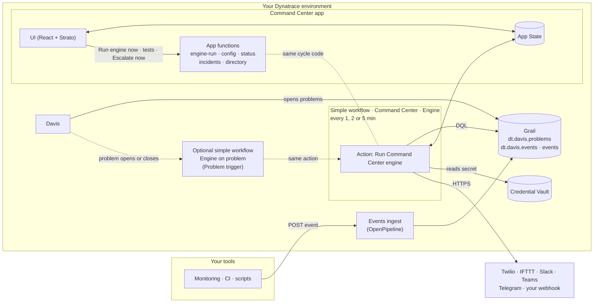

# Operations — architecture, cost, troubleshooting and limits

## Architecture



**One engine cycle** (the action, or `engine-run` on demand):

1. Take the engine lease (`lock.engine`) so that two runs never page twice. If another run holds it, this run is
   skipped (counted as `skippedLocked` in the heartbeat).
2. Run the DQL queries of the enabled sources (Q1–Q4), normalise the records into alerts, de-duplicate and route them.
   A new problem none of whose Davis events can be read yet is held back for up to 90 seconds (see
   [Behaviour you should know](#behaviour-you-should-know)).
3. Create or update incidents, apply operator actions in order, end snoozes that are due, evaluate escalation policies
   against the schedules, plan notifications and retries (failed or without a result) in the ledger, archive old
   resolved incidents and update the daily rollup. Write the heartbeat (`hb.engine`) and release the lease.
4. Read each needed provider secret from the Credential Vault and send (or run your custom workflow). Write `sent` or
   `failed` into the ledger.

All routing, schedule, escalation and planning logic is plain TypeScript in `ui/app/domain/`. The UI uses the same
code, so what the Console shows right after an action matches what the engine will do.

## Why one simple workflow

| Design | Workflow hours | Function invocations | Verdict |
| --- | --- | --- | --- |
| Version 2 before this change: a **standard** workflow `tick` → 8 senders → `report` | 1 per hour of the workflow's lifetime, whether or not it does anything | Measured: about 690 per hour (≈ 11.5 per minute) | Replaced |
| **One simple workflow, one action, interval trigger** (current) | **none** | Measured: **1 per run** (60 per hour at 1 minute) | ✅ The engine also sends, so a notification adds no invocation. |
| A second simple workflow with a **Problem trigger** and the same action (optional) | none | Measured: **1 per firing**, about 2 per problem (it opens, it closes) | ✅ Optional. The first page does not wait for the interval, so a longer interval becomes practical. See [Running on problems](#running-on-problems). |
| One **simple** workflow per integration, run by the engine per notification (optional, per integration) | none | Measured: **1 per notification** of that integration (the workflow's task), failed sends included | Optional since 2.3.0 (it was the default in 2.1 and 2.2). Each delivery is a workflow execution you can see. The engine falls back to a direct send when that workflow can't be run. |

Sources: *Create a simple workflow* ("without consuming workflow hours") and *Workflows concepts* (simple workflows "do
not generate any consumption of workflow hours") in the Dynatrace documentation. Simple workflows allow exactly one
task, and that task cannot be *Run JavaScript*, *Run workflow* or an approval. That is why the engine is a custom app
action (`actions/run-engine.action.ts`) and not a script.

Measured on the trial environment, from the billing events in `dt.system.events` (`AppEngine Functions - Small`):

| 10-minute window (UTC) | Old engine still installed | New engine only |
| --- | --- | --- |
| Invocations | 00:50 → 105, 01:00 → 120, 01:10 → 114 | 01:30 → 21, 01:40 → 11, 01:50 → 18 |
| of which `ACTION` (the engine) | — | 10 per window = 1 per minute |

The remaining invocations in the new column are the trial-only alert simulator (a standard workflow running
JavaScript) and our own test calls to the app functions.

Workflow hours, from the `Automation Workflow` billing events: for the hour 01:00–02:00 UTC only the alert simulator
(a standard workflow) was billed. The simple-workflow engine, which ran every minute in that hour, produced no workflow
billing event.

### Why the integration workflows start on demand

The engine workflow has an interval trigger. The integration workflows and the custom workflow have the **On demand**
trigger: the engine starts them through the Workflows API and passes the notification as run parameters. The
Dynatrace documentation describes *On demand* as the trigger for a workflow that "should run exclusively via API".

An **event trigger** (*Problem*, *Davis event* or *Event*) starts only when a matching event is ingested. A page is a
decision of the engine (who is on call, which escalation step, still not acknowledged), not an event that Dynatrace
produces. With an event trigger the engine would first have to ingest one event per notification, carrying the
recipient and the text.

The trigger does not change the cost. Each execution runs its task as one function call, whatever started it. The
Dynatrace licensing documentation gives the example of a simple workflow that notifies on every new problem: no
workflow hours, one function call per notification. Measured on the trial environment: the app's *Send Command Center
notification* action and Dynatrace's own *HTTP request* action (the custom workflow example) were each billed one
invocation per run, failed sends included. The API call that starts a run left no billing event of its own.

That is why the engine sends an integration directly unless you give it a workflow of its own (**Configure →
Delivery**): the send happens inside the run the engine is already doing, with no extra invocation. Its own workflow
adds one invocation per notification. In return, each delivery is an execution you can see in the Workflows app, and
the sends do not share the time limit of the engine run (100 seconds; what is not sent in time waits for a later
run).

### Running on problems

The optional workflow **Command Center · Engine on problem** is where an event trigger does fit: a Davis problem that
opens or closes is an event Dynatrace produces by itself. It is a simple workflow with a **Problem trigger** (the
problem opens or closes; every category) and one task, the same engine action. The trigger passes the problem's ID
and status to the action.

Measured on the trial environment with test problems (2026-11-27):

| What | Measured |
| --- | --- |
| The trigger fires after the problem event | 1–4 s for a close or a first-seen update, 11–12 s for a new problem |
| The problem record can be queried in Grail | About 30–40 s after its timestamp. Runs 24 s and 29 s after it did not find the record yet. |
| Incident created by the problem-triggered run | 34 s, 40 s and 34 s after the problem's timestamp, in three tests. Counted from posting the test event: 49 s, 65 s and 54 s, because Davis opened the problem 15–25 s after the event. |
| Compared with scheduled runs alone | The gain is between nothing and one interval: without the trigger, an incident waits for the first scheduled run after the problem is readable. In these tests, timed so that a scheduled run (1-minute interval) fell just before that moment, it was 50 s, 34 s and 45 s. |
| Incident resolved after the problem closed | Within 30 s of the close event (three closes) |
| Routing | The incident got its service's team from `cc.service`: the problem's Davis event was readable by then |
| Billing | One `ACTION` invocation per firing (runs of 23–30 s). The trigger fired once when the problem opened and once when it closed, not on the update in between. |

Because the trigger fires before the record can be queried, the run **waits**. Every 5 seconds it checks the incident
in App State and one small query (the problem's newest status), for up to 40 seconds. As soon as the problem can be
read it runs a normal cycle, and at most one more if the incident is still not there. If another run was faster, it
ends without a cycle. If the problem is not readable in time, it ends too, and the scheduled run picks the problem up
as before. The wait is inside the same invocation, and
a function call of up to 60 seconds is one billed invocation.

What it gives you: the incident no longer waits for the next scheduled run. It is created about half a minute after
the problem opens, whatever the interval, and its first notifications are planned and sent in that same cycle. That
makes a 5-minute interval practical: about 8,640 scheduled runs a month instead of 43,200, plus about two runs per
problem. It does not replace the engine workflow. Escalation steps, snooze ends, retries and the other sources
(Davis events, generic events) are handled on the interval.

Limits:

- Dynatrace limits each workflow to 1,000 event-triggered executions per hour and throttles beyond that; the
  scheduled run then covers the gap.
- A new trigger needs time to become active. On the trial environment a problem created 52 seconds after the
  workflow did not start it; events from two and a half minutes on did.
- After installation the trigger also fires once for every problem that is already open, on its next update. Those
  runs end at once, because the incident exists.
- Only the API creation of this workflow was exercised. **Install in Workflows** and the upload of its JSON were
  not clicked through.

## Cost and consumption

> Read this before running the app in production. The engine runs all day, independently of how many people use the
> app.

| Item | Per month at 1 min | at 2 min | at 5 min |
| --- | --- | --- | --- |
| Engine runs = function invocations (`ACTION`) | ≈ 43,200 | ≈ 21,600 | ≈ 8,640 |
| Workflow hours | 0 | 0 | 0 |
| Grail queries | 1–8 per run (below) | same | same |
| *Engine on problem* runs (optional) = function invocations (`ACTION`) | about 2 per problem: it opens, it closes | same | same |
| Integration workflow runs (optional) = function invocations (`ACTION`) | one per notification of an integration that has its own workflow, failed sends and retries included; none by default | same | same |

One invocation is a function call of up to 60 seconds; a call that runs for 61 to 120 seconds counts as two (Dynatrace
licensing documentation). The engine runs measured on the trial environment took 3 to 10 seconds.

**Grail queries per run**: Q1 problems (when the Davis problems source is on, the default), Q4 event properties of the problems Q1 returned (one per 100 event IDs, at most
5), Q2 Davis events and Q3 generic events (only when turned on). The UI runs **no** DQL: open tabs read only App State.

| Factor | Effect |
| --- | --- |
| Run interval | Linear in runs. A longer interval also means coarser escalation timing. |
| Enabled sources | Q2 and Q3 add one query each per run |
| Problem look-back (72 h) | A wider window scans more data |
| Data volume | More problems and events, more bytes scanned |
| Open browser tabs | No Grail cost. Each tab reads App State every minute by default. |

**Scan limit (cost guard).** Every engine query carries a scan limit, *Grail scan limit per query* in Settings →
Event sources (default 1 GB, 1–100 whole GB; Grail accepts no smaller value). On the trial environment one engine
query scanned at most 1.4 MB and a whole run about 2 MB, so 1 GB never cuts a normal run; it caps what a run can cost
if the data grows unexpectedly. The limit is per query: a run's worst case is its number of queries (1–8) times the
limit. A query that reaches it counts as cut short: its source is incomplete for that run (nothing of it is archived)
and the engine's last error says so. Settings → Event sources shows what the last run scanned and the daily estimate at
the current interval.

How to measure in your environment:

- Billing events: `fetch dt.system.events | filter event.kind == "BILLING_USAGE_EVENT"`, grouped by `event.type`
  and, for functions, by `function.type`.
- **Account Management → Cost & usage** for Grail queries, AppEngine functions and workflows after a day of running.
- The Dynatrace documentation notes that simple workflows, while consuming no workflow hours, can still trigger other
  billable capabilities: here the function invocations and the Grail queries.

How to reduce cost: keep Q2 and Q3 off unless you send events that don't open problems; lower the look-back; choose
a 2- or 5-minute interval if your escalation delays are long, and install *Engine on problem* so that the first page
does not wait for it. Leave integrations on **By the engine** (the default): a workflow of its own costs one
invocation per notification.

**The queries** (`ui/app/data/dql.ts`, all executed on the trial environment):

```
// Q1 — Davis problems
fetch dt.davis.problems, from: now() - 72h
| filter not(dt.davis.is_duplicate)
| dedup event.id, sort: { timestamp desc }
| filter event.status == "ACTIVE" or event.end >= now() - 2h
| fields timestamp, event.id, display_id, event.name, event.description, event.category, event.severity,
         event.status, event.start, event.end, dt.davis.last_reopen_timestamp, dt.davis.event_ids,
         dt.davis.affected_users_count, dt.davis.mute.status, maintenance.is_under_maintenance,
         smartscape.affected_entities, root_cause.smartscape_entity, affected_entity_ids,
         affected_entity_names, root_cause_entity_name, entity_tags
| sort event.start desc
| limit 1000

// Q2 — Davis events (optional)
fetch dt.davis.events, from: now() - 24h
| filter in(event.type, array("CUSTOM_ALERT", "ERROR_EVENT"))
| dedup event.id, sort: { timestamp desc }
| filter event.status == "ACTIVE" or event.end >= now() - 2h
| fieldsKeep timestamp, event.id, event.name, event.description, event.type, event.category, event.severity,
             event.status, event.start, event.end, event.provider, dt.davis.is_frequent_event,
             maintenance.is_under_maintenance, dt.source_entity, entity_tags, "cc.*"
| limit 1000

// Q3 — generic events (optional)
fetch events, from: now() - 24h
| filter event.type == "command_center.alert"
| filter isNotNull(cc.dedup_key)
| sort timestamp asc
| summarize { last_action = takeLast(cc.action), title = takeLast(event.name),
              description = takeLast(event.description), priority = takeLast(cc.priority),
              service = takeLast(cc.service), tags = takeLast(cc.tags),
              first_seen = min(timestamp), last_seen = max(timestamp) },
            by: { cc.dedup_key }
| limit 1000

// Q4 — cc.* properties of the events behind active problems (up to 100 IDs per query)
fetch dt.davis.events, from: now() - 72h
| filter in(event.id, array("<event id>", "…"))
| dedup event.id, sort: { timestamp desc }
| fieldsKeep event.id, event.type, event.provider, "cc.*"
| limit 1000

// Q5 — one problem's newest status (only the run started by the Problem trigger: one per 5-second check)
fetch dt.davis.problems, from: now() - 2h
| filter event.id == "<problem id>"
| filter not(dt.davis.is_duplicate)
| sort timestamp desc
| limit 1
| fields event.id, event.status, dt.davis.event_ids
```

## Health and monitoring

- **Console banner**: the engine is *late* after two intervals plus one minute without a run (3 minutes at the default
  interval), or the last run reported an error. The **bell** notifies only when the engine is late.
- **Integrations → Workflows**: last run, its duration and counts, the last error, and the install status.
- **External monitoring**: call the `status` app function. It returns the heartbeat, the lease and the
  open/triggered counts (see [configuration](configuration.md#app-functions-automation-and-scripts)).
- Simple workflows keep only execution metadata: task results and logs are not stored. The engine's diagnostics are
  therefore in the heartbeat, not in the Workflows execution log.

## Behaviour you should know

- **Never resolved by absence.** A failed or empty query never resolves anything. Only a CLOSED record,
  `cc.action: "resolve"` or an operator resolves an incident.
- **An incomplete result is not proof of absence.** When Grail cuts a query result short (record limit, scan limit,
  sampling), the engine still uses the records it got but treats that source as incomplete for the run: no resolved
  incident of that source is archived, and the heartbeat's last error names the query and Grail's notice, for example
  `Q1 problems: result truncated (…)`.
- **A crashed run blocks few runs.** The engine lease lasts 130–180 seconds, longer than one run can take (120 s). If
  a run dies without releasing it, the next scheduled runs are skipped until it expires: at most 2 at a 1-minute
  interval, 1 at 2 minutes, none at 5 minutes. A *Run engine now* or *Engine on problem* run that dies just before a
  scheduled run can cost one more.
- **At-least-once paging.** The ledger prevents duplicates in normal operation. In rare races (a run that overlaps a
  slow previous run, a result that arrives after the timeout) a person can be notified twice.
- **Timing precision = interval.** A step fires on the first run after it is due. The same applies to snooze ends.
- **A new problem waits for its events.** A problem record can become queryable before the Davis events it links to.
  Routing happens once, when the incident is created, and the `cc.*` properties are on those events. So a problem
  none of whose events can be read yet is held back for up to 90 seconds, then goes through as it is.
- **A page is never faster than Grail.** On the trial environment a problem could be queried about 30–40 seconds
  after it opened. No trigger or interval pages before that.
- **Configuration is last-write-wins.** Two people saving the same team at the same moment: the later save wins.
- **Roles are guidance.** Any user of the app can change configuration. IAM decides who can open the app.
- **Demo mode is per browser** and never mixes sample data with real data (see [configuration](configuration.md#general)).

## Security and privacy

- **No secrets in the app.** Provider credentials stay in the Credential Vault. App State stores only entry IDs. Error
  texts mask secrets and URLs.
- **Contact data is visible to every user of the app.** App State has no per-key permissions. Tell people before they
  enter personal numbers. Emails are not stored; they are read live from IAM.
- **The engine workflow does not need to be private.** It exposes no personal data: its executions keep only metadata
  and the action returns only counts, so no phone numbers or message texts appear in Workflows. A custom workflow
  receives the full notification (including the address) as run params: decide yourself who may see it.
- **Outbound traffic** is limited by the External requests allowlist: allow only the provider hosts you use.
- **Inbound tokens**: give your tools a platform token with only `openpipeline:events.davis:ingest` (or
  `openpipeline:events:ingest`), keep it in their secret store and rotate it.
- **Message texts** contain the alert title and description, which are sent to third parties.
- **Audit identity** comes from App State modification info, not from what the browser claims.

## Troubleshooting

| Symptom | Cause and fix |
| --- | --- |
| *The paging engine hasn't run yet / is late* | The workflow is not installed, not deployed, or failing. Check Integrations → Workflows. Most often the Workflows **Authorization settings** lack a permission for the actor. |
| Workflows tab: *Installed as a standard workflow* | The create-workflow intent has no type field. Delete that workflow and upload the downloaded JSON, or run `scripts/install-workflow.mjs`. |
| Workflows tab: *Update available* | The app was upgraded. Reinstall, then delete the old workflow. |
| No incidents appear | Settings → Event sources; check that the event reached Grail (`fetch dt.davis.events` in a Notebook) and that its type opens a problem. Otherwise turn on the Davis events source. |
| An incident has no team and nobody was paged | No routing rule matched and there is no default team. Problems that Davis detects on its own carry no team (only events you post can name a service in `cc.service`). Open the team and select *Receive all unrouted alerts* in its **Ready to page?** checklist (or set Settings → Routing defaults), or add a routing rule. The checklist also shows what else the team is missing. |
| *Engine on problem* is installed but does not seem to run | Simple workflows show no execution list: check **Integrations → Workflows → Last engine run** right after a problem opens. A new trigger needs a few minutes before it fires. Its actor needs the same permissions as the engine's, and the trigger must be switched on. |
| Routing ignores `cc.service` | The name or ID doesn't match a service, or an earlier rule set another service. Use Services → Test a rule. |
| *Host not allowed: &lt;host&gt;* on a notification or a provider card | Dynatrace refused the call because the host is not on the allowlist. Add the host to Settings → General → Environment management → External requests (Integrations → Configure shows which one), then **Send test**. The app cannot change that list itself. |
| A notification **failed** | Incident → Notifications shows the provider error. Usual causes: host missing in External requests, a vault entry the actor can't read, wrong credential type, phone not in E.164, Twilio API key without *Account SID*. |
| A notification shows **No result** | The run ended before the call returned. It is retried up to *Delivery attempts*. |
| *Run engine now* says *Engine is already running* | A scheduled run holds the lease. Wait a few seconds and try again. |
| The user picker finds nobody | Type at least 3 characters. Only **active** users are returned; invited people must sign in once. *User search is unavailable (IAM returned 403)*: your user must belong to the account that owns the environment and be allowed to view users. |
| Deploy rejected because of the version | `app.version` must be higher than the installed version. |
| Configuration lost | App State was cleared or the app was uninstalled. Import your last export. |

## Verified and not verified

Verified on a trial environment (latest Dynatrace):

- Davis event ingest (live endpoint, platform token) → Davis problem → engine → routing by `cc.service` → schedule →
  escalation steps → **generic webhook** delivered → ledger updated. A four-step policy fired every step within one
  minute of being due.
- Generic events through `/platform/ingest/v1/events`: trigger and resolve by `cc.dedup_key`.
- The engine as a **simple workflow** with the app's custom action: every run successful, App State, Grail and
  Credential Vault reads, outbound HTTPS. Billing: one `ACTION` invocation per run.
- The **Custom workflow** integration: a test and a scheduled escalation ran a simple workflow with an HTTP request
  task, and the expression `{{ execution().params | to_json }}` delivered the full notification JSON.
- App functions `engine-run`, `config` (export, import, dry run), `status` and `incidents`. War room notebooks created
  through the Document API.
- **Engine on problem**: a simple workflow with a Problem trigger and the engine action, created through the
  Automation API. It fired when test problems opened and closed, the run waited until the problem was readable,
  created the incident with the right team and resolved it on close, one billed invocation per firing. The numbers
  are in [Running on problems](#running-on-problems).

Not verified, or only partly:

- **Twilio, IFTTT, Slack, Microsoft Teams and Telegram** senders: implemented from vendor documentation, not exercised
  live. Unit tests cover the Twilio SMS and voice, Slack and Telegram requests.
- **Install in Workflows** (intent) and the **Upload** of the JSON in the Workflows app: not clicked through by us,
  for the engine, for *Engine on problem* and for an integration's own workflow. The API install of the same
  definitions is verified.
- **Configure → Delivery** (the choice between the engine and an integration's own workflow) was exercised in the
  offline preview only.
- **A notification sent by a problem-triggered run**: no provider was switched on during those tests. The runs
  created and resolved incidents; nothing was sent. Sending uses the same cycle code as the scheduled run.
- **Minimal permissions** of the workflow actor: all permissions were enabled on the trial environment.
- **User search** returned nobody for users who had just been invited. A search for active users in a signed-in
  session was not confirmed on the trial environment. With a platform token, IAM answered *User not authorized*.
- **First-time setup** (new team → *Ready to page?* → contact methods → schedule → policy): walked through in the
  offline preview starting with no data, not in a signed-in session on an environment. That a problem Davis detects
  on its own goes to the default team was checked there with the rule tester and is covered by a unit test; it was
  not observed with a live problem.
- **Add people → your own user**: it is offered from the signed-in user's ID. That this ID is the IAM user ID that
  team membership uses was not confirmed in a signed-in session.
- **Problems open longer than the look-back** (72 h) are no longer read; their incident stays open until resolved by
  hand.
- **Two-way replies** (acknowledge by SMS or chat) are not implemented.
