# User guide — every screen, icon and status

<!-- app:omit -->
Screenshots were taken in **demo mode** with sample data.
<!-- /app:omit -->

## Header

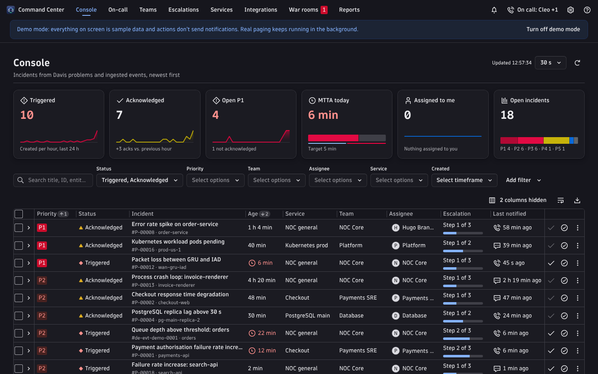

| Element | What it does |
| --- | --- |
| **Console · On-call · Teams · Escalations · Services · Integrations · War rooms · Reports** | Main navigation. **War rooms** shows a red count while rooms are in progress. |
| 🔔 **Bell** | The last notifications of this session, with an unread count (up to `99+`). Icon states: bell = nothing new, active bell = unread items, crossed-out bell = pop-ups silenced. Selecting an item opens what it refers to. Closing the menu marks everything as read. |
| 📞 **On-call indicator** | `You're on call` in a green circle when you are on call; otherwise `On call: <name>` (+N for more people), `On call` when nobody covers right now, or `No one on call` when there is no schedule yet. The menu lists who is on call per team until when, and offers **Leave on-call now…** or **Take on-call now…** (below). |
| ⚙️ **Settings** | Opens [Settings](configuration.md). |
| **?** Help menu | Get started, in-app guide, sending events, keyboard shortcuts, about. |

### Notifications (bell and pop-ups)

Pop-ups appear at the **bottom right** for four categories:

| Category | Examples |
| --- | --- |
| New P1/P2 incidents | `P1 · <title>` (critical), `P2 · <title>` (warning). After three, they are grouped as `N more new P1/P2 incidents`. |
| Confirmations of my actions | `Incident acknowledged` with **Undo** (10 seconds), `Incident resolved` with **Undo**, `Incident snoozed`… |
| Errors | `Couldn't save your changes`, `Couldn't acknowledge …` with **Retry** |
| Paging engine health | `Paging engine is not running`: no engine run for two intervals plus one minute (an engine error shows only in the Console banner) |

In the bell menu, **Pop-ups on (click to silence)** switches to *Silenced: only counting*. **Show pop-ups for…**
chooses the categories, and **Clear all** empties the list. Preferences are kept in this browser. The list itself lives
in memory and is cleared when you reload the page. When pop-ups are silenced, the Undo button of the confirmations is
not shown either.

### Leave or take on-call

- **Leave on-call now…** asks who covers the rest of your shift. The next person in the rotation is preselected. It
  then creates a schedule **override** from now until the end of the current shift, so pages stop reaching you
  immediately.
- **Take on-call now…** appears for schedules where you are a participant but not on call. It creates an override that
  puts you on call until the current shift ends, or for 8 hours if nobody was on call.
- Overrides are listed in **On-call → Overrides**, with the note *Left on-call from the header* or *Took on-call from
  the header*, and can be removed there.

## Icons and colours

**Incident status**

| Indicator | Status | Meaning |
| --- | --- | --- |
| 🔴 Triggered | `triggered` | New or re-triggered. The escalation policy is running. |
| 🟠 Acknowledged | `acknowledged` | Someone is on it. Escalation stops. |
| ⚪ Snoozed | `snoozed` | Hidden until a time. Then it triggers again and escalation restarts. |
| 🟢 Resolved | `resolved` | Closed by the source or by an operator. It stays visible for 24 hours (setting), then it is archived. |

**Priority chips**: text only, no icon. **P1** is the only solid red chip, **P2** is red-tinted, **P3** amber, **P4**
blue and **P5** grey. Meanings: P1 critical (major outage or customer impact), P2 high (a service is degraded), P3
moderate (needs attention soon), P4 low (can wait for business hours), P5 informational. Priority does not decide
*whether* someone is paged: the escalation policy does, and a routing rule can suppress. Priority selects people's
notification rules ("for priorities P1–P2…") and the quiet-hours behaviour.

**Notification (delivery) status**

| Label | Meaning |
| --- | --- |
| Sending | Planned in this run, no result yet |
| Sent | The provider accepted the message (HTTP 2xx). Delivery to the handset is not tracked. |
| Failed | The provider refused it, or every attempt failed. The provider's error is shown. |
| No result | No result arrived in time. The engine retries with a new attempt. |

**Channels**: 📱 SMS · 📞 voice · 💬 chat (WhatsApp, Telegram, Slack, Microsoft Teams) · 🌐 HTTP (IFTTT, webhook). A
red ✖ in *Last notified* means the last notification failed or got no result.

**Sources**: the Davis (AI) icon marks a Davis problem; the event icon marks a Davis event or an Events API event.

**Other icons**: ⬆ escalate · ⏸ snooze · 👤 assignee / reassign · ✎ priority or tag change · 📝 note · 👥 war room or
whole team · 🕒 MTTA or *over the acknowledge target* · 🔇 suppressed · 🔁 the policy repeats · ✔ (green) step done ·
spinner = current step · ○ pending step · 🔒 default route · ▶ run or send test · 🔑 Credential Vault · workflow icon =
engine workflow.

**Created-item highlight**: anything you create with a button in a list (a war room, a team, a member, a schedule, a
layer, an override, a policy step, a service, a rule, a note…) pulses once for one second with an outline, so you can
spot it. With the system setting *reduce motion* it fades once without pulsing.

## Console

The Console is the NOC screen: every open incident, newest first.

**KPI tiles** (sparklines are counts per hour, last 24 hours):

| Tile | Value | Click |
| --- | --- | --- |
| Triggered | Incidents waiting for someone (red when > 0) | Filters on Triggered |
| Acknowledged | Incidents being worked on. Footer: acknowledgements vs. the previous hour | Filters on Acknowledged |
| Open P1 | Unresolved P1 incidents (red when > 0) | Filters on open P1 |
| MTTA today | **Median** time to acknowledge since local midnight. Red above your acknowledge target; the meter goes from 0 to twice the target. | — |
| Assigned to me | Open incidents assigned to you | Filters on Assignee = me |
| Open incidents | All open incidents, split by priority | — |

**Show** (tabs above the table): *Open* (Triggered + Acknowledged, the default), *Triggered*, *Acknowledged*,
*Snoozed*, *Resolved* and *All*. Each tab shows a count that follows the other filters.

**Filters**: search (title, ID, entity, tag), Priority, Team, Assignee (*Me*, *Unassigned*, members), Service, Source,
Escalation level (*Not started*, *Step N*, *Exhausted*) and Created (time frame). All filters except the time frame
are part of the URL, and so is the **Show** tab (`status=…`), so a NOC view can be bookmarked.

**Columns**: Priority, Status (and *until …* when snoozed), Incident (title, `#display ID · first entity`), Age (red
with a clock icon when a **triggered** incident is older than the acknowledge target), Service, Team, Assignee,
Escalation (*Step N of M*, *Not started*, *Exhausted*, *No policy*), Last notified. Source and Created are hidden by
default. Use the column menu to show, hide or reorder columns. The choice is remembered in this browser. Rows can be
expanded to show the description, the latest activity and the escalation.

**Row actions**: **Acknowledge** (only when triggered), **Resolve**, and **⋮**: *Reassign…*, *Escalate now*,
*Snooze* (15 min, 30 min, 1 h, 4 h, Custom…), *Change priority…*, *Add note*, *Open war room…* / *Join war room*, *Open
Davis problem*, *Copy link*.

**Bulk actions** (select rows): Acknowledge, Resolve (asks for confirmation above 10 incidents), Reassign, Snooze,
Escalate now, Set priority.

**Keyboard shortcuts** (Console only, never while typing): `j`/`k` next/previous, `a` acknowledge, `r` resolve, `x`
select, `/` search, `Shift+R` refresh, `Esc` close details. They can be turned off in Settings → General.

**Banners**: *The paging engine is late / reported an error / hasn't run yet* appears when the engine heartbeat is
older than two run intervals plus one minute, or reports an error. *Demo mode* shows a permanent banner with **Turn off
demo mode**.

**Actions in detail**

| Action | Effect |
| --- | --- |
| Acknowledge | Escalation stops. MTTA is measured. **Undo** within 10 seconds, or *Undo acknowledgement* later in the details. |
| Resolve | Escalation stops. Nobody is notified about the resolution. Davis problems also resolve on their own when Davis closes them. |
| Reopen | A resolved incident triggers again and escalation restarts. |
| Snooze | Until a time in the future, optionally with a note. Then the incident triggers again and the policy restarts. |
| Reassign | To a team or a person, optionally with a note |
| Escalate now | Fires the **next step** of the policy immediately (an acknowledged or snoozed incident becomes triggered again) and runs the engine right away. If the immediate run fails, the toast says *Escalation recorded, but the engine didn't start*, and the next scheduled run sends it. |
| Change priority | P1–P5 |
| Add note | Markdown, append-only, part of the audit trail |

Every action is recorded in the incident timeline with who did it and when.

## Incident details

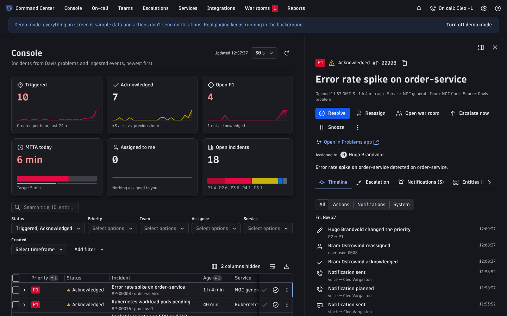

Opens beside the table. The header shows priority, status, `#ID`, a copy-link button, title, *Opened … · Service ·
Team · Source*, and *Under maintenance: paging suppressed* when it applies. Buttons: Acknowledge, Resolve, Reopen,
Reassign, Open/Join war room, Escalate now, Snooze, and ⋮ (Change priority, Add note, Undo acknowledgement, Copy link).
Davis problems link to **Open in Problems app**.

| Tab | Content |
| --- | --- |
| Timeline | Every event: created, routed, acknowledged, notifications, notes… Filters *All / Actions / Notifications / System*. Failed notifications are highlighted. |
| Escalation | The policy, each step with its targets and channels, which step is next and when. *Escalation stops automatically while an incident is acknowledged or snoozed.* |
| Notifications (N) | The ledger: channel, recipient, step (`N · try A`, with *repeat P*), status, time, provider details |
| Entities (N) | Affected entities: name, type, entity ID |
| Notes (N) | Add a note (Markdown). Notes are append-only. |

## War rooms

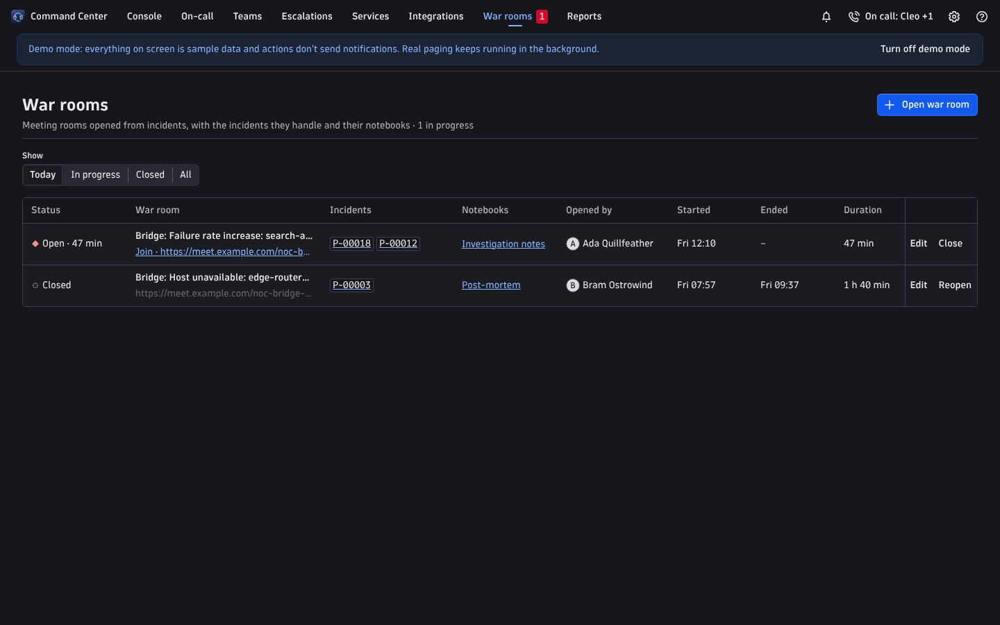

A war room is a meeting link plus the incidents it handles and its notebooks.

- **Open**: from an incident (**Open war room**, or **⋮ → Open war room…** in the Console) or with the **Open war
  room** button. Paste the meeting link you created in Teams, Zoom, Meet or a Slack huddle (https only). Related open
  incidents are added automatically: those with the same root cause, or the same service and started within 30 minutes.
  Remove any that don't belong.
- **Notebooks**: **Create post-mortem notebook** creates a Dynatrace Notebook named after the first incident (for
  example `P-26112613 · Post-mortem: …`) with summary, timeline, root cause, impact, action items and a DQL section for
  the room's problems. **Select an existing notebook** attaches any notebook you can access. You can also add any https
  link. A new notebook belongs to the person who created it and, per the Dynatrace Document API, is not accessible to
  other users until it is shared in the Notebooks app.
- **List**: *Today* by default (open rooms and rooms opened or closed today), or *In progress*, *Closed*, *All*.
  Columns: Status (*Open · duration* or *Closed*), War room (title and **Join** link), Incidents, Notebooks, Opened by,
  Started, Ended, Duration.
- **Close / Reopen** is done by people. A closed room keeps its link visible as plain text for reference, and it cannot
  be clicked. While a room is open, the incident shows **Join war room**.

## On-call

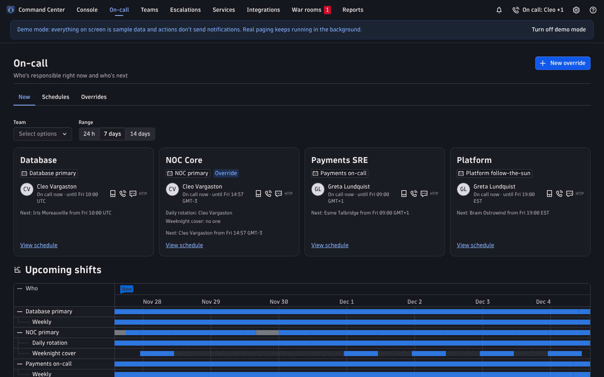

| Tab | Content |
| --- | --- |
| Now | One card per team: who is on call until when, their contact methods (greyed out when not configured), who is next, and each layer. *No one is on call* comes with **Add override**. While there is no team yet, the page says *Start with a team*. Below: *Upcoming shifts* (Gantt: shifts in green, overrides in a separate colour, gaps in amber, a *Now* marker). Filters: Team, Range (24 h, 7 days, 14 days). |
| Schedules | Name, team, time zone, layers, on call now, next handoff, coverage for the next 7 days (in %). Edit, Duplicate, Delete. |
| Overrides | Who covers, for whom, schedule, from, to, reason. Upcoming or past. Remove. |

**Schedule editor** 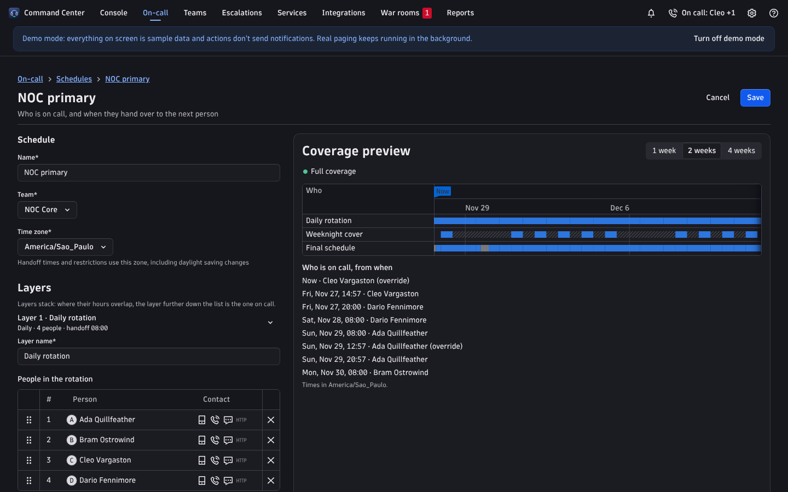

A new schedule is ready to save: it is named after its team, the team's people who get paged are already in the
rotation, and it starts today, so someone is on call at once.

- **Schedule**: name, team, time zone (handoffs and restrictions follow it, including daylight saving time).
- **Rotation**: *People in the rotation* come first, in the order they take turns (drag to reorder). *Add from the
  team* adds a team member with one click; *Add someone else* searches all users. Then the *Rotation type* (*Daily*,
  *Weekly*, or *Custom* with a shift length of 1–672 hours), the *Handoff time* (HH:mm) and when the *Rotation
  starts*. A sentence under these fields says when people swap, for example *People swap every Fri at 09:00
  (America/Sao_Paulo)*; the weekday is that of the first handoff in the schedule's time zone. *Only during specific
  hours* limits the rotation to weekdays and hours.
- **Add layer** (optional) adds a second rotation for certain hours, for example nights or weekends. With several
  layers, each one has a name, **the layer further down the list is on call where their hours overlap**, and
  overrides beat every layer.
- **Coverage preview** (1, 2 or 4 weeks): *Full coverage* or *N gaps, … uncovered*, the Gantt with a *Final schedule*
  row, and **Who is on call, from when**: the next handoffs as a list, in the schedule's time zone.

**New override**: schedule, who covers, from, to (default: the next full hour, for 8 hours), reason. A preview sentence
says exactly what will happen.

## Teams

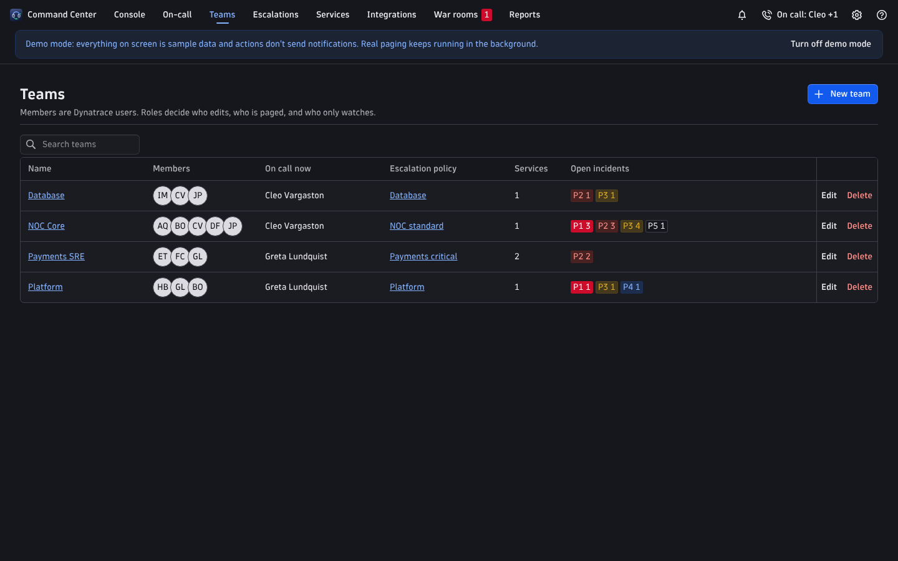 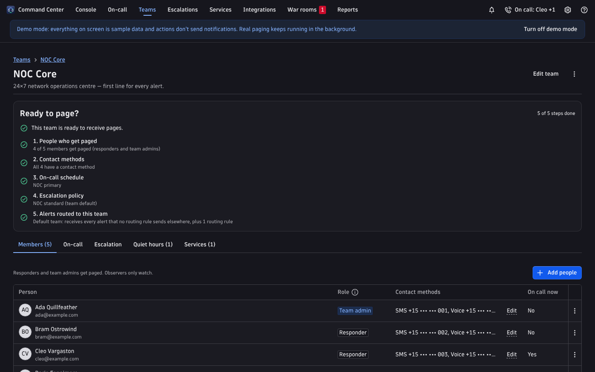

- **Teams list**: name, members, on call now, escalation policy, services, open incidents per priority. A team that is
  still used by policies, rules or services cannot be deleted until those references are removed.
- **New team**: a name and an optional description. **Default team** is ticked while no default team exists: the
  default team receives every alert that no routing rule sends elsewhere. Problems that Davis detects on its own carry no team, so without a
  default team or routing rules they page nobody. **Edit team** also sets the team's default escalation policy.
- **Team detail tabs**: *Members*, *On-call*, *Escalation*, *Quiet hours*, *Services*.
- **Ready to page?** A checklist of 5 steps, in order: people who get paged, contact methods, an on-call schedule, an
  escalation policy, and alerts routed to the team. The next step has the highlighted button; steps that need people
  first show none. Step 5 is done when the team is the default team or an enabled routing rule sends alerts to it. A
  service alone is not enough: only events that name it in `cc.service` arrive. Its button is *Receive all unrouted
  alerts* while no default team exists, otherwise *Add routing rule*. With all five steps done, the checklist still
  warns when a channel the team uses has no provider switched on, or when the engine has never run.
- **Add people**: your own user is offered first. For others, type at least 3 letters of a name or an email. Results
  come from Dynatrace IAM: active users of the account that owns the environment (people who never signed in are not
  found). People you pick stay in a **Selected (n)** list under the results, each with **Remove**, across several
  searches. Roles:

| Role | Paged? | Meant for |
| --- | --- | --- |
| Team admin | yes | Edits the team, its schedules and its policy |
| Responder | yes | Acknowledges and resolves |
| Observer | never | Watches the team's incidents |

Roles are guidance: App State has no per-key permissions, so every user of the app can technically change
configuration.

- **Contact methods** (person → *Add* or *Edit*): each row has a channel, the address and an optional label, plus **Send
  test**. For a person without contact methods, the sheet opens with a row ready to fill in. The address field is named
  after the channel: *Phone number* in E.164 with the country code (SMS, voice, WhatsApp); *Chat ID* (Telegram); *Name
  in the message* (Slack, Teams and IFTTT: their webhook or applet decides the destination); *Routing key* (webhook or
  custom workflow). Rows left empty are ignored. From the checklist, **Save and next** moves on to the next person
  without a contact method. Phone numbers and chat IDs are readable by every user of the app. They are masked in lists.
  Email is not a separate channel: send email through a webhook gateway.
- **Notification rules (optional)**: without rules, every contact method is used at once. A rule says: *use* this
  method *after N minutes* (counted from when the step fires) *for priorities* P1 to Px, or all. Once a person has
  rules, only incidents covered by a rule notify them; the sheet says which priorities are left out. A step with
  forced channels uses the first method of each channel, with no delay.
- **Quiet hours**: windows (days, from/to, time zone; a window may cross midnight) during which incidents **less
  urgent** than a priority are either **held** (no paging until the window ends) or paged with **low-urgency** channels
  only (Slack, Teams, Telegram, IFTTT, webhook). More urgent incidents always page. When windows overlap, *hold* wins.

## Escalations

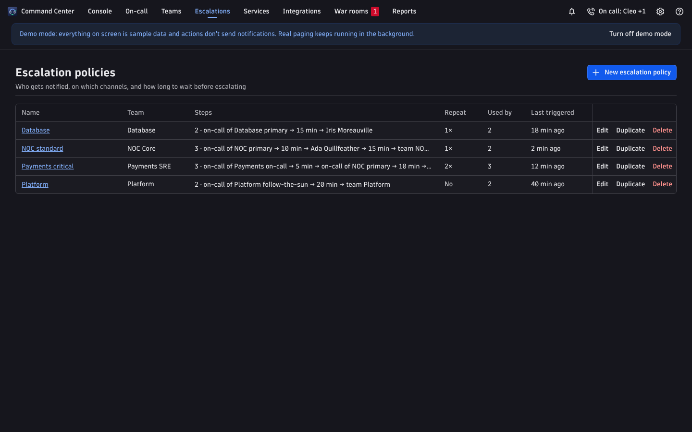 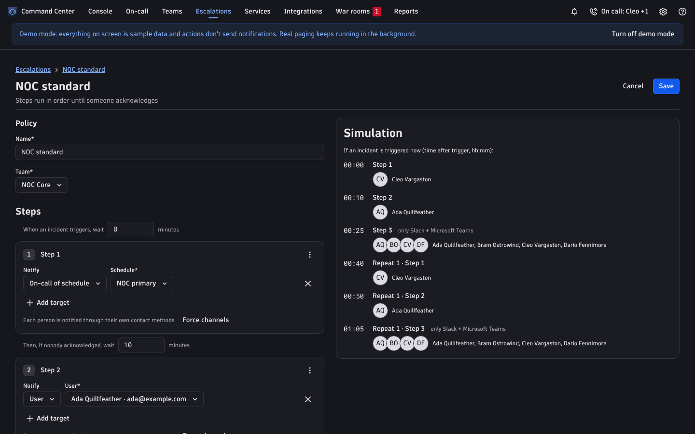

- **List**: name, team, steps (who is notified at each step and the wait in between, for example *on-call of
  Payments on-call → 10 min → team Payments*), repeat, used by, last triggered. Deleting a policy makes its incidents
  fall back to their team's default policy, or else the default policy from Settings.
- **Editor**: a new policy is ready to save. It is named after its team; step 1 notifies the on-call person of the
  team's schedule and step 2 the whole team after 10 minutes (without a schedule: the whole team at once). Steps run
  in order until someone acknowledges. Each step waits a number of minutes (0–1440) **counted from the previous
  step**, then notifies its targets: *On-call of schedule*, *Team (all responders)*, which means every non-observer,
  including admins, or a *User*. **Add step** adds a step that notifies the whole team after 5 minutes. Each person
  is notified through their own contact methods; **Force channels** opens the *Channels* field to override that for
  one step. Channels without a provider switched on are disabled.
- **Repeat**: *Repeat policy if nobody acknowledges* 1–5 times. Each repeat starts after the last step's delay (5
  minutes if that delay is 0). When all repeats are done the policy is **exhausted** and the incident stays triggered.
- **Simulation** (always visible in the editor): *If an incident is triggered now* lists, minute by minute, who would
  be paged. It warns when a step pages no one (a schedule gap or an empty team), names the people who have no contact
  method yet, and says so when nothing follows the only step.

Timing precision equals the engine interval: a step fires on the first engine run after it is due. On the trial
environment, with a 1-minute interval, every step of a four-step test policy fired within one minute of being due.

## Services and routing

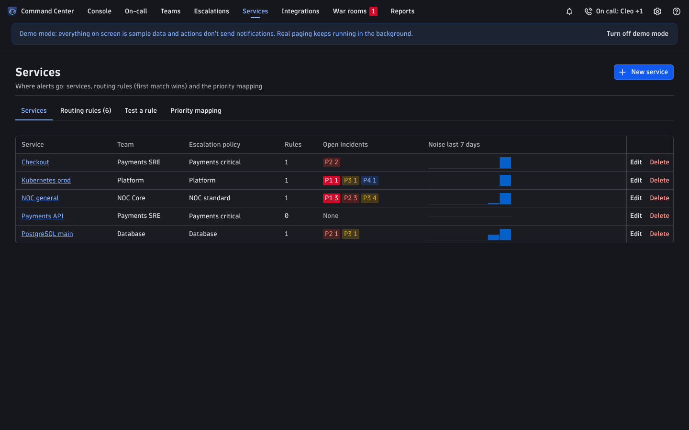 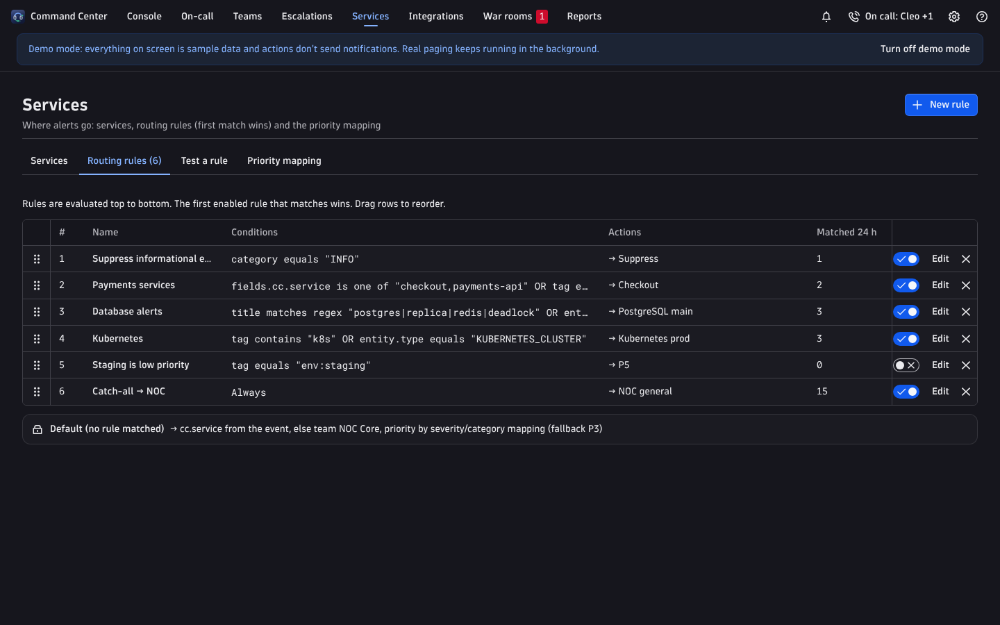

| Tab | Content |
| --- | --- |
| Services | Service, team, escalation policy (or *Team default*), rules, open incidents, noise last 7 days |
| Routing rules (N) | Ordered rules (drag to reorder). **The first enabled rule that matches wins.** A new rule is placed above the first catch-all rule (a rule without conditions). Columns: #, name, conditions, actions, matched in 24 h, and a switch that turns the rule on or off. The last, fixed row is the default route; it warns when there is no default team. On this tab the page button is **New rule**. |
| Test a rule | Load a recent alert or an example, edit the JSON, **Run test**: shows the matched rule (or the closest one), each condition ✔/✖, and the resulting service, team, policy and priority with its source |
| Priority mapping | Priority by Davis category and by severity, plus the fallback |

**Rule editor**: name, enabled, *Match all / any*, conditions (field, operator, value, *Not*), and **Then**: service,
team, escalation policy, priority (or *Use priority mapping*), add tags, and *Suppress (create the incident, page
nobody)*. Opened from a team's checklist (*Add routing rule*), the rule is already named and points to that team, so
only the condition is left. Fields, operators and the
routing order are listed in the [alerts reference](alerts-reference.md#how-an-alert-becomes-an-incident).

**Service**: name (events reference it by name or ID in `cc.service`; other alerts, such as problems that Davis detects
on its own, need a routing rule), description, owning team, escalation policy (empty = the team's default) and default
priority.

## Integrations

| Tab | Content |
| --- | --- |
| Inbound 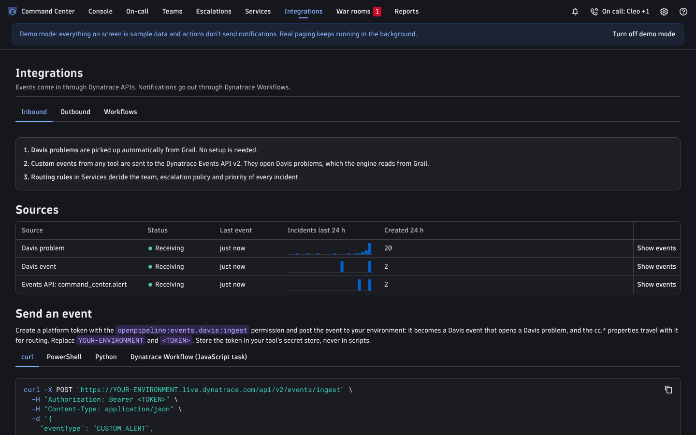 | Each source with its status (*Receiving*, *Quiet > 1 h*, *Turned off*, *Never seen*), last event, incidents in 24 h and **Show events**. Copy-ready snippets (curl, PowerShell, Python, Dynatrace Workflow) and the fields the app reads. |
| Outbound  | The nine providers (eight built-in plus **Custom workflow**), each with an **On/Off** switch: *Not configured*, *Off*, *Configured*, *Last delivery failed* or *Host not allowed: add it to External requests*, sent/failed counts, *Sent by the engine* (the default) or *Sent by its workflow*, **Configure** (vault entry ID or workflow ID, parameters, **Delivery**, and for a built-in provider the host to allow under *External requests*) and **Send test**. Under **Delivery** you choose who sends a built-in provider: *By the engine* (no extra cost) or *Through its own workflow* (one more function call per notification). One provider per channel can be on. |
| Workflows 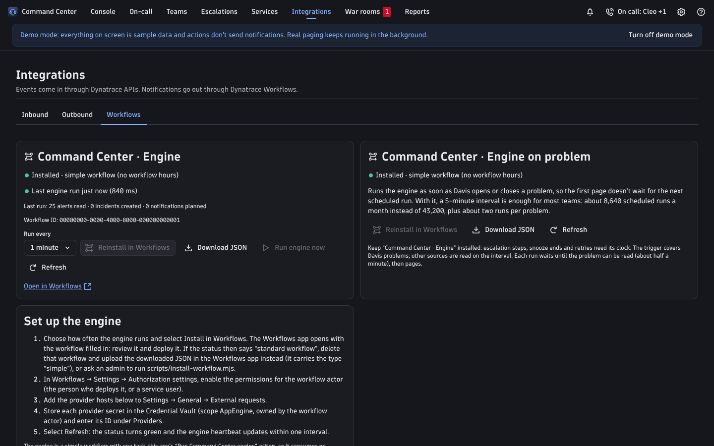 | Engine status (*Not installed*, *Installed · simple workflow*, *Update available*, *Installed as a standard workflow…*), the last engine run, **Run every**, **Install in Workflows**, **Download JSON**, **Run engine now**, **Refresh**, the setup steps and the hosts to allow. A second card, **Command Center · Engine on problem**, installs the optional workflow that runs the engine when Davis opens or closes a problem (*Optional · not installed*, *Installed · simple workflow*, *Installed, but its trigger is switched off*). |

Details: [integrations](integrations.md) and [getting started](getting-started.md).

## Reports

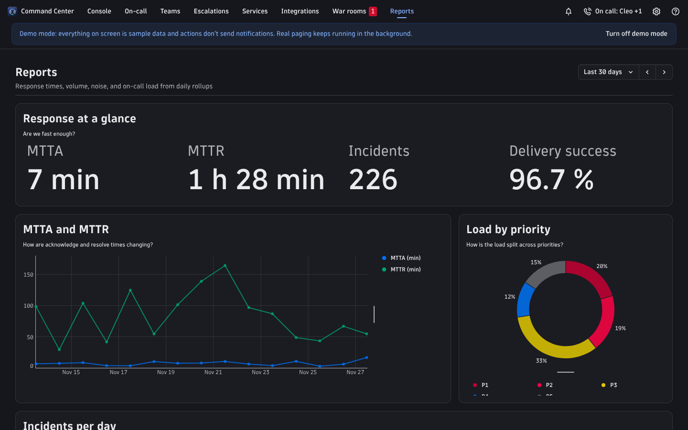

The time frame defaults to the last 30 days. Response, volume, team and noise panels come from daily rollups (kept
90 days). *Time to acknowledge* and the off-hours, night and acknowledgement columns of *On-call load* use the
incidents still in the app and the notification ledger (kept 14 days), so they cover at most about 14 days.

| Panel | Question it answers |
| --- | --- |
| Response at a glance | MTTA, MTTR, incidents, delivery success |
| MTTA and MTTR | How are acknowledge and resolve times changing? |
| Load by priority | How is the load split across priorities? |
| Incidents per day | When do incidents arrive, and how urgent are they? |
| Incidents by team | Which teams get the most incidents? |
| Noisiest services and sources | Where do incidents come from? (top 10) |
| Time to acknowledge | Distribution in minutes (bins from 0, 1, 2, 5, 10, 15, 30, 60 and 120 minutes; the last bin holds everything from 120 up) |
| Notification delivery | Share of notifications the providers accepted |
| On-call load | Per person: on-call hours, pages, off-hours pages, night pages (00–06), acknowledgements, average time to acknowledge |

*Off-hours* means before 08:00, from 18:00, or on a weekend; *night* means before 06:00. Both use your browser's time
zone.

## Help

**Get started** has five steps and ticks itself from your data: create a team, finish the team's *Ready to page?*
checklist (ticked when one team has all five steps done), switch on a provider, install the engine workflow (a
heartbeat exists), and send a test event (an incident exists). Then come concepts,
Console workflow, sending events, notifications, keyboard shortcuts, troubleshooting and privacy.

The menu on the left also lists the six guides (getting started, user guide, alerts reference, integrations,
configuration, operations). The language selector shows them in English, Português (BR) or Español; the choice is
remembered in this browser, and a guide's address carries the guide and the language, so it can be shared. Get started
and the sections after it are in English.
