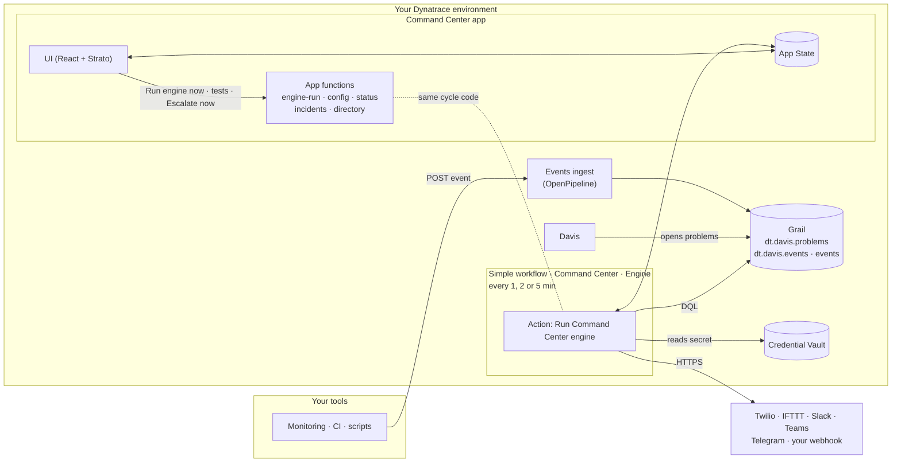

# Operaciones — arquitectura, costo, resolución de problemas y límites

🌐 [English](../en/operations.md) · [Português (BR)](../pt-BR/operations.md) · **Español**

## Arquitectura



**Un ciclo del motor** (la acción, o `engine-run` bajo demanda):

1. Tomar el lease del motor (`lock.engine`) para que dos ejecuciones nunca avisen dos veces. Si otra ejecución lo
   tiene, esta ejecución se omite (se cuenta como `skippedLocked` en el heartbeat).
2. Ejecutar las consultas DQL de las fuentes habilitadas (Q1–Q4), normalizar los registros en alertas, deduplicarlas y
   enrutarlas.
3. Crear o actualizar incidentes, aplicar en orden las acciones de los operadores, terminar las posposiciones que
   vencen, evaluar las políticas de escalamiento contra los calendarios, planificar las notificaciones y los reintentos
   (fallidas o sin resultado) en el registro de notificaciones (ledger), archivar los incidentes resueltos antiguos y
   actualizar el resumen diario. Escribir el heartbeat (`hb.engine`) y liberar el lease.
4. Leer cada secreto de proveedor necesario desde el Credential Vault y enviar (o ejecutar tu custom workflow).
   Escribir `sent` o `failed` en el registro de notificaciones.

Toda la lógica de enrutamiento, calendarios, escalamiento y planificación es TypeScript simple en `ui/app/domain/`. La
UI usa el mismo código, así que lo que muestra la Console justo después de una acción coincide con lo que hará el
motor.

## Por qué un único simple workflow

| Diseño | Horas de workflow | Invocaciones de función | Veredicto |
| --- | --- | --- | --- |
| Versión 2 antes de este cambio: un **standard** workflow `tick` → 8 emisores → `report` | 1 por hora de vida del workflow, haga algo o no | Medido: cerca de 690 por hora (≈ 11.5 por minuto) | Reemplazado |
| Un **simple** workflow por integración, ejecutado por el motor por cada notificación (actual, adicional) | ninguna | Una ejecución de workflow adicional por cada notificación de esa integración | ✅ Cada integración activada obtiene su propio workflow (una confirmación). El motor sigue leyendo las alertas y escalando; entrega cada notificación al workflow de la integración y recurre a un envío directo cuando ese workflow no se puede ejecutar. |
| **Un simple workflow, una acción, trigger de intervalo** (actual) | **ninguna** | Medido: **1 por ejecución** (60 por hora con 1 minuto) | ✅ |

Fuentes: *Create a simple workflow* ("without consuming workflow hours") y *Workflows concepts* (los simple workflows
"do not generate any consumption of workflow hours") en la documentación de Dynatrace. Los simple workflows permiten
exactamente una tarea, y esa tarea no puede ser *Run JavaScript*, *Run workflow* ni una aprobación. Por eso el motor es
una acción personalizada de la app (`actions/run-engine.action.ts`) y no un script.

Medido en el entorno trial, a partir de los eventos de facturación en `dt.system.events` (`AppEngine Functions - Small`):

| Ventana de 10 minutos (UTC) | Motor anterior todavía instalado | Solo el motor nuevo |
| --- | --- | --- |
| Invocaciones | 00:50 → 105, 01:00 → 120, 01:10 → 114 | 01:30 → 21, 01:40 → 11, 01:50 → 18 |
| de las cuales `ACTION` (el motor) | — | 10 por ventana = 1 por minuto |

Las invocaciones restantes en la columna nueva son el simulador de alertas solo para entornos trial (un standard
workflow que ejecuta JavaScript) y nuestras propias llamadas de prueba a las funciones de la app.

Horas de workflow, a partir de los eventos de facturación `Automation Workflow`: en la hora 01:00–02:00 UTC solo se
facturó el simulador de alertas (un standard workflow). El motor basado en simple workflow, que se ejecutó cada minuto
en esa hora, no generó ningún evento de facturación de workflow.

## Costo y consumo

> Lee esto antes de ejecutar la app en producción. El motor se ejecuta todo el día, independientemente de cuántas
> personas usen la app.

| Elemento | Por mes con 1 min | con 2 min | con 5 min |
| --- | --- | --- | --- |
| Ejecuciones del motor = invocaciones de función (`ACTION`) | ≈ 43,200 | ≈ 21,600 | ≈ 8,640 |
| Horas de workflow | 0 | 0 | 0 |
| Consultas a Grail | 1–8 por ejecución (más abajo) | igual | igual |
| Ejecuciones de workflows de integración | una por notificación de una integración vinculada | igual | igual |

**Consultas a Grail por ejecución**: Q1 problemas (cuando la fuente Davis problems está activada, el valor
predeterminado), Q4 propiedades de eventos de los problemas que devolvió Q1 (una
por cada 100 IDs de eventos, como máximo 5), Q2 eventos de Davis y Q3 eventos genéricos (solo cuando están activados).
La UI **no** ejecuta DQL: las pestañas abiertas solo leen App State.

| Factor | Efecto |
| --- | --- |
| Intervalo de ejecución | Lineal en ejecuciones. Un intervalo más largo también significa un tiempo de escalamiento menos preciso. |
| Fuentes habilitadas | Q2 y Q3 agregan una consulta cada una por ejecución |
| Look-back de problemas (72 h) | Una ventana más amplia escanea más datos |
| Volumen de datos | Más problemas y eventos, más bytes escaneados |
| Pestañas abiertas del navegador | Sin costo de Grail. Cada pestaña lee App State cada 30 s de forma predeterminada. |

Cómo medir en tu entorno:

- Eventos de facturación: `fetch dt.system.events | filter event.kind == "BILLING_USAGE_EVENT"`, agrupados por
  `event.type` y, para las funciones, por `function.type`.
- **Account Management → Cost & usage** para las consultas a Grail, las funciones de AppEngine y los workflows después
  de un día de ejecución.
- La documentación de Dynatrace señala que los simple workflows, aunque no consumen horas de workflow, todavía pueden
  disparar otras capacidades facturables: aquí, las invocaciones de función y las consultas a Grail.

Cómo reducir el costo: mantén Q2 y Q3 desactivadas a menos que envíes eventos que no abren problemas; reduce el
look-back; elige un intervalo de 2 o 5 minutos si las demoras de tus escalamientos son largas.

**Las consultas** (`ui/app/data/dql.ts`, todas ejecutadas en el entorno trial):

```
// Q1 — Davis problems
fetch dt.davis.problems, from: now() - 72h
| filter not(dt.davis.is_duplicate)
| dedup event.id, sort: { timestamp desc }
| filter event.status == "ACTIVE" or event.end >= now() - 2h
| fields timestamp, event.id, display_id, event.name, event.description, event.category, event.severity,
         event.status, event.start, event.end, dt.davis.last_reopen_timestamp, dt.davis.event_ids,
         dt.davis.affected_users_count, dt.davis.mute.status, maintenance.is_under_maintenance,
         smartscape.affected_entities, root_cause.smartscape_entity, affected_entity_ids,
         affected_entity_names, root_cause_entity_name, entity_tags
| sort event.start desc
| limit 1000

// Q2 — Davis events (optional)
fetch dt.davis.events, from: now() - 24h
| filter in(event.type, array("CUSTOM_ALERT", "ERROR_EVENT"))
| dedup event.id, sort: { timestamp desc }
| filter event.status == "ACTIVE" or event.end >= now() - 2h
| fieldsKeep timestamp, event.id, event.name, event.description, event.type, event.category, event.severity,
             event.status, event.start, event.end, event.provider, dt.davis.is_frequent_event,
             maintenance.is_under_maintenance, dt.source_entity, entity_tags, "cc.*"
| limit 1000

// Q3 — generic events (optional)
fetch events, from: now() - 24h
| filter event.type == "command_center.alert"
| filter isNotNull(cc.dedup_key)
| sort timestamp asc
| summarize { last_action = takeLast(cc.action), title = takeLast(event.name),
              description = takeLast(event.description), priority = takeLast(cc.priority),
              service = takeLast(cc.service), tags = takeLast(cc.tags),
              first_seen = min(timestamp), last_seen = max(timestamp) },
            by: { cc.dedup_key }
| limit 1000

// Q4 — cc.* properties of the events behind active problems (up to 100 IDs per query)
fetch dt.davis.events, from: now() - 72h
| filter in(event.id, array("<event id>", "…"))
| dedup event.id, sort: { timestamp desc }
| fieldsKeep event.id, event.type, event.provider, "cc.*"
| limit 1000
```

## Salud y monitoreo

- **Banner de la Console**: el motor está *atrasado* (late) después de dos intervalos más un minuto sin una ejecución
  (3 minutos con el intervalo predeterminado), o cuando la última ejecución reportó un error. La **campana** avisa solo
  cuando el motor está atrasado.
- **Integrations → Workflows**: última ejecución, su duración y conteos, el último error y el estado de instalación.
- **Monitoreo externo**: llama a la función de la app `status`. Devuelve el heartbeat, el lease y los conteos de
  abiertos/triggered (consulta [configuración](configuration.md#funciones-de-la-app-automatización-y-scripts)).
- Los simple workflows conservan solo metadatos de ejecución: los resultados y los logs de las tareas no se almacenan.
  Por lo tanto, los diagnósticos del motor están en el heartbeat, no en el log de ejecución de Workflows.

## Comportamiento que debes conocer

- **Nunca se resuelve por ausencia.** Una consulta fallida o vacía nunca resuelve nada. Solo un registro CLOSED,
  `cc.action: "resolve"` o un operador resuelven un incidente.
- **Avisos al menos una vez.** El registro de notificaciones evita duplicados en la operación normal. En carreras poco
  frecuentes (una ejecución que se superpone con una ejecución anterior lenta, un resultado que llega después del
  timeout) una persona puede ser notificada dos veces.
- **Precisión de tiempo = intervalo.** Un paso se dispara en la primera ejecución después de su vencimiento. Lo mismo
  aplica al fin de las posposiciones.
- **La configuración es de tipo última-escritura-gana.** Dos personas que guardan el mismo equipo en el mismo momento:
  gana el guardado posterior.
- **Los roles son orientativos.** Cualquier usuario de la app puede cambiar la configuración. IAM decide quién puede
  abrir la app.
- **El modo demo es por navegador** y nunca mezcla datos de ejemplo con datos reales (consulta [configuración](configuration.md#general)).

## Seguridad y privacidad

- **Sin secretos en la app.** Las credenciales de los proveedores permanecen en el Credential Vault. App State guarda
  solo los IDs de las entradas. Los textos de error enmascaran secretos y URLs.
- **Los datos de contacto son visibles para todos los usuarios de la app.** App State no tiene permisos por clave.
  Avísales a las personas antes de que ingresen números personales. Los correos electrónicos no se almacenan; se leen
  en vivo desde IAM.
- **El workflow del motor no necesita ser privado.** No expone datos personales: sus ejecuciones conservan solo
  metadatos y la acción devuelve solo conteos, así que no aparecen números de teléfono ni textos de mensajes en
  Workflows. Un custom workflow recibe la notificación completa (incluida la dirección) como parámetros de ejecución:
  decide tú quién puede verla.
- **El tráfico de salida** está limitado por la lista de hosts permitidos de External requests: permite solo los hosts
  de los proveedores que uses.
- **Tokens de entrada**: dale a tus herramientas un platform token con solo `openpipeline:events.davis:ingest` (o
  `openpipeline:events:ingest`), guárdalo en su almacén de secretos y rótalo.
- **Los textos de los mensajes** contienen el título y la descripción de la alerta, que se envían a terceros.
- **La identidad de auditoría** proviene de la información de modificación de App State, no de lo que afirma el
  navegador.

## Resolución de problemas

| Síntoma | Causa y solución |
| --- | --- |
| *The paging engine hasn't run yet / is late* | El workflow no está instalado, no está desplegado o está fallando. Revisa Integrations → Workflows. Lo más frecuente es que a las **Authorization settings** de Workflows les falte un permiso para el actor. |
| Pestaña Workflows: *Installed as a standard workflow* | El intent create-workflow no tiene campo de tipo. Elimina ese workflow y sube el JSON descargado, o ejecuta `scripts/install-workflow.mjs`. |
| Pestaña Workflows: *Update available* | La app se actualizó. Reinstala y luego elimina el workflow anterior. |
| No aparecen incidentes | Settings → Event sources; verifica que el evento llegó a Grail (`fetch dt.davis.events` en un Notebook) y que su tipo abre un problema. Si no, activa la fuente de eventos de Davis. |
| Un incidente queda sin equipo y no se avisa a nadie | Ninguna regla de enrutamiento coincidió y no hay equipo predeterminado. Los problemas de Davis no traen equipo. Abre el equipo y selecciona *Receive all unrouted alerts* en su lista de verificación **Ready to page?** (o defínelo en Settings → Routing defaults), o agrega una regla de enrutamiento. La lista también muestra qué más le falta al equipo. |
| El enrutamiento ignora `cc.service` | El nombre o el ID no coincide con un servicio, o una regla anterior definió otro servicio. Usa Services → Test a rule. |
| Una notificación **falló** | Incidente → Notifications muestra el error del proveedor. Causas habituales: falta el host en External requests, una entrada del vault que el actor no puede leer, tipo de credencial incorrecto, teléfono que no está en E.164, API key de Twilio sin *Account SID*. |
| Una notificación muestra **No result** | La ejecución terminó antes de que la llamada respondiera. Se reintenta hasta *Delivery attempts*. |
| *Run engine now* dice *Engine is already running* | Una ejecución programada tiene el lease. Espera unos segundos y vuelve a intentarlo. |
| El selector de usuarios no encuentra a nadie | Escribe al menos 3 caracteres. Solo se devuelven usuarios **activos**; las personas invitadas deben iniciar sesión una vez. *User search is unavailable (IAM returned 403)*: tu usuario debe pertenecer a la cuenta propietaria del entorno y tener permiso para ver usuarios. |
| Despliegue rechazado por la versión | `app.version` debe ser mayor que la versión instalada. |
| Configuración perdida | Se borró App State o se desinstaló la app. Importa tu última exportación. |

## Verificado y no verificado

Verificado en un entorno trial (latest Dynatrace):

- Ingesta de eventos de Davis (endpoint en vivo, platform token) → problema de Davis → motor → enrutamiento por
  `cc.service` → calendario → pasos de escalamiento → **webhook genérico** entregado → registro de notificaciones
  actualizado. Una política de cuatro pasos disparó cada paso dentro del minuto siguiente a su vencimiento.
- Eventos genéricos a través de `/platform/ingest/v1/events`: trigger y resolve por `cc.dedup_key`.
- El motor como **simple workflow** con la acción personalizada de la app: todas las ejecuciones exitosas, lecturas de
  App State, Grail y Credential Vault, HTTPS de salida. Facturación: una invocación `ACTION` por ejecución.
- La integración **Custom workflow**: una prueba y un escalamiento programado ejecutaron un simple workflow con una
  tarea HTTP request, y la expresión `{{ execution().params | to_json }}` entregó el JSON completo de la notificación.
- Funciones de la app `engine-run`, `config` (export, import, dry run), `status` e `incidents`. Notebooks de war rooms
  creados a través de la Document API.

No verificado, o solo en parte:

- Emisores de **Twilio, IFTTT, Slack, Microsoft Teams y Telegram**: implementados a partir de la documentación de los
  proveedores, no ejercitados en vivo. Las pruebas unitarias cubren las solicitudes de Twilio SMS y voz, Slack y
  Telegram.
- **Install in Workflows** (intent) y el **Upload** del JSON en la app Workflows: no los recorrimos haciendo clic
  nosotros. La instalación por API de la misma definición está verificada.
- **Permisos mínimos** del actor del workflow: en el entorno trial se habilitaron todos los permisos.
- La **búsqueda de usuarios** no devolvió a nadie para usuarios que acababan de ser invitados. Una búsqueda de usuarios
  activos en una sesión iniciada no se confirmó en el entorno trial. Con un platform token, IAM respondió *User not
  authorized*.
- Los **problemas abiertos por más tiempo que el look-back** (72 h) ya no se leen; su incidente permanece abierto hasta
  que se resuelva manualmente.
- Las **respuestas bidireccionales** (reconocer por SMS o chat) no están implementadas.
