# Guía del usuario — cada pantalla, ícono y estado

🌐 [English](../en/user-guide.md) · [Português (BR)](../pt-BR/user-guide.md) · **Español**

Las capturas de pantalla se tomaron en **modo demo** con datos de ejemplo.

## Encabezado

| Elemento | Qué hace |
| --- | --- |
| **Console · On-call · Teams · Escalations · Services · Integrations · War rooms · Reports** | Navegación principal. **War rooms** muestra un contador rojo mientras hay salas en curso. |
| 🔔 **Campana** | Las últimas notificaciones de esta sesión, con un contador de no leídas (hasta `99+`). Estados del ícono: campana = nada nuevo, campana activa = elementos no leídos, campana tachada = pop-ups silenciados. Seleccionar un elemento abre aquello a lo que se refiere. Cerrar el menú marca todo como leído. |
| 📞 **Indicador de guardia** | `You're on call` en un círculo verde cuando estás de guardia; si no, `On call: <name>` (+N si hay más personas), `On call` cuando nadie cubre en este momento, o `No one on call` cuando todavía no hay ningún calendario. El menú lista quién está de guardia en cada equipo y hasta cuándo, y ofrece **Leave on-call now…** o **Take on-call now…** (más abajo). |
| ⚙️ **Settings** | Abre [Settings](configuration.md). |
| Menú de ayuda **?** | Get started (primeros pasos), guía dentro de la app, envío de eventos, atajos de teclado, acerca de. |

### Notificaciones (campana y pop-ups)

Los pop-ups aparecen **abajo a la derecha** para cuatro categorías:

| Categoría | Ejemplos |
| --- | --- |
| Nuevos incidentes P1/P2 | `P1 · <title>` (crítico), `P2 · <title>` (advertencia). Después de tres, se agrupan como `N more new P1/P2 incidents`. |
| Confirmaciones de mis acciones | `Incident acknowledged` con **Undo** (10 segundos), `Incident resolved` con **Undo**, `Incident snoozed`… |
| Errores | `Couldn't save your changes`, `Couldn't acknowledge …` con **Retry** |
| Salud del motor de avisos | `Paging engine is not running`: ninguna ejecución del motor durante dos intervalos más un minuto (un error del motor se muestra solo en el banner de la Console) |

En el menú de la campana, **Pop-ups on (click to silence)** cambia a *Silenced: only counting*. **Show pop-ups for…**
elige las categorías, y **Clear all** vacía la lista. Las preferencias se guardan en este navegador. La lista en sí vive
en memoria y se borra cuando recargas la página. Cuando los pop-ups están silenciados, tampoco se muestra el botón Undo
de las confirmaciones.

### Dejar o tomar la guardia

- **Leave on-call now…** pregunta quién cubre el resto de tu turno. La siguiente persona de la rotación viene
  preseleccionada. Luego crea un **override** (reemplazo) del calendario desde ahora hasta el final del turno actual,
  de modo que los avisos dejan de llegarte de inmediato.
- **Take on-call now…** aparece en los calendarios en los que participas pero no estás de guardia. Crea un override que
  te pone de guardia hasta que termine el turno actual, o durante 8 horas si nadie estaba de guardia.
- Los overrides se listan en **On-call → Overrides**, con la nota *Left on-call from the header* o *Took on-call from
  the header*, y se pueden eliminar desde ahí.

## Íconos y colores

**Estado del incidente**

| Indicador | Estado | Significado |
| --- | --- | --- |
| 🔴 Triggered | `triggered` | Nuevo o disparado de nuevo. La política de escalamiento está en curso. |
| 🟠 Acknowledged | `acknowledged` | Alguien se está ocupando. El escalamiento se detiene. |
| ⚪ Snoozed | `snoozed` | Oculto hasta una hora determinada. Luego se dispara de nuevo y el escalamiento se reinicia. |
| 🟢 Resolved | `resolved` | Cerrado por la fuente o por un operador. Permanece visible durante 24 horas (ajuste) y luego se archiva. |

**Chips de prioridad**: solo texto, sin ícono. **P1** es el único chip rojo sólido, **P2** tiene un tono rojizo, **P3**
ámbar, **P4** azul y **P5** gris. Significados: P1 crítico (caída grave o impacto en clientes), P2 alto (un servicio
está degradado), P3 moderado (requiere atención pronto), P4 bajo (puede esperar al horario laboral), P5 informativo.
La prioridad no decide *si* se avisa a alguien: eso lo decide la política de escalamiento, y una regla de enrutamiento
puede suprimir. La prioridad selecciona las reglas de notificación de las personas ("para prioridad hasta P2…") y el
comportamiento de las horas de silencio.

**Estado de la notificación (entrega)**

| Etiqueta | Significado |
| --- | --- |
| Sending | Planificada en esta ejecución, todavía sin resultado |
| Sent | El proveedor aceptó el mensaje (HTTP 2xx). La entrega al dispositivo no se rastrea. |
| Failed | El proveedor la rechazó, o fallaron todos los intentos. Se muestra el error del proveedor. |
| No result | No llegó ningún resultado a tiempo. El motor reintenta con un nuevo intento. |

**Canales**: 📱 SMS · 📞 voz · 💬 chat (WhatsApp, Telegram, Slack, Microsoft Teams) · 🌐 HTTP (IFTTT, webhook). Una
✖ roja en *Last notified* significa que la última notificación falló o no obtuvo resultado.

**Fuentes**: el ícono de Davis (IA) marca un problema de Davis; el ícono de evento marca un evento de Davis o un evento
de la Events API.

**Otros íconos**: ⬆ escalar · ⏸ posponer · 👤 responsable / reasignar · ✎ cambio de prioridad o de tag · 📝 nota ·
👥 war room o equipo completo · 🕒 MTTA o *por encima del objetivo de reconocimiento* · 🔇 suprimido · 🔁 la política
se repite · ✔ (verde) paso completado · spinner = paso actual · ○ paso pendiente · 🔒 ruta predeterminada · ▶ ejecutar
o enviar prueba · 🔑 Credential Vault · ícono de workflow = workflow del motor.

**Resaltado de elementos creados**: todo lo que creas con un botón en una lista (una war room, un equipo, un miembro, un
calendario, una capa, un override, un paso de política, un servicio, una regla, una nota…) pulsa una vez durante un
segundo con un contorno, para que puedas ubicarlo. Con el ajuste del sistema *reducir movimiento* se desvanece una vez
sin pulsar.

## Console

La Console es la pantalla del NOC: todos los incidentes abiertos, los más recientes primero.

**Mosaicos de KPI** (los sparklines son conteos por hora, últimas 24 horas):

| Mosaico | Valor | Clic |
| --- | --- | --- |
| Triggered | Incidentes que esperan a alguien (rojo cuando > 0) | Filtra por Triggered |
| Acknowledged | Incidentes en los que se está trabajando. Pie: reconocimientos vs. la hora anterior | Filtra por Acknowledged |
| Open P1 | Incidentes P1 sin resolver (rojo cuando > 0) | Filtra por P1 abiertos |
| MTTA today | Tiempo **mediano** de reconocimiento desde la medianoche local. Rojo por encima de tu objetivo de reconocimiento; el medidor va de 0 al doble del objetivo. | — |
| Assigned to me | Incidentes abiertos asignados a ti | Filtra por Assignee = me |
| Open incidents | Todos los incidentes abiertos, divididos por prioridad | — |

**Filtros**: búsqueda (título, ID, entidad, tag), Status (predeterminado *Triggered + Acknowledged*), Priority, Team,
Assignee (*Me*, *Unassigned*, miembros), Service, Source, Escalation level (*Not started*, *Step N*, *Exhausted*) y
Created (rango de tiempo). Todos los filtros excepto el rango de tiempo forman parte de la URL, así que una vista de NOC se puede guardar como marcador.

**Columnas**: Priority, Status (y *until …* cuando está pospuesto), Incident (título, `#display ID · first entity`),
Age (en rojo con un ícono de reloj cuando un incidente **triggered** es más antiguo que el objetivo de reconocimiento),
Service, Team, Assignee, Escalation (*Step N of M*, *Not started*, *Exhausted*, *No policy*), Last notified. Source y
Created están ocultas de forma predeterminada. Usa el menú de columnas para mostrar, ocultar o reordenar columnas. La
elección se recuerda en este navegador. Las filas se pueden expandir para mostrar la descripción, la actividad más
reciente y el escalamiento.

**Acciones de fila**: **Acknowledge** (solo cuando está triggered), **Resolve**, y **⋮**: *Reassign…*, *Escalate now*,
*Snooze* (15 min, 30 min, 1 h, 4 h, Custom…), *Change priority…*, *Add note*, *Open war room…* / *Join war room*,
*Open Davis problem*, *Copy link*.

**Acciones masivas** (selecciona filas): Acknowledge, Resolve (pide confirmación con más de 10 incidentes), Reassign,
Snooze, Escalate now, Set priority.

**Atajos de teclado** (solo en la Console, nunca mientras escribes): `j`/`k` siguiente/anterior, `a` reconocer,
`r` resolver, `x` seleccionar, `/` buscar, `Shift+R` actualizar, `Esc` cerrar detalles. Se pueden desactivar en
Settings → General.

**Banners**: *The paging engine is late / reported an error / hasn't run yet* aparece cuando el heartbeat del motor es
más antiguo que dos intervalos de ejecución más un minuto, o cuando reporta un error. *Demo mode* muestra un banner
permanente con **Turn off demo mode**.

**Acciones en detalle**

| Acción | Efecto |
| --- | --- |
| Acknowledge | El escalamiento se detiene. Se mide el MTTA. **Undo** dentro de 10 segundos, o *Undo acknowledgement* más tarde en los detalles. |
| Resolve | El escalamiento se detiene. No se notifica a nadie sobre la resolución. Los problemas de Davis también se resuelven solos cuando Davis los cierra. |
| Reopen | Un incidente resuelto se dispara de nuevo y el escalamiento se reinicia. |
| Snooze | Hasta una hora en el futuro, opcionalmente con una nota. Luego el incidente se dispara de nuevo y la política se reinicia. |
| Reassign | A un equipo o a una persona, opcionalmente con una nota |
| Escalate now | Dispara de inmediato el **siguiente paso** de la política (un incidente reconocido o pospuesto vuelve a quedar triggered) y ejecuta el motor en ese momento. Si la ejecución inmediata falla, el toast dice *Escalation recorded, but the engine didn't start*, y la siguiente ejecución programada lo envía. |
| Change priority | P1–P5 |
| Add note | Markdown, solo anexado, parte del registro de auditoría |

Cada acción queda registrada en la línea de tiempo del incidente con quién la hizo y cuándo.

## Detalles del incidente

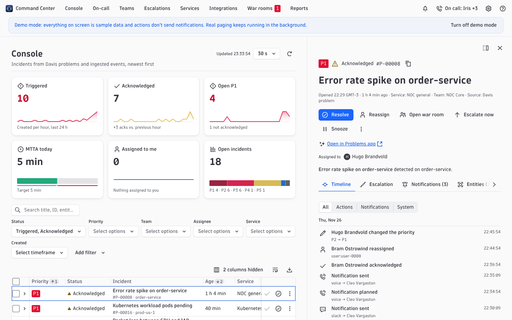

Se abre junto a la tabla. El encabezado muestra prioridad, estado, `#ID`, un botón para copiar el enlace, título,
*Opened … · Service · Team · Source*, y *Under maintenance: paging suppressed* cuando corresponde. Botones: Acknowledge,
Resolve, Reopen, Reassign, Open/Join war room, Escalate now, Snooze, y ⋮ (Change priority, Add note, Undo
acknowledgement, Copy link). Los problemas de Davis enlazan a **Open in Problems app**.

| Pestaña | Contenido |
| --- | --- |
| Timeline | Cada evento: creado, enrutado, reconocido, notificaciones, notas… Filtros *All / Actions / Notifications / System*. Las notificaciones fallidas se resaltan. |
| Escalation | La política, cada paso con sus destinos y canales, qué paso sigue y cuándo. *Escalation stops automatically while an incident is acknowledged or snoozed.* |
| Notifications (N) | El registro de notificaciones (ledger): canal, destinatario, paso (`N · try A`, con *repeat P*), estado, hora, detalles del proveedor |
| Entities (N) | Entidades afectadas: nombre, tipo, ID de la entidad |
| Notes (N) | Agregar una nota (Markdown). Las notas son de solo anexado. |

## War rooms

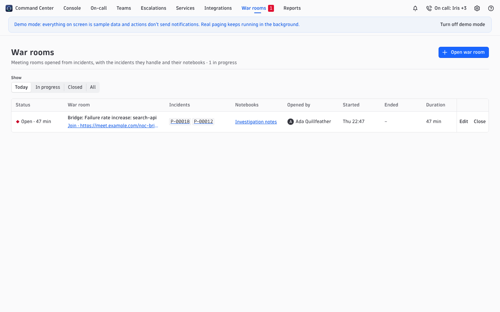

Una war room (sala de crisis) es un enlace de reunión más los incidentes que atiende y sus notebooks.

- **Abrir**: desde un incidente (**Open war room**, o **⋮ → Open war room…** en la Console) o con el botón **Open war
  room**. Pega el enlace de reunión que creaste en Teams, Zoom, Meet o un huddle de Slack (solo https). Los incidentes
  abiertos relacionados se agregan automáticamente: los que tienen la misma causa raíz, o el mismo servicio y
  comenzaron dentro de un lapso de 30 minutos. Quita los que no correspondan.
- **Notebooks**: **Create post-mortem notebook** crea un Dynatrace Notebook con el nombre del primer incidente (por
  ejemplo `P-26112613 · Post-mortem: …`) con resumen, línea de tiempo, causa raíz, impacto, acciones a realizar y una
  sección DQL para los problemas de la sala. **Select an existing notebook** adjunta cualquier notebook al que tengas
  acceso. También puedes agregar cualquier enlace https. Un notebook nuevo pertenece a la persona que lo creó y, según
  la Document API de Dynatrace, no es accesible para otros usuarios hasta que se comparte en la app Notebooks.
- **Lista**: *Today* de forma predeterminada (salas abiertas y salas abiertas o cerradas hoy), o *In progress*,
  *Closed*, *All*. Columnas: Status (*Open · duration* o *Closed*), War room (título y enlace **Join**), Incidents,
  Notebooks, Opened by, Started, Ended, Duration.
- **Close / Reopen** lo hacen las personas. Una sala cerrada mantiene su enlace visible como texto plano a modo de
  referencia, y no se puede hacer clic en él. Mientras una sala está abierta, el incidente muestra **Join war room**.

## On-call

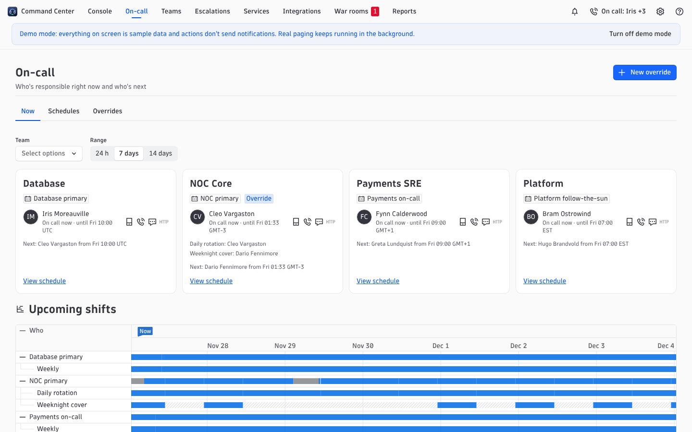

| Pestaña | Contenido |
| --- | --- |
| Now | Una tarjeta por equipo: quién está de guardia y hasta cuándo, sus métodos de contacto (en gris cuando no están configurados), quién sigue, y cada capa. *No one is on call* viene con **Add override**. Debajo: *Upcoming shifts* (Gantt: turnos en verde, overrides en un color aparte, huecos en ámbar, un marcador *Now*). Filtros: Team, Range (24 h, 7 days, 14 days). |
| Schedules | Nombre, equipo, zona horaria, capas, de guardia ahora, próximo traspaso, cobertura para los próximos 7 días. Edit, Duplicate, Delete. |
| Overrides | Quién cubre, a quién, calendario, desde, hasta, motivo. Próximos o pasados. Remove. |

**Editor de calendarios** 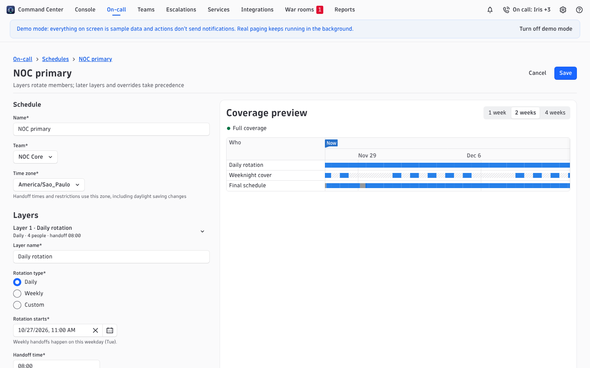

- **Schedule**: nombre, equipo, zona horaria (los traspasos y las restricciones la siguen, incluido el horario de
  verano).
- **Layers**: cada capa tiene un nombre, una rotación (*Daily*, *Weekly*, o *Custom* con una duración de turno de
  1–672 horas), un inicio, una hora de traspaso (HH:mm), opcionalmente *Only during specific hours* (días de la semana
  y desde/hasta), y participantes en orden de rotación (arrastra para reordenar). **Las capas posteriores tienen
  precedencia sobre las anteriores**, y los overrides prevalecen sobre todas las capas.
- **Coverage preview** (1, 2 o 4 semanas): *Full coverage* o *N gaps, … uncovered*, con una fila *Final schedule*.

**New override**: calendario, quién cubre, desde, hasta (predeterminado: la próxima hora completa, durante 8 horas),
motivo. Una frase de vista previa dice exactamente qué va a ocurrir.

## Teams

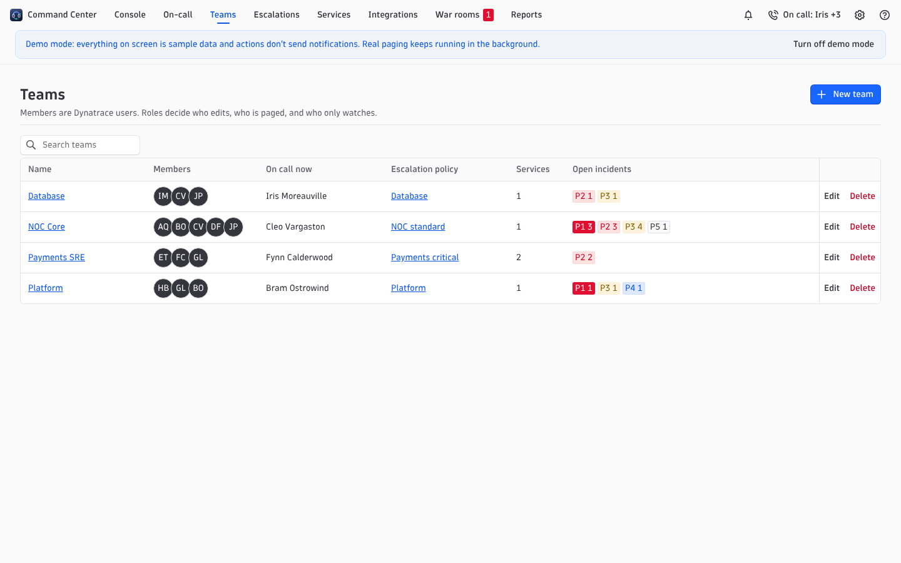 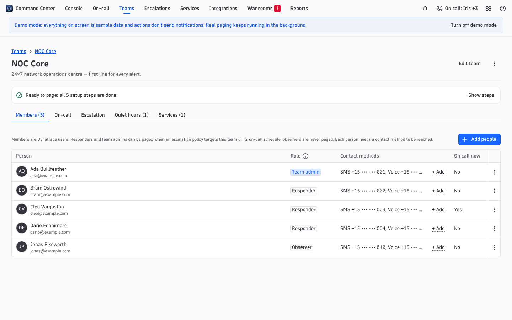

- **Lista de equipos**: nombre, miembros, de guardia ahora, política de escalamiento, servicios, incidentes abiertos
  por prioridad. Un equipo que todavía usan políticas, reglas o servicios no se puede eliminar hasta que se quiten esas
  referencias.
- **Pestañas del detalle del equipo**: *Members*, *On-call*, *Escalation*, *Quiet hours*, *Services*.
- **Ready to page?** Una lista de verificación de 5 pasos, cada uno con un botón para corregirlo: personas a las que se
  avisa, métodos de contacto, un calendario de guardia, una política de escalamiento y alertas enrutadas al equipo.
- **Add people**: escribe al menos 3 letras de un nombre o un correo electrónico. Los resultados provienen de Dynatrace
  IAM: usuarios activos de la cuenta propietaria del entorno. Roles:

| Rol | ¿Recibe avisos? | Pensado para |
| --- | --- | --- |
| Team admin | sí | Edita el equipo, sus calendarios y su política |
| Responder | sí | Reconoce y resuelve |
| Observer | nunca | Observa los incidentes del equipo |

Los roles son orientativos: App State no tiene permisos por clave, así que técnicamente cualquier usuario de la app
puede cambiar la configuración.

- **Contact methods** (persona → *Edit contact methods*): canal, dirección y etiqueta, más **Send test** por método.
  Formatos de dirección: teléfono en E.164 con el código de país (SMS, voz, WhatsApp); chat ID de Telegram; cualquier
  etiqueta para Slack, Teams e IFTTT (su webhook o applet decide el destino, y los mensajes muestran el nombre de la
  persona); una clave de enrutamiento para el webhook o el custom workflow. Los números de teléfono y los chat IDs son legibles para cualquier usuario de la app. Se
  enmascaran en las listas. El correo electrónico no es un canal aparte: envía correos a través de un gateway de
  webhook.
- **When I'm paged** (reglas de notificación): *método*, *después de N minutos* (contados desde que se dispara el paso)
  y *para prioridad hasta Px*. Una persona con métodos pero sin reglas recibe todos los métodos de inmediato. Un paso
  con canales forzados usa el primer método de cada canal, sin demora.
- **Quiet hours** (horas de silencio): ventanas (días, desde/hasta, zona horaria; una ventana puede cruzar la
  medianoche) durante las cuales los incidentes **menos urgentes** que una prioridad se **retienen** (sin avisos hasta
  que termina la ventana) o se avisan solo por canales de **baja urgencia** (Slack, Teams, Telegram, IFTTT, webhook).
  Los incidentes más urgentes siempre generan avisos. Cuando las ventanas se superponen, gana *hold*.

## Escalations

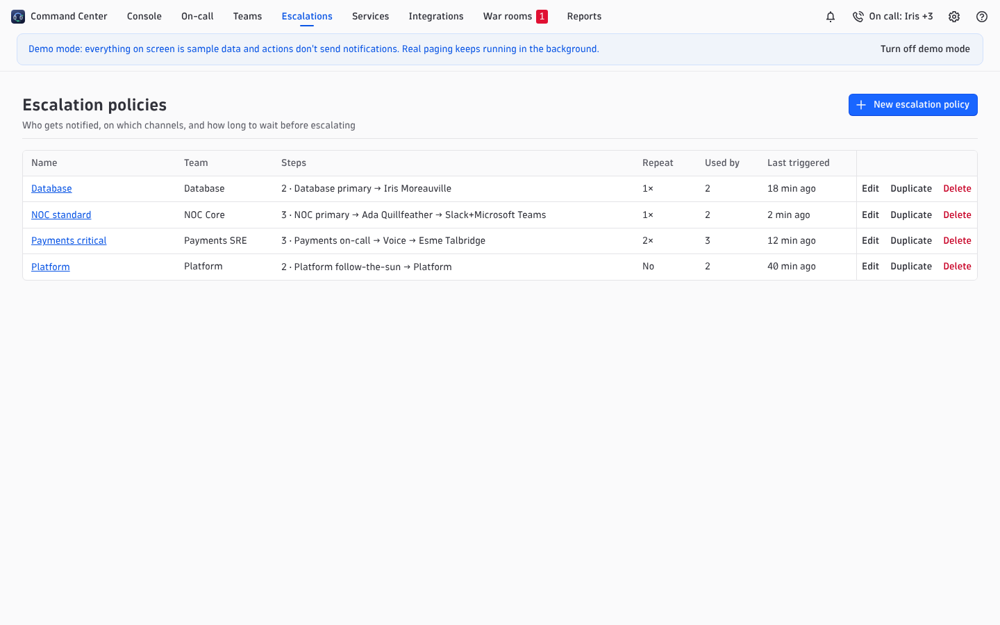 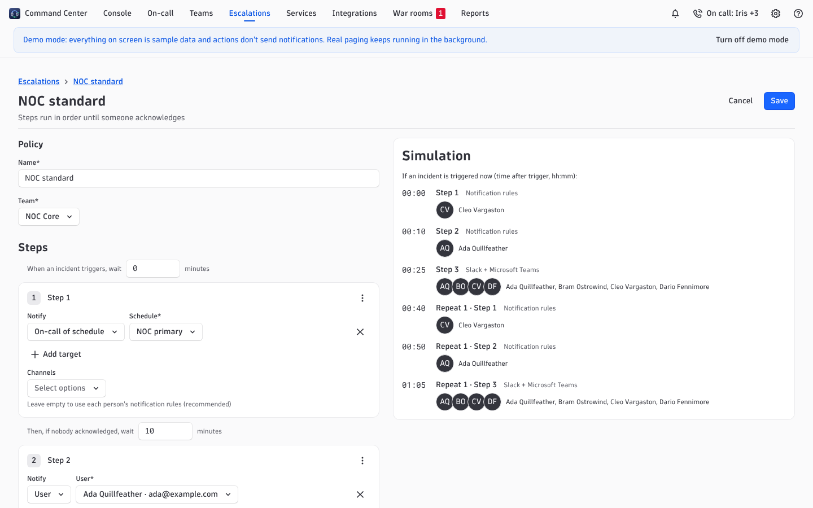

- **Lista**: nombre, equipo, pasos (`N · summary`), repetición, usada por, último disparo. Eliminar una política hace
  que sus incidentes recurran a la política predeterminada de su equipo o, si no la hay, a la política predeterminada
  de Settings.
- **Editor**: los pasos se ejecutan en orden hasta que alguien reconoce. Cada paso espera una cantidad de minutos
  (0–1440) **contados desde el paso anterior** y luego notifica a sus destinos: *On-call of schedule*, *Team (all
  responders)*, que significa todos los que no son observadores, incluidos los administradores, o un *User*. Los
  *Channels* son opcionales: déjalos vacíos para usar las reglas de notificación de cada persona (recomendado). Los
  canales sin un proveedor configurado están deshabilitados.
- **Repeat**: *Repeat policy if nobody acknowledges* 1–5 veces. Cada repetición comienza después de la demora del
  último paso (5 minutos si esa demora es 0). Cuando se completan todas las repeticiones, la política queda
  **agotada** (exhausted) y el incidente permanece triggered.
- **Simulation** (siempre visible en el editor): *If an incident is triggered now* lista, minuto a minuto, a quién se avisaría y por qué canales, y
  advierte cuando un paso no avisa a nadie (un hueco en el calendario o un equipo vacío).

La precisión de tiempo es igual al intervalo del motor: un paso se dispara en la primera ejecución del motor después de
su vencimiento. En el entorno trial, con un intervalo de 1 minuto, cada paso de una política de prueba de cuatro pasos
se disparó dentro del minuto siguiente a su vencimiento.

## Services y enrutamiento

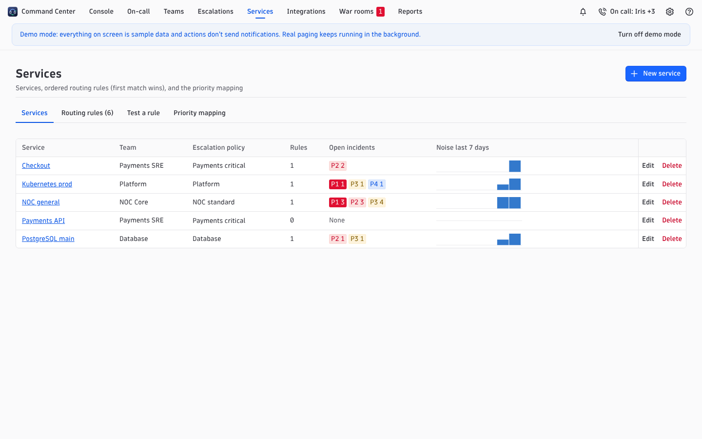 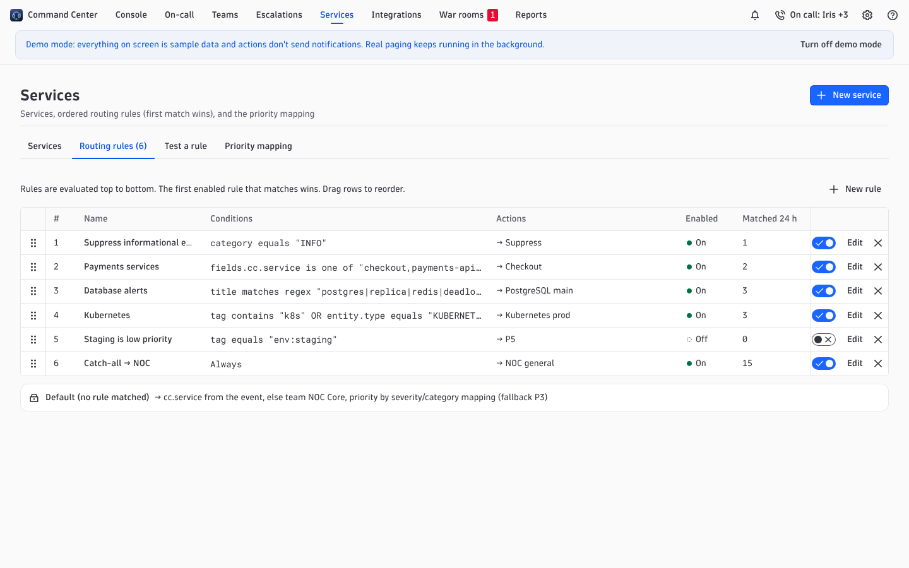

| Pestaña | Contenido |
| --- | --- |
| Services | Servicio, equipo, política de escalamiento (o *Team default*), reglas, incidentes abiertos, ruido de los últimos 7 días |
| Routing rules (N) | Reglas ordenadas (arrastra para reordenar). **Gana la primera regla habilitada que coincide.** Una regla nueva se coloca encima de la primera regla comodín (una regla sin condiciones). Columnas: #, nombre, condiciones, acciones, habilitada, coincidencias en 24 h. La última fila, fija, es la ruta predeterminada. |
| Test a rule | Carga una alerta reciente o un ejemplo, edita el JSON, **Run test**: muestra la regla que coincidió (o la más cercana), cada condición ✔/✖, y el servicio, equipo, política y prioridad resultantes con su origen |
| Priority mapping | Prioridad por categoría de Davis y por severidad, más el valor de respaldo |

**Editor de reglas**: nombre, habilitada, *Match all / any*, condiciones (campo, operador, valor, *Not*), y **Then**:
servicio, equipo, política de escalamiento, prioridad (o *Use priority mapping*), agregar tags, y *Suppress (create the incident, page nobody)* (crear el incidente sin avisar a nadie). Los
campos, los operadores y el orden de enrutamiento se listan en la
[referencia de alertas](alerts-reference.md#cómo-una-alerta-se-convierte-en-incidente).

**Service**: nombre (los eventos lo referencian por nombre o ID en `cc.service`), descripción, equipo propietario,
política de escalamiento (vacía = la predeterminada del equipo) y prioridad predeterminada.

## Integrations

| Pestaña | Contenido |
| --- | --- |
| Inbound 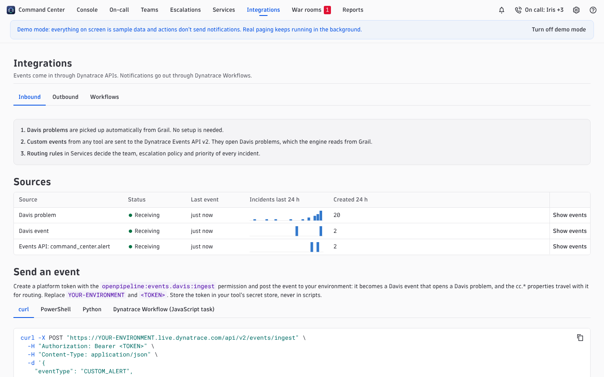 | Cada fuente con su estado (*Receiving*, *Quiet > 1 h*, *Turned off*, *Never seen*), último evento, incidentes en 24 h y **Show events**. Fragmentos listos para copiar (curl, PowerShell, Python, Dynatrace Workflow) y los campos que lee la app. |
| Outbound  | Los nueve proveedores (ocho integrados más **Custom workflow**), cada uno con un interruptor **On/Off**: *Not configured*, *Off*, *Configured* o *Last delivery failed*, conteos de enviados/fallidos, **Configure** (ID de la entrada del vault o workflow ID, parámetros) y **Send test**. Puede haber un solo proveedor activado por canal. |
| Workflows 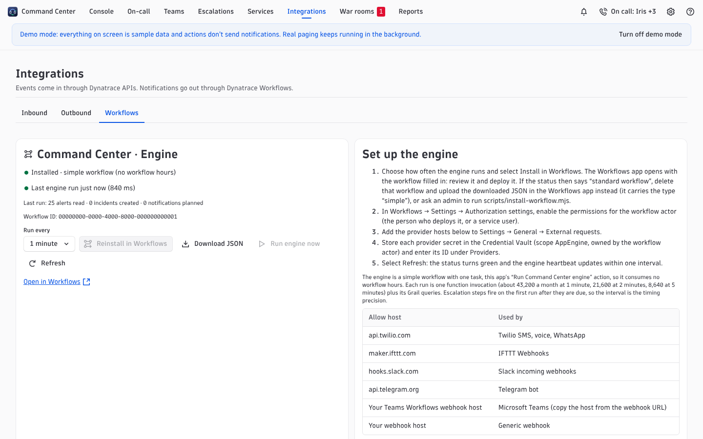 | Estado del motor (*Not installed*, *Installed · simple workflow*, *Update available*, *Installed as a standard workflow…*), la última ejecución del motor, **Run every**, **Install in Workflows**, **Download JSON**, **Run engine now**, **Refresh**, los pasos de configuración y los hosts que se deben permitir. |

Detalles: [integraciones](integrations.md) y [primeros pasos](getting-started.md).

## Reports

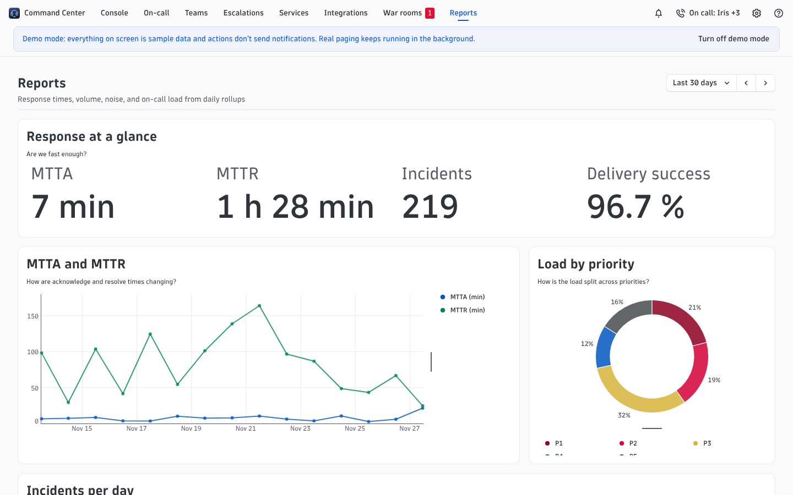

El rango de tiempo predeterminado son los últimos 30 días. Los paneles de respuesta, volumen, equipos y ruido provienen
de resúmenes diarios (conservados 90 días). *Time to acknowledge* y las columnas de fuera de horario, nocturnos y
reconocimientos de *On-call load* usan los incidentes que todavía están en la app y el registro de notificaciones
(conservado 14 días), así que cubren como máximo unos 14 días.

| Panel | Pregunta que responde |
| --- | --- |
| Response at a glance | MTTA, MTTR, incidentes, éxito de entrega |
| MTTA and MTTR | ¿Cómo están cambiando los tiempos de reconocimiento y de resolución? |
| Load by priority | ¿Cómo se reparte la carga entre las prioridades? |
| Incidents per day | ¿Cuándo llegan los incidentes y qué tan urgentes son? |
| Incidents by team | ¿Qué equipos reciben más incidentes? |
| Noisiest services and sources | ¿De dónde vienen los incidentes? (top 10) |
| Time to acknowledge | Distribución en minutos (intervalos desde 0, 1, 2, 5, 10, 15, 30, 60 y 120 minutos; el último intervalo contiene todo desde 120 en adelante) |
| Notification delivery | Proporción de notificaciones que aceptaron los proveedores |
| On-call load | Por persona: horas de guardia, avisos, avisos fuera de horario, avisos nocturnos (00–06), reconocimientos, tiempo promedio de reconocimiento |

*Off-hours* (fuera de horario) significa antes de las 08:00, desde las 18:00, o en fin de semana; *night* (nocturno)
significa antes de las 06:00. Ambos usan la zona horaria de tu navegador.

## Help

**Get started** se marca solo a partir de tus datos: crear un equipo, un calendario, una política de escalamiento,
configurar un proveedor, instalar el workflow del motor (existe un heartbeat), y enviar un evento de prueba (existe un
incidente). Luego vienen conceptos, flujo de trabajo de la Console, envío de eventos, notificaciones, atajos de
teclado, resolución de problemas y privacidad.
