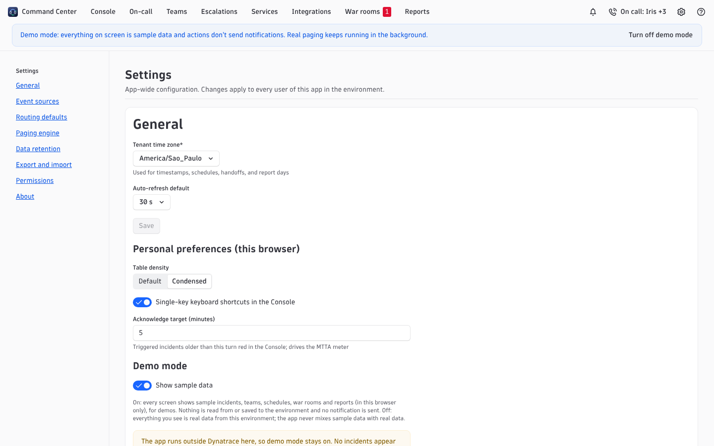

# Referência de configuração — cada configuração, função do app e chave armazenada

🌐 [English](../en/configuration.md) · **Português (BR)** · [Español](../es/configuration.md)

As configurações valem **para o app inteiro**: uma alteração se aplica a todos os usuários do app no ambiente. As
únicas exceções são os itens marcados como *this browser* (este navegador), que são salvos imediatamente. As seções
General, Event sources, Routing defaults, Paging engine e Data retention têm cada uma o seu próprio botão **Save**. A
validação roda antes de salvar e indica o campo que precisa de correção.



## General (Geral)

| Configuração | Padrão | Faixa | Efeito |
| --- | --- | --- | --- |
| Tenant time zone | O fuso horário do navegador | Fusos IANA | Timestamps, escalas, passagens de plantão e dias dos relatórios |
| Auto-refresh default | 30 s | Off, 15 s, 30 s, 1 min, 5 min | Com que frequência as páginas abertas recarregam o App State. Sem custo de Grail: a UI não executa DQL. |
| Table density *(this browser)* | Condensed | Default, Condensed | Altura das linhas das tabelas |
| Single-key keyboard shortcuts in the Console *(this browser)* | On | On, Off | `j`/`k`, `a`, `r`, `x`, `/`, `Shift+R`, `Esc` |
| Acknowledge target (minutes) *(this browser)* | 5 | 1–240 | Incidentes mais antigos que isso sem reconhecimento ficam vermelhos no Console. Controla o medidor de MTTA. |
| Demo mode → Show sample data *(this browser)* | Off | On, Off | On: dados de exemplo em todo lugar. Nada é lido do ambiente nem salvo nele, e nenhuma notificação é enviada. Off: somente dados reais. A página recarrega quando você alterna. |

Por que o modo demo é por navegador? Uma configuração compartilhada substituiria o console real de todos os operadores
por dados de exemplo, enquanto os acionamentos reais continuariam em segundo plano. Com uma chave por navegador, um
apresentador pode fazer a demonstração na própria tela sem afetar ninguém de plantão.

## Event sources (origens de eventos)

| Configuração | Padrão | Faixa | Efeito |
| --- | --- | --- | --- |
| Davis problems | On | | Lê `dt.davis.problems` (consulta Q1) e as propriedades `cc.*` dos seus eventos (Q4) |
| Look back (hours) | 72 | 1–336 | Até quando no passado Q1 e Q4 leem. Um problem mais antigo que isso deixa de ser visto. |
| Page during maintenance windows | Off | | Off: problems sob uma janela de manutenção do Davis criam incidentes, mas não acionam ninguém |
| Davis events that don't open a problem (Events API v2) | Off | | Lê `dt.davis.events` dos tipos listados (Q2, últimas 24 h) |
| Davis event types | `CUSTOM_ALERT, ERROR_EVENT` | Separados por vírgula | Tipos de evento lidos pela Q2 |
| Generic events (OpenPipeline) | Off | | Lê a tabela `events` (Q3, últimas 24 h) |
| Generic event type | `command_center.alert` | | `event.type` lido pela Q3 |

Os formatos e campos estão na [referência de alertas](alerts-reference.md).

## Routing defaults (padrões de roteamento)

Usados quando nenhuma regra de roteamento, propriedade de evento ou serviço decide.

| Configuração | Padrão | Efeito |
| --- | --- | --- |
| Default team | nenhuma | Equipe para incidentes que nenhuma regra ou serviço atribui |
| Default escalation policy | nenhuma | Política quando nem a regra, nem o serviço, nem a equipe têm uma. Sem política, ninguém é acionado. |
| Fallback priority | P3 | Último passo da ordem de prioridade |

O mapeamento de prioridade por severidade e categoria é editado em **Services → Priority mapping**.

## Paging engine (motor de acionamento)

| Configuração | Padrão | Faixa | Efeito |
| --- | --- | --- | --- |
| Engine enabled | On | | Off pausa **todos** os acionamentos. O motor continua rodando no agendamento, mas não faz nada. |
| Engine workflow ID | Preenchido por Integrations → Workflows | UUID | Permite que a aba Workflows encontre e vincule o workflow. O intervalo (1, 2 ou 5 minutos) é escolhido na instalação; o app o lê de volta a partir do workflow instalado. |
| Max notifications per run | 100 | 1–500 | Notificações além disso são planejadas novamente na execução seguinte |
| Delivery report timeout (seconds) | 180 | 30–3600 | Uma notificação sem resultado de entrega após esse tempo é marcada como *timeout* e tentada novamente |
| Delivery attempts | 3 | 1–10 | Tentativas por notificação antes de ela ser marcada como falha |
| Engine lock lease (seconds) | 130 | 30–180 | Impede que duas execuções acionem duas vezes. O motor sempre usa um valor entre 130 e 180. |

## Data retention (retenção de dados)

| Configuração | Padrão | Faixa | Efeito |
| --- | --- | --- | --- |
| Keep resolved incidents visible (hours) | 24 | 1–720 | Depois disso o incidente é arquivado e sai do Console |
| Archive resolved incidents for (days) | 30 | 1–90 | Por quanto tempo os incidentes arquivados são mantidos. O App State permite no máximo 90 dias. |

A seção mostra uma estimativa do App State usado pelos dados carregados nesta página (arquivos excluídos). O App State
permite 50 MB por app.

## Export and import (exportar e importar)

- **Export configuration** baixa configurações, equipes, escalas, políticas, serviços, regras de roteamento e contatos
  como JSON. Incidentes, war rooms e histórico não são incluídos.
- **Import configuration** valida o arquivo inteiro primeiro, incluindo as referências entre as entidades. Se algo
  estiver errado, nada é gravado e você recebe a lista de erros. Equipes, escalas, políticas, serviços e contatos são
  **adicionados ou atualizados por ID** e nunca excluídos. As regras de roteamento do arquivo **substituem** as regras
  atuais, e uma lista de provedores no arquivo substitui os provedores atuais. As demais configurações são mescladas.
- O arquivo contém números de telefone, chat IDs e IDs de entradas do Credential Vault em texto puro: guarde-o como
  dado pessoal.
- **Legacy data**: a versão 1 armazenava os reconhecimentos na chave de App State `problem-ack-states`. A versão 2 não
  a lê, e este botão a exclui.

## Permissions e About (permissões e sobre)

**Permissions** lista os escopos do app e o que cada um habilita (a mesma lista de
[primeiros passos](getting-started.md#passo-2--entenda-as-permissões)). Os papéis de equipe (*Team admin*,
*Responder*, *Observer*) são orientações para as pessoas. O App State não tem permissões por chave, então qualquer
usuário do app pode alterar a configuração. Suas políticas de IAM decidem quem pode abrir o app.

**About** mostra a versão do app, a versão do esquema de dados e se o app está conectado ao ambiente ou rodando em
modo demo.

## Funções do app (automação e scripts)

Cada função é chamada com `POST https://YOUR-ENVIRONMENT.apps.dynatrace.com/platform/app-engine/app-functions/v1/apps/my.command.center/api/<name>`
e roda com as permissões de **quem chama**. Quem chama precisa de `app-engine:apps:run` mais as permissões dos dados
que a função acessa.

| Função | Corpo | Retorno | Verificado |
| --- | --- | --- | --- |
| `config` | `{"op":"export"}` ou `{"op":"import","bundle":{…},"dryRun":true}` | Export: `{ok, bundle}`. Import: contagens, ou `errors[]` com entidade, caminho e mensagem. | Sim (export, import, dry run) |
| `engine-run` | `{"reason":"manual"}` ou `{"reason":"test","testRequest":{"providerId","channel","address"}}` | `{ok, sent, failed, deferred, counts, errors, skipped?}`. Se uma execução agendada estiver com o lease, a função espera até cerca de 20 segundos. | Sim |
| `status` | `{}` | `{heartbeat, lease, openIncidents, triggered}` — para verificações de saúde externas | Sim |
| `incidents` | `{}` ou `{"status":"triggered"}` | Os 200 resumos de incidentes mais recentes, sem dados de contato nem linha do tempo | Sim |
| `directory` | `{"query":"ana"}` ou `{"uids":[…]}` | Usuários do IAM | Com um platform token, a API do IAM respondeu *User not authorized* (também quando chamada diretamente, mesmo para o dono da conta). Ela responde na sessão de um usuário conectado. |

```bash
curl -X POST "https://YOUR-ENVIRONMENT.apps.dynatrace.com/platform/app-engine/app-functions/v1/apps/my.command.center/api/config" \
  -H "Authorization: Bearer <PLATFORM-TOKEN>" -H "Content-Type: application/json" \
  -d '{"op":"export"}' > command-center-config.json
```

## O que é armazenado, e onde

Tudo fica no **App State** deste app, no seu ambiente. Não há banco de dados externo. As chaves são em minúsculas, com
no máximo 200 caracteres, e os valores são JSON com um `schemaVersion`.

| Chave | Gravada por | Conteúdo | Expiração |
| --- | --- | --- | --- |
| `cfg.settings` | UI | Configurações, incluindo provedores (somente **IDs** de entradas do vault) | nenhuma |
| `rules.main` | UI | Regras de roteamento ordenadas | nenhuma |
| `team.<id>`, `sched.<id>`, `pol.<id>`, `svc.<id>` | UI | Equipes, escalas, políticas, serviços | nenhuma |
| `contact.<uid>` | UI | Métodos de contato e regras de notificação de uma pessoa | nenhuma |
| `war.<id>` | UI | War room | nenhuma |
| `inc.<id>` | motor | Incidente (linha do tempo limitada a 200 entradas) | arquivado após o período visível |
| `act.<incId>.<time>.<rand>` | UI | Uma ação de operador (reconhecimento, nota…) | 7 dias, excluída depois de aplicada |
| `ntf.<key>` | motor | Entrada do registro de notificações | 14 dias |
| `arc.<yyyymmdd>.<id>` | motor | Incidente arquivado | *Archive resolved incidents for* |
| `rpt.<yyyy-mm-dd>` | motor | Consolidação diária para Reports | 90 dias |
| `hb.engine` | motor | Heartbeat: última execução, duração, contagens, último erro, estimativa de armazenamento | nenhuma |
| `lock.engine` | motor | Lease do motor | liberado ao fim de cada execução |

**Por que os operadores nunca gravam incidentes.** O App State não tem locking otimista: a última gravação vence. Por
isso cada ação de operador é a sua própria chave `act.*`. O motor aplica essas ações em ordem na execução seguinte, e a
UI mostra o resultado imediatamente com a mesma lógica. Edições de configuração (equipes, escalas…) seguem a regra de
última gravação vence: se duas pessoas salvarem a mesma equipe ao mesmo tempo, vale o salvamento mais tardio.
