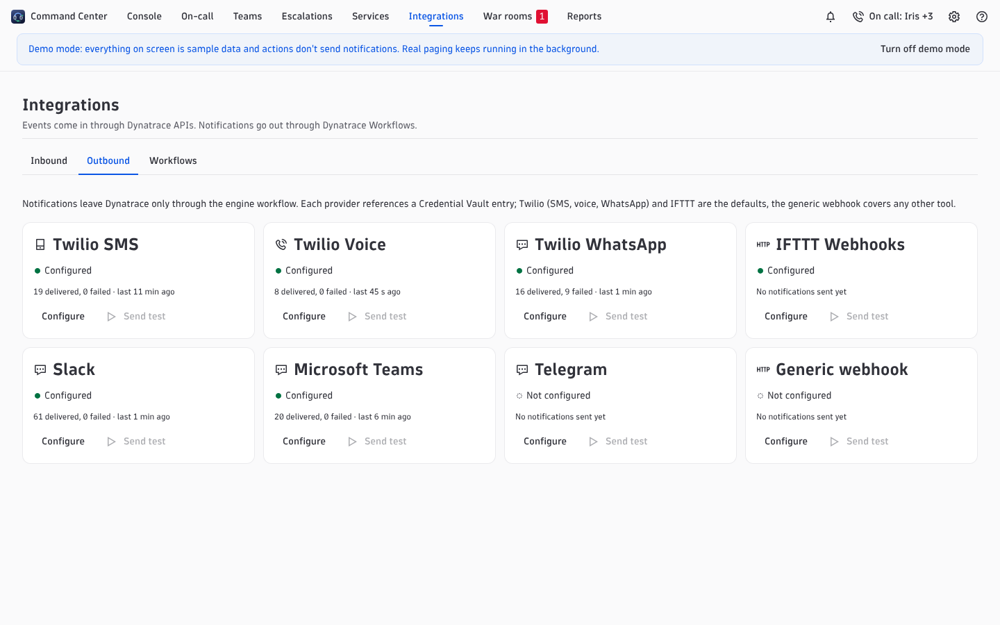

# Integrações — como as notificações saem

🌐 [English](../en/integrations.md) · **Português (BR)** · [Español](../es/integrations.md)

Os eventos de entrada são tratados na [referência de alertas](alerts-reference.md). Esta página trata do lado de
saída: os oito canais, o que cada provedor recebe e como testá-los.



## Como uma notificação é enviada

1. O motor roda no seu agendamento (simple workflow, uma ação). Ele decide quem precisa ser notificado agora: o passo
   de escalonamento que está vencido, as pessoas de plantão para os alvos desse passo e as regras de notificação de
   cada pessoa.
2. Ele grava uma **entrada no registro (ledger)** (`planned`) por pessoa, passo, canal e tentativa.
3. Na mesma execução, ele lê o segredo do provedor no Credential Vault e chama o provedor por HTTPS.
4. O resultado é gravado de volta: `sent` (com a referência do provedor, quando uma é retornada) ou `failed` (com o
   erro do provedor; segredos e URLs são mascarados como `***` e `<url>`).
5. Uma notificação que não tem resultado após *Delivery report timeout* passa a `timeout` e é tentada novamente, até
   *Delivery attempts* (padrão 3).

Cada chamada HTTP tem um timeout de 10 segundos. Uma execução para de enviar após cerca de 100 segundos; o que sobrar
é enviado na execução seguinte. O acionamento é **pelo menos uma vez (at least once)**: em raras condições de corrida
(uma execução que se sobrepõe a uma execução anterior lenta), uma pessoa pode ser notificada duas vezes.

## Canais e provedores

| Canal | Provedor (ID padrão) | Endereço de contato de uma pessoa | Entrada do vault |
| --- | --- | --- | --- |
| SMS | Twilio SMS (`twilio-sms`) | Telefone em E.164, por exemplo `+5511999990000` | Username/password: Account SID (ou API key SID) / auth token (ou API key secret) |
| Chamada de voz | Twilio Voice (`twilio-voice`) | Telefone em E.164 | igual |
| WhatsApp | Twilio WhatsApp (`twilio-whatsapp`) | Telefone em E.164 (o prefixo `whatsapp:` é adicionado) | igual |
| IFTTT | IFTTT Webhooks (`ifttt`) | Um rótulo (o applet decide para onde vai) | Token: sua chave do Webhooks |
| Slack | Slack (`slack`) | Um rótulo ou handle, exibido na mensagem | Token: a URL do incoming webhook |
| Microsoft Teams | Microsoft Teams (`teams`) | Um rótulo ou handle, exibido no card | Token: a URL do webhook do Teams Workflows |
| Telegram | Telegram (`telegram`) | O chat ID | Token: o token do bot |
| Webhook | Webhook genérico (`webhook`) | Uma routing key para o seu endpoint | Token: a URL do endpoint. Ou username/password: username = URL, password = valor do header de autenticação |

Todo provedor começa **desativado**. Um provedor só é usado quando está ativado e tem um ID de entrada do vault.

## O que cada provedor recebe

| Provedor | Requisição | Conteúdo |
| --- | --- | --- |
| Twilio SMS | `POST https://api.twilio.com/2010-04-01/Accounts/{AccountSid}/Messages.json` (form, HTTP Basic) | `To`, `Body` (o texto do SMS, no máximo 1.600 caracteres), `From` ou `MessagingServiceSid` |
| Twilio WhatsApp | mesmo endpoint | `To` e `From` com o prefixo `whatsapp:`, `Body` |
| Twilio Voice | `POST …/Calls.json` | `To`, `From`, `Twiml`: a mensagem é falada duas vezes com `<Say>` (`voice` e `language` opcionais) |
| IFTTT | `POST https://maker.ifttt.com/trigger/{event}/with/key/{key}` | `value1` = assunto, `value2` = texto, `value3` = link do incidente |
| Slack | `POST` na URL do webhook | Uma mensagem com o assunto, o texto e o link do incidente. A marcação do Slack é escapada, então o título de um alerta não consegue mencionar `@channel`. |
| Microsoft Teams | `POST` na URL do webhook | Um Adaptive Card com o assunto, o texto e um botão **Open in Command Center** |
| Telegram | `POST https://api.telegram.org/bot{token}/sendMessage` | `chat_id`, `text` = assunto + texto + link, como texto simples (sem marcação), pré-visualização de links desativada |
| Webhook genérico | `POST` na sua URL, `Content-Type: application/json`, header de autenticação opcional | `{"source":"command-center","version":1,"notification":{…}}` (abaixo) |

Microsoft Teams: somente webhooks do **Teams Workflows** são suportados. A Microsoft aposentou os antigos webhooks de
conector do Office 365.

### Payload do webhook genérico

```json
{
  "source": "command-center",
  "version": 1,
  "notification": {
    "key": "dp-p-26112716.0.0.1a2b3c4d.webhook.1",
    "incidentId": "dp-p-26112716",
    "displayId": "P-26112716",
    "cycle": 0,
    "step": 0,
    "attempt": 1,
    "channel": "webhook",
    "providerId": "webhook",
    "priority": "P2",
    "to": { "uid": "<IAM user id>", "address": "<routing key>", "name": "Ana Lima" },
    "subject": "[P2] P-26112716 Checkout latency above 2 s · Command Center",
    "text": "P2 P-26112716: Checkout latency above 2 s …",
    "incidentUrl": "https://YOUR-ENVIRONMENT.apps.dynatrace.com/ui/apps/my.command.center/incidents/dp-p-26112716"
  }
}
```

| Campo | Significado |
| --- | --- |
| `key` | Único por incidente, ciclo de escalonamento, passo, pessoa, canal e tentativa. Use-o para deduplicar do seu lado. |
| `cycle` | Ciclo de escalonamento, incrementado por *Escalate now* e por um novo disparo |
| `step` | Índice do passo de escalonamento (0 = primeiro passo) |
| `attempt` | 1 na primeira tentativa, depois 2, 3… nas novas tentativas após um timeout |
| `to` | A pessoa: ID de usuário do IAM, o endereço do seu método de contato, nome de exibição |
| `subject`, `text` | Textos pré-renderizados (limites abaixo) |
| `speech` | Somente para voz: o texto a ser falado |

Este é o caminho de saída para qualquer ferramenta sem um remetente integrado: um ITSM, um gateway de email, um chat
bot, outro serviço de acionamento.

## Textos das mensagens

- **Assunto:** `[P2] P-26112716 <title> · Command Center`, no máximo 150 caracteres.
- **SMS e voz:** `P2 P-26112716: <title> <service> Ack: <incident link>`, no máximo 300 caracteres. O título é
  encurtado primeiro.
- **Outros canais:** prioridade, ID, título, serviço, equipe, descrição (como texto simples) e até cinco entidades
  afetadas, depois o link. Limites: WhatsApp 1.000, IFTTT 1.000, Slack 3.000, Teams 3.000, Telegram 3.500, webhook
  4.000 caracteres.
- Em uma repetição da política, o texto diz `(repeat N)`.

Os textos das mensagens incluem o título e a descrição do alerta. Não coloque segredos ou dados pessoais em títulos de
eventos se eles forem enviados a terceiros.

## Regras de notificação e urgência

Cada pessoa tem **métodos de contato** e **regras de notificação** (Teams → pessoa → Contact methods). Uma regra diz:
"para incidentes de prioridade Px ou mais urgentes, use este método após N minutos a partir do momento em que o passo
dispara". Um passo de escalonamento também pode **forçar canais**, o que substitui as regras pessoais naquele passo.

Durante as **quiet hours** de uma equipe no modo *low urgency*, somente Slack, Teams, Telegram, IFTTT e webhook são
usados. SMS, voz e WhatsApp são ignorados.

## Testando um provedor

**Integrations → Outbound → provedor → Send test notification** envia uma mensagem para o endereço que você digitar,
pelo mesmo código que o motor usa (função do app `engine-run` com `reason: "test"`). O resultado (enviado, ou o erro do
provedor) aparece na hora. Teste cada canal que você ativar, de ponta a ponta, antes de depender dele.

## O que foi verificado

| Provedor | Status |
| --- | --- |
| Webhook genérico | ✅ Verificado ao vivo em um ambiente trial: escalonamentos e testes entregues, resultados gravados no registro (ledger) |
| Twilio SMS, voz, WhatsApp, IFTTT, Slack, Microsoft Teams, Telegram | Implementados a partir da documentação da API de cada fornecedor e cobertos por testes unitários, **não exercitados ao vivo** (sem contas no ambiente de teste). Teste-os com *Send test notification*. |

Respostas bidirecionais (reconhecer respondendo a um SMS ou a uma mensagem de chat) não estão implementadas. Reconheça
no Console.
