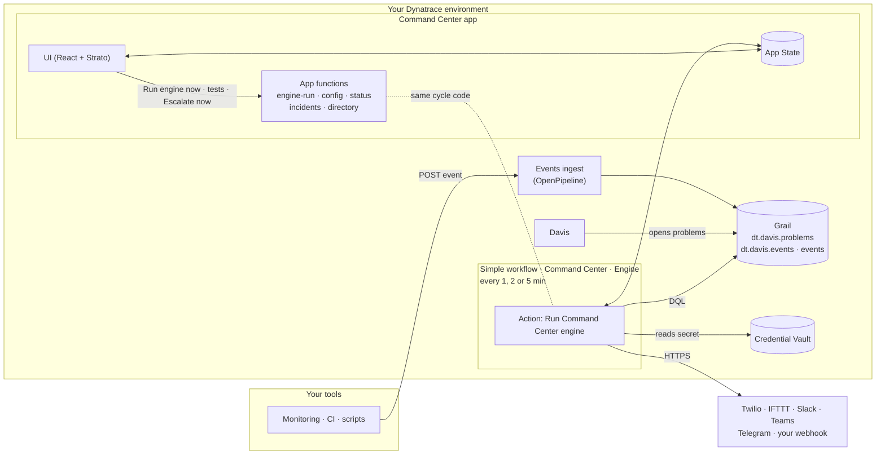

# Operações — arquitetura, custo, solução de problemas e limites

🌐 [English](../en/operations.md) · **Português (BR)** · [Español](../es/operations.md)

## Arquitetura



**Um ciclo do motor** (a ação, ou `engine-run` sob demanda):

1. Obter o lease do motor (`lock.engine`) para que duas execuções nunca acionem duas vezes. Se outra execução estiver
   com ele, esta execução é ignorada (contada como `skippedLocked` no heartbeat).
2. Executar as consultas DQL das origens habilitadas (Q1–Q4), normalizar os registros em alertas, deduplicá-los e
   roteá-los.
3. Criar ou atualizar incidentes, aplicar as ações dos operadores em ordem, encerrar os snoozes vencidos, avaliar as
   políticas de escalonamento contra as escalas, planejar notificações e novas tentativas (com falha ou sem resultado)
   no registro (ledger), arquivar incidentes resolvidos antigos e atualizar a consolidação diária. Gravar o heartbeat
   (`hb.engine`) e liberar o lease.
4. Ler no Credential Vault cada segredo de provedor necessário e enviar (ou executar o seu custom workflow). Gravar
   `sent` ou `failed` no registro.

Toda a lógica de roteamento, escalas, escalonamento e planejamento é TypeScript puro em `ui/app/domain/`. A UI usa o
mesmo código, então o que o Console mostra logo após uma ação corresponde ao que o motor vai fazer.

## Por que um único simple workflow

| Desenho | Workflow hours | Invocações de função | Veredito |
| --- | --- | --- | --- |
| Versão 2 antes desta mudança: um workflow **standard** `tick` → 8 remetentes → `report` | 1 por hora de vida do workflow, faça ele algo ou não | Medido: cerca de 690 por hora (≈ 11,5 por minuto) | Substituído |
| Um **simple workflow** por integração, executado pelo motor a cada notificação (atual, adicional) | nenhuma | Uma execução de workflow extra por notificação daquela integração | ✅ Cada integração ativada ganha o seu próprio workflow (uma confirmação). O motor continua lendo os alertas e escalonando; ele entrega cada notificação ao workflow da integração e recorre a um envio direto quando esse workflow não pode ser executado. |
| **Um simple workflow, uma ação, gatilho de intervalo** (atual) | **nenhuma** | Medido: **1 por execução** (60 por hora a 1 minuto) | ✅ |

Fontes: *Create a simple workflow* ("without consuming workflow hours") e *Workflows concepts* (simple workflows "do
not generate any consumption of workflow hours") na documentação da Dynatrace. Simple workflows permitem exatamente
uma tarefa, e essa tarefa não pode ser *Run JavaScript*, *Run workflow* nem uma aprovação. É por isso que o motor é uma
ação customizada do app (`actions/run-engine.action.ts`) e não um script.

Medido no ambiente trial, a partir dos eventos de billing em `dt.system.events` (`AppEngine Functions - Small`):

| Janela de 10 minutos (UTC) | Motor antigo ainda instalado | Somente o motor novo |
| --- | --- | --- |
| Invocações | 00:50 → 105, 01:00 → 120, 01:10 → 114 | 01:30 → 21, 01:40 → 11, 01:50 → 18 |
| das quais `ACTION` (o motor) | — | 10 por janela = 1 por minuto |

As invocações restantes na coluna nova são do simulador de alertas só para trial (um workflow standard executando
JavaScript) e das nossas próprias chamadas de teste às funções do app.

Workflow hours, a partir dos eventos de billing `Automation Workflow`: na hora 01:00–02:00 UTC, somente o simulador de
alertas (um workflow standard) foi cobrado. O motor baseado em simple workflow, que rodou a cada minuto nessa hora, não
produziu nenhum evento de billing de workflow.

## Custo e consumo

> Leia isto antes de rodar o app em produção. O motor roda o dia inteiro, independentemente de quantas pessoas usam o
> app.

| Item | Por mês a 1 min | a 2 min | a 5 min |
| --- | --- | --- | --- |
| Execuções do motor = invocações de função (`ACTION`) | ≈ 43.200 | ≈ 21.600 | ≈ 8.640 |
| Workflow hours | 0 | 0 | 0 |
| Consultas ao Grail | 1–8 por execução (abaixo) | igual | igual |
| Execuções de workflows de integração | uma por notificação de uma integração vinculada | igual | igual |

**Consultas ao Grail por execução**: Q1 problems (quando a origem Davis problems está ativada, o padrão), Q4
propriedades de eventos dos problems que a Q1 retornou (uma a cada
100 IDs de eventos, no máximo 5), Q2 Davis events e Q3 eventos genéricos (somente quando ativados). A UI **não**
executa DQL: as abas abertas leem apenas o App State.

| Fator | Efeito |
| --- | --- |
| Intervalo de execução | Linear no número de execuções. Um intervalo mais longo também significa um timing de escalonamento menos preciso. |
| Origens habilitadas | Q2 e Q3 adicionam uma consulta cada por execução |
| Look-back de problems (72 h) | Uma janela mais ampla varre mais dados |
| Volume de dados | Mais problems e eventos, mais bytes varridos |
| Abas abertas no navegador | Sem custo de Grail. Cada aba lê o App State a cada 30 s por padrão. |

Como medir no seu ambiente:

- Eventos de billing: `fetch dt.system.events | filter event.kind == "BILLING_USAGE_EVENT"`, agrupados por
  `event.type` e, para funções, por `function.type`.
- **Account Management → Cost & usage** para consultas ao Grail, funções do AppEngine e workflows depois de um dia
  rodando.
- A documentação da Dynatrace observa que simple workflows, embora não consumam workflow hours, ainda podem acionar
  outras capacidades cobradas: aqui, as invocações de função e as consultas ao Grail.

Como reduzir o custo: mantenha Q2 e Q3 desativadas, a menos que você envie eventos que não abrem problems; reduza o
look-back; escolha um intervalo de 2 ou 5 minutos se os atrasos de escalonamento forem longos.

**As consultas** (`ui/app/data/dql.ts`, todas executadas no ambiente trial):

```
// Q1 — Davis problems
fetch dt.davis.problems, from: now() - 72h
| filter not(dt.davis.is_duplicate)
| dedup event.id, sort: { timestamp desc }
| filter event.status == "ACTIVE" or event.end >= now() - 2h
| fields timestamp, event.id, display_id, event.name, event.description, event.category, event.severity,
         event.status, event.start, event.end, dt.davis.last_reopen_timestamp, dt.davis.event_ids,
         dt.davis.affected_users_count, dt.davis.mute.status, maintenance.is_under_maintenance,
         smartscape.affected_entities, root_cause.smartscape_entity, affected_entity_ids,
         affected_entity_names, root_cause_entity_name, entity_tags
| sort event.start desc
| limit 1000

// Q2 — Davis events (optional)
fetch dt.davis.events, from: now() - 24h
| filter in(event.type, array("CUSTOM_ALERT", "ERROR_EVENT"))
| dedup event.id, sort: { timestamp desc }
| filter event.status == "ACTIVE" or event.end >= now() - 2h
| fieldsKeep timestamp, event.id, event.name, event.description, event.type, event.category, event.severity,
             event.status, event.start, event.end, event.provider, dt.davis.is_frequent_event,
             maintenance.is_under_maintenance, dt.source_entity, entity_tags, "cc.*"
| limit 1000

// Q3 — generic events (optional)
fetch events, from: now() - 24h
| filter event.type == "command_center.alert"
| filter isNotNull(cc.dedup_key)
| sort timestamp asc
| summarize { last_action = takeLast(cc.action), title = takeLast(event.name),
              description = takeLast(event.description), priority = takeLast(cc.priority),
              service = takeLast(cc.service), tags = takeLast(cc.tags),
              first_seen = min(timestamp), last_seen = max(timestamp) },
            by: { cc.dedup_key }
| limit 1000

// Q4 — cc.* properties of the events behind active problems (up to 100 IDs per query)
fetch dt.davis.events, from: now() - 72h
| filter in(event.id, array("<event id>", "…"))
| dedup event.id, sort: { timestamp desc }
| fieldsKeep event.id, event.type, event.provider, "cc.*"
| limit 1000
```

## Saúde e monitoramento

- **Banner do Console**: o motor fica *late* (atrasado) após dois intervalos mais um minuto sem execução (3 minutos no
  intervalo padrão), ou quando a última execução reportou um erro. O **sino** notifica apenas quando o motor está
  atrasado.
- **Integrations → Workflows**: última execução, sua duração e contagens, o último erro e o status de instalação.
- **Monitoramento externo**: chame a função do app `status`. Ela retorna o heartbeat, o lease e as contagens de
  abertos/disparados (veja [configuração](configuration.md#funções-do-app-automação-e-scripts)).
- Simple workflows guardam apenas metadados de execução: resultados de tarefas e logs não são armazenados. Os
  diagnósticos do motor ficam, portanto, no heartbeat, e não no log de execução do Workflows.

## Comportamentos que você deve conhecer

- **Nunca resolvido por ausência.** Uma consulta com falha ou vazia nunca resolve nada. Somente um registro CLOSED,
  `cc.action: "resolve"` ou um operador resolve um incidente.
- **Acionamento pelo menos uma vez (at least once).** O registro (ledger) impede duplicatas na operação normal. Em
  raras condições de corrida (uma execução que se sobrepõe a uma execução anterior lenta, um resultado que chega depois
  do timeout), uma pessoa pode ser notificada duas vezes.
- **Precisão de timing = intervalo.** Um passo dispara na primeira execução depois de vencido. O mesmo vale para o fim
  dos snoozes.
- **Configuração: a última gravação vence.** Duas pessoas salvando a mesma equipe no mesmo momento: vale o salvamento
  mais tardio.
- **Papéis são orientações.** Qualquer usuário do app pode alterar a configuração. O IAM decide quem pode abrir o app.
- **O modo demo é por navegador** e nunca mistura dados de exemplo com dados reais (veja
  [configuração](configuration.md#general-geral)).

## Segurança e privacidade

- **Nenhum segredo no app.** As credenciais dos provedores ficam no Credential Vault. O App State guarda apenas IDs de
  entradas. Os textos de erro mascaram segredos e URLs.
- **Os dados de contato ficam visíveis para todos os usuários do app.** O App State não tem permissões por chave. Avise
  as pessoas antes que elas cadastrem números pessoais. Emails não são armazenados; eles são lidos ao vivo do IAM.
- **O workflow do motor não precisa ser privado.** Ele não expõe dados pessoais: suas execuções guardam apenas
  metadados e a ação retorna apenas contagens, então nenhum número de telefone ou texto de mensagem aparece no
  Workflows. Um custom workflow recebe a notificação completa (incluindo o endereço) como parâmetros de execução:
  decida você mesmo quem pode vê-la.
- **O tráfego de saída** é limitado pela lista de permissões de External requests: libere apenas os hosts dos
  provedores que você usa.
- **Tokens de entrada**: dê às suas ferramentas um platform token apenas com `openpipeline:events.davis:ingest` (ou
  `openpipeline:events:ingest`), guarde-o no cofre de segredos delas e faça a rotação dele.
- **Os textos das mensagens** contêm o título e a descrição do alerta, que são enviados a terceiros.
- **A identidade para auditoria** vem das informações de modificação do App State, e não do que o navegador alega.

## Solução de problemas

| Sintoma | Causa e correção |
| --- | --- |
| *The paging engine hasn't run yet / is late* | O workflow não está instalado, não está implantado ou está falhando. Confira Integrations → Workflows. Na maioria das vezes, falta uma permissão para o ator nas **Authorization settings** do Workflows. |
| Aba Workflows: *Installed as a standard workflow* | O intent create-workflow não tem campo de tipo. Exclua esse workflow e faça o upload do JSON baixado, ou execute `scripts/install-workflow.mjs`. |
| Aba Workflows: *Update available* | O app foi atualizado. Reinstale e depois exclua o workflow antigo. |
| Nenhum incidente aparece | Settings → Event sources; confira se o evento chegou ao Grail (`fetch dt.davis.events` em um Notebook) e se o seu tipo abre um problem. Caso contrário, ative a origem de Davis events. |
| O roteamento ignora `cc.service` | O nome ou ID não corresponde a um serviço, ou uma regra anterior definiu outro serviço. Use Services → Test a rule. |
| Uma notificação **falhou** (Failed) | Incidente → Notifications mostra o erro do provedor. Causas comuns: host ausente em External requests, uma entrada do vault que o ator não consegue ler, tipo de credencial errado, telefone fora do padrão E.164, API key do Twilio sem *Account SID*. |
| Uma notificação mostra **No result** | A execução terminou antes de a chamada retornar. Ela é tentada novamente até *Delivery attempts*. |
| *Run engine now* diz *Engine is already running* | Uma execução agendada está com o lease. Aguarde alguns segundos e tente de novo. |
| O seletor de usuários não encontra ninguém | Digite pelo menos 3 caracteres. Somente usuários **ativos** são retornados; pessoas convidadas precisam entrar uma vez. *User search is unavailable (IAM returned 403)*: o seu usuário precisa pertencer à conta dona do ambiente e ter permissão para ver usuários. |
| Implantação rejeitada por causa da versão | `app.version` precisa ser maior que a versão instalada. |
| Configuração perdida | O App State foi limpo ou o app foi desinstalado. Importe a sua última exportação. |

## Verificado e não verificado

Verificado em um ambiente trial (Dynatrace mais recente):

- Ingestão de Davis event (endpoint ao vivo, platform token) → Davis problem → motor → roteamento por `cc.service` →
  escala → passos de escalonamento → **webhook genérico** entregue → registro atualizado. Uma política de quatro passos
  disparou cada passo dentro de um minuto após o vencimento.
- Eventos genéricos por `/platform/ingest/v1/events`: trigger e resolve por `cc.dedup_key`.
- O motor como **simple workflow** com a ação customizada do app: todas as execuções com sucesso, leituras de App
  State, Grail e Credential Vault, HTTPS de saída. Billing: uma invocação `ACTION` por execução.
- A integração **Custom workflow**: um teste e um escalonamento agendado executaram um simple workflow com uma tarefa
  HTTP request, e a expressão `{{ execution().params | to_json }}` entregou o JSON completo da notificação.
- Funções do app `engine-run`, `config` (export, import, dry run), `status` e `incidents`. Notebooks de war room
  criados pela Document API.

Não verificado, ou apenas parcialmente:

- Remetentes de **Twilio, IFTTT, Slack, Microsoft Teams e Telegram**: implementados a partir da documentação dos
  fornecedores, não exercitados ao vivo. Testes unitários cobrem as requisições de Twilio SMS e voz, Slack e Telegram.
- **Install in Workflows** (intent) e o **Upload** do JSON no app Workflows: não foram clicados por nós de ponta a
  ponta. A instalação pela API da mesma definição está verificada.
- **Permissões mínimas** do ator do workflow: todas as permissões estavam habilitadas no ambiente trial.
- A **busca de usuários** não retornou ninguém para usuários que tinham acabado de ser convidados. Uma busca por
  usuários ativos em uma sessão conectada não foi confirmada no ambiente trial. Com um platform token, o IAM respondeu
  *User not authorized*.
- **Problems abertos há mais tempo que o look-back** (72 h) deixam de ser lidos; o incidente deles continua aberto até
  ser resolvido manualmente.
- **Respostas bidirecionais** (reconhecer por SMS ou chat) não estão implementadas.
