# Guia do usuário — cada tela, ícone e status

🌐 [English](../en/user-guide.md) · **Português (BR)** · [Español](../es/user-guide.md)

As capturas de tela foram feitas em **modo demo**, com dados de exemplo.

## Cabeçalho

| Elemento | O que faz |
| --- | --- |
| **Console · On-call · Teams · Escalations · Services · Integrations · War rooms · Reports** | Navegação principal. **War rooms** mostra um contador vermelho enquanto há salas em andamento. |
| 🔔 **Sino** | As últimas notificações desta sessão, com um contador de não lidas (até `99+`). Estados do ícone: sino = nada novo, sino ativo = itens não lidos, sino riscado = pop-ups silenciados. Selecionar um item abre aquilo a que ele se refere. Fechar o menu marca tudo como lido. |
| 📞 **Indicador de plantão** | `You're on call` em um círculo verde quando você está de plantão; caso contrário, `On call: <name>` (+N para mais pessoas) ou `No one on call`. O menu lista quem está de plantão em cada equipe e até quando, e oferece **Leave on-call now…** ou **Take on-call now…** (abaixo). |
| ⚙️ **Settings** | Abre as [configurações](configuration.md). |
| Menu de ajuda **?** | Primeiros passos, guia dentro do app, envio de eventos, atalhos de teclado, sobre. |

### Notificações (sino e pop-ups)

Os pop-ups aparecem no **canto inferior direito** para quatro categorias:

| Categoria | Exemplos |
| --- | --- |
| New P1/P2 incidents (novos incidentes P1/P2) | `P1 · <title>` (crítico), `P2 · <title>` (aviso). Depois de três, eles são agrupados como `N more new P1/P2 incidents`. |
| Confirmations of my actions (confirmações das minhas ações) | `Incident acknowledged` com **Undo** (10 segundos), `Incident resolved` com **Undo**, `Incident snoozed`… |
| Errors (erros) | `Couldn't save your changes`, `Couldn't acknowledge …` com **Retry** |
| Paging engine health (saúde do motor de acionamento) | `Paging engine is not running`: nenhuma execução do motor por dois intervalos mais um minuto |

No menu do sino, **Pop-ups on (click to silence)** alterna para *Silenced: only counting*. **Show pop-ups for…**
escolhe as categorias, e **Clear all** esvazia a lista. As preferências ficam guardadas neste navegador. A lista em si
fica na memória e é apagada quando você recarrega a página. Quando os pop-ups estão silenciados, o botão Undo das
confirmações também não é exibido.

### Sair ou assumir o plantão

- **Leave on-call now…** pergunta quem cobre o restante do seu turno. A próxima pessoa do rodízio vem pré-selecionada.
  Em seguida, ele cria uma **substituição (override)** na escala, de agora até o fim do turno atual, para que os
  acionamentos parem de chegar a você imediatamente.
- **Take on-call now…** aparece nas escalas em que você participa, mas não está de plantão. Ele cria uma substituição
  que coloca você de plantão até o fim do turno atual, ou por 8 horas se ninguém estava de plantão.
- As substituições aparecem em **On-call → Overrides**, com a nota *Left on-call from the header* ou *Took on-call from
  the header*, e podem ser removidas ali.

## Ícones e cores

**Status do incidente**

| Indicador | Status | Significado |
| --- | --- | --- |
| 🔴 Triggered | `triggered` | Novo ou disparado novamente. A política de escalonamento está em andamento. |
| 🟠 Acknowledged | `acknowledged` | Alguém está cuidando dele. O escalonamento para. |
| ⚪ Snoozed | `snoozed` | Oculto até um horário. Depois, dispara novamente e o escalonamento recomeça. |
| 🟢 Resolved | `resolved` | Fechado pela origem ou por um operador. Continua visível por 24 horas (configurável), depois é arquivado. |

**Chips de prioridade**: somente texto, sem ícone. **P1** é o único chip vermelho sólido, **P2** é avermelhado, **P3**
âmbar, **P4** azul e **P5** cinza. Significados: P1 crítico (grande indisponibilidade ou impacto em clientes), P2 alto
(um serviço está degradado), P3 moderado (precisa de atenção em breve), P4 baixo (pode esperar o horário comercial), P5
informativo. A prioridade não decide *se* alguém é acionado: quem decide é a política de escalonamento, e uma regra de
roteamento pode suprimir. A prioridade seleciona as regras de notificação das pessoas ("for priority up to P2…") e o
comportamento das quiet hours.

**Status da notificação (entrega)**

| Rótulo | Significado |
| --- | --- |
| Sending | Planejada nesta execução, ainda sem resultado |
| Sent | O provedor aceitou a mensagem (HTTP 2xx). A entrega no aparelho não é rastreada. |
| Failed | O provedor a recusou, ou todas as tentativas falharam. O erro do provedor é exibido. |
| No result | Nenhum resultado chegou a tempo. O motor tenta novamente com uma nova tentativa. |

**Canais**: 📱 SMS · 📞 voz · 💬 chat (WhatsApp, Telegram, Slack, Microsoft Teams) · 🌐 HTTP (IFTTT, webhook). Um ✖
vermelho em *Last notified* significa que a última notificação falhou ou ficou sem resultado.

**Origens**: o ícone do Davis (IA) marca um Davis problem; o ícone de evento marca um Davis event ou um evento da
Events API.

**Outros ícones**: ⬆ escalar · ⏸ snooze · 👤 responsável / reatribuir · ✎ alteração de prioridade ou de tag · 📝 nota ·
👥 war room ou equipe inteira · 🕒 MTTA ou *acima da meta de reconhecimento* · 🔇 suprimido · 🔁 a política se repete ·
✔ (verde) passo concluído · spinner = passo atual · ○ passo pendente · 🔒 rota padrão · ▶ executar ou enviar teste · 🔑
Credential Vault · ícone de workflow = workflow do motor.

**Destaque de item criado**: tudo o que você cria com um botão em uma lista (uma war room, uma equipe, um membro, uma
escala, uma camada, uma substituição, um passo de política, um serviço, uma regra, uma nota…) pulsa uma vez por um
segundo com um contorno, para que você o encontre. Com a configuração de sistema *reduce motion*, ele esmaece uma vez,
sem pulsar.

## Console

O Console é a tela do NOC: todos os incidentes abertos, os mais recentes primeiro.

**Tiles de KPI** (os sparklines são contagens por hora, nas últimas 24 horas):

| Tile | Valor | Clique |
| --- | --- | --- |
| Triggered | Incidentes esperando alguém (vermelho quando > 0) | Filtra por Triggered |
| Acknowledged | Incidentes sendo trabalhados. Rodapé: reconhecimentos vs. a hora anterior | Filtra por Acknowledged |
| Open P1 | Incidentes P1 não resolvidos (vermelho quando > 0) | Filtra por P1 abertos |
| MTTA today | Tempo **mediano** para reconhecer desde a meia-noite local. Vermelho acima da sua meta de reconhecimento; o medidor vai de 0 ao dobro da meta. | — |
| Assigned to me | Incidentes abertos atribuídos a você | Filtra por Assignee = me |
| Open incidents | Todos os incidentes abertos, divididos por prioridade | — |

**Filtros**: busca (título, ID, entidade, tag), Status (padrão *Triggered + Acknowledged*), Priority, Team, Assignee
(*Me*, *Unassigned*, membros), Service, Source, Escalation level (*Not started*, *Step N*, *Exhausted*) e Created
(intervalo de tempo). Os filtros fazem parte da URL, então uma visão de NOC pode ser salva nos favoritos.

**Colunas**: Priority, Status (e *until …* quando em snooze), Incident (título, `#display ID · first entity`), Age
(vermelho com um ícone de relógio quando um incidente **triggered** é mais antigo que a meta de reconhecimento),
Service, Team, Assignee, Escalation (*Step N of M*, *Not started*, *Exhausted*, *No policy*), Last notified. Source e
Created ficam ocultas por padrão. Use o menu de colunas para mostrar, ocultar ou reordenar colunas. A escolha é
lembrada neste navegador. As linhas podem ser expandidas para mostrar a descrição, a atividade mais recente e o
escalonamento.

**Ações da linha**: **Acknowledge** (somente quando triggered), **Resolve** e **⋮**: *Reassign…*, *Escalate now*,
*Snooze* (15 min, 30 min, 1 h, 4 h, Custom…), *Change priority…*, *Add note*, *Open war room…* / *Join war room*, *Open
Davis problem*, *Copy link*.

**Ações em massa** (selecione linhas): Acknowledge, Resolve (pede confirmação acima de 10 incidentes), Reassign,
Snooze, Escalate now, Set priority.

**Atalhos de teclado** (somente no Console, nunca enquanto você digita): `j`/`k` próximo/anterior, `a` reconhecer, `r`
resolver, `x` selecionar, `/` buscar, `Shift+R` atualizar, `Esc` fechar detalhes. Eles podem ser desativados em
Settings → General.

**Banners**: *The paging engine is late / reported an error / hasn't run yet* aparece quando o heartbeat do motor é
mais antigo que dois intervalos de execução mais um minuto, ou quando ele reporta um erro. *Demo mode* mostra um banner
permanente com **Turn off demo mode**.

**Ações em detalhe**

| Ação | Efeito |
| --- | --- |
| Acknowledge | O escalonamento para. O MTTA é medido. **Undo** em até 10 segundos, ou *Undo acknowledgement* depois, nos detalhes. |
| Resolve | O escalonamento para. Ninguém é notificado sobre a resolução. Davis problems também se resolvem sozinhos quando o Davis os fecha. |
| Reopen | Um incidente resolvido dispara novamente e o escalonamento recomeça. |
| Snooze | Até um horário no futuro, opcionalmente com uma nota. Depois, o incidente dispara novamente e a política recomeça. |
| Reassign | Para uma equipe ou uma pessoa, opcionalmente com uma nota |
| Escalate now | Dispara o **próximo passo** da política imediatamente (um incidente reconhecido ou em snooze volta a ficar triggered) e executa o motor na hora. Se a execução imediata falhar, o toast diz *Escalation recorded, but the engine didn't start*, e a próxima execução agendada faz o envio. |
| Change priority | P1–P5 |
| Add note | Markdown, somente acréscimo (append-only), parte da trilha de auditoria |

Cada ação é registrada na linha do tempo do incidente, com quem a fez e quando.

## Detalhes do incidente

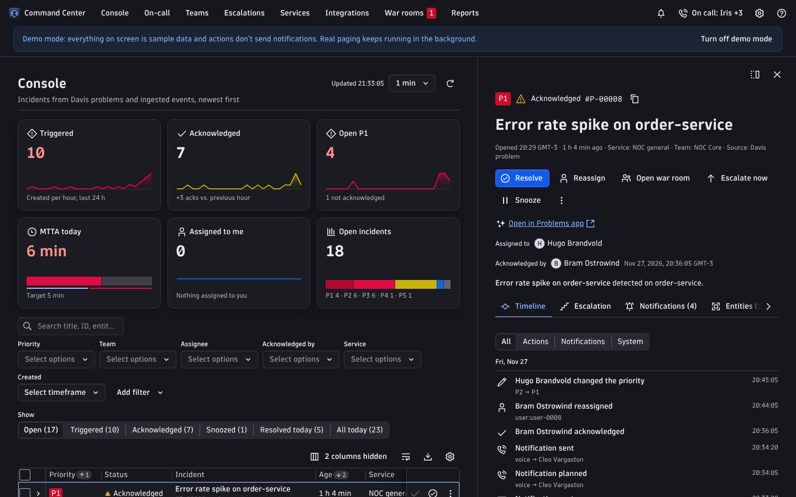

Abre ao lado da tabela. O cabeçalho mostra prioridade, status, `#ID`, um botão de copiar link, título, *Opened … ·
Service · Team · Source* e *Under maintenance: paging suppressed* quando se aplica. Botões: Acknowledge, Resolve,
Reopen, Reassign, Open/Join war room, Escalate now, Snooze e ⋮ (Change priority, Add note, Undo acknowledgement, Copy
link). Davis problems têm o link **Open in Problems app**.

| Aba | Conteúdo |
| --- | --- |
| Timeline | Cada evento: criado, roteado, reconhecido, notificações, notas… Filtros *All / Actions / Notifications / System*. Notificações com falha ficam destacadas. |
| Escalation | A política, cada passo com os seus alvos e canais, qual passo é o próximo e quando. *Escalation stops automatically while an incident is acknowledged or snoozed.* |
| Notifications (N) | O registro (ledger): canal, destinatário, passo (`N · try A`, com *repeat P*), status, horário, detalhes do provedor |
| Entities (N) | Entidades afetadas: nome, tipo, ID da entidade |
| Notes (N) | Adicione uma nota (Markdown). As notas são somente acréscimo (append-only). |

## War rooms

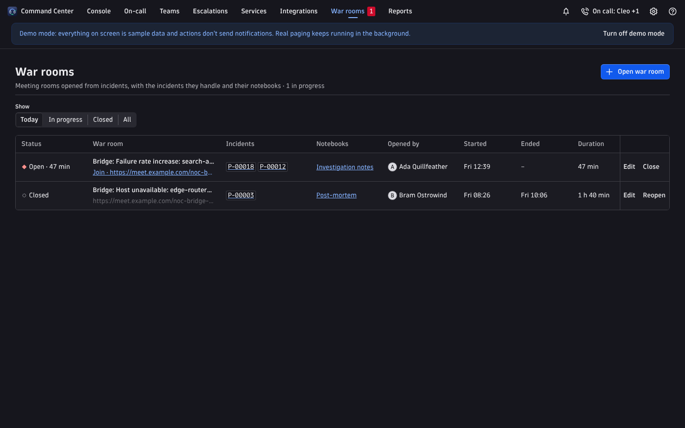

Uma war room é um link de reunião mais os incidentes que ela trata e os seus notebooks.

- **Abrir**: a partir de um incidente (**Open war room**, ou **⋮ → Open war room…** no Console) ou com o botão **Open
  war room**. Cole o link da reunião que você criou no Teams, Zoom, Meet ou em um huddle do Slack (somente https).
  Incidentes abertos relacionados são adicionados automaticamente: os que têm a mesma causa raiz, ou o mesmo serviço e
  começaram em até 30 minutos. Remova os que não pertencem à sala.
- **Notebooks**: **Create post-mortem notebook** cria um Dynatrace Notebook com o nome do primeiro incidente (por
  exemplo `P-26112613 · Post-mortem: …`) com resumo, linha do tempo, causa raiz, impacto, itens de ação e uma seção DQL
  para os problems da sala. **Select an existing notebook** anexa qualquer notebook a que você tenha acesso. Você
  também pode adicionar qualquer link https. Um notebook novo pertence a quem o criou e, segundo a Document API da
  Dynatrace, não fica acessível para outros usuários até ser compartilhado no app Notebooks.
- **Lista**: *Today* por padrão (salas abertas e salas abertas ou fechadas hoje), ou *In progress*, *Closed*, *All*.
  Colunas: Status (*Open · duration* ou *Closed*), War room (título e link **Join**), Incidents, Notebooks, Opened by,
  Started, Ended, Duration.
- **Close / Reopen** é feito por pessoas. Uma sala fechada mantém o link visível como texto simples, para referência,
  e ele não pode ser clicado. Enquanto uma sala está aberta, o incidente mostra **Join war room**.

## On-call (plantão)

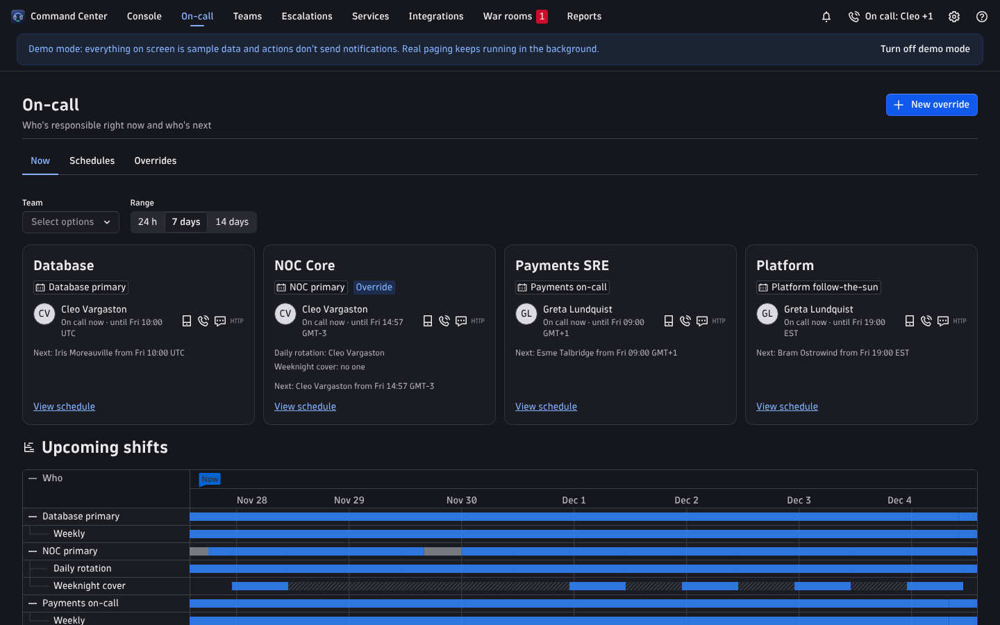

| Aba | Conteúdo |
| --- | --- |
| Now | Um card por equipe: quem está de plantão e até quando, os seus métodos de contato (em cinza quando não configurados), quem é o próximo e cada camada. *No one is on call* vem com **Add override**. Abaixo: *Upcoming shifts* (Gantt: turnos em verde, substituições em outra cor, lacunas em âmbar, um marcador *Now*). Filtros: Team, Range (24 h, 7 dias, 14 dias). |
| Schedules | Nome, equipe, fuso horário, camadas, de plantão agora, próxima passagem de plantão, cobertura para os próximos 7 dias. Edit, Duplicate, Delete. |
| Overrides | Quem cobre, para quem, escala, de, até, motivo. Futuras ou passadas. Remove. |

**Editor de escala** 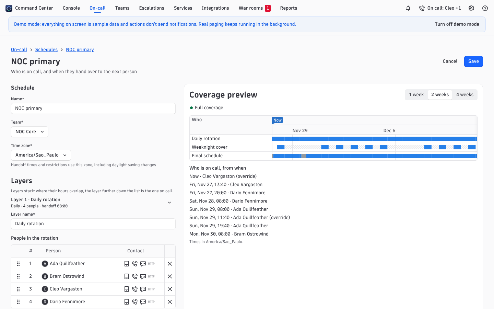

- **Schedule**: nome, equipe, fuso horário (as passagens de plantão e as restrições o seguem, incluindo o horário de
  verão).
- **Layers (camadas)**: cada camada tem um nome, um rodízio (*Daily*, *Weekly* ou *Custom*, com duração de turno de
  1–672 horas), um início, um horário de passagem de plantão (HH:mm), opcionalmente *Only during specific hours* (dias
  da semana e de/até), e participantes na ordem do rodízio (arraste para reordenar). **Camadas posteriores têm
  precedência sobre as anteriores**, e as substituições vencem todas as camadas.
- **Prévia de cobertura** (1, 2 ou 4 semanas): *Full coverage* ou *N gaps, … uncovered*, com uma linha *Final
  schedule*.

**Nova substituição (New override)**: escala, quem cobre, de, até (padrão: a próxima hora cheia, por 8 horas), motivo.
Uma frase de prévia diz exatamente o que vai acontecer.

## Teams (equipes)

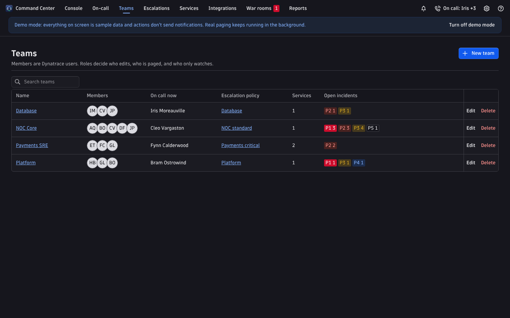 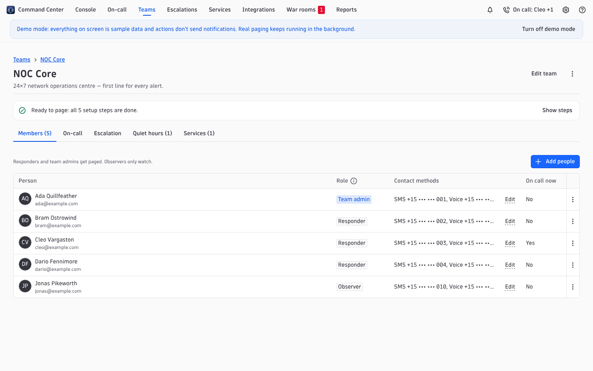

- **Lista de equipes**: nome, membros, de plantão agora, política de escalonamento, serviços, incidentes abertos por
  prioridade. Uma equipe que ainda é usada por políticas, regras ou serviços não pode ser excluída até que essas
  referências sejam removidas.
- **Abas do detalhe da equipe**: *Members*, *On-call*, *Escalation*, *Quiet hours*, *Services*.
- **Ready to page?** Uma checklist de 5 passos, cada um com um botão de correção: pessoas que são acionadas, métodos de
  contato, uma escala de plantão, uma política de escalonamento e alertas roteados para a equipe.
- **Add people**: digite pelo menos 3 letras de um nome ou de um email. Os resultados vêm do IAM do Dynatrace: usuários
  ativos da conta dona do ambiente. Papéis:

| Papel | Acionado? | Indicado para |
| --- | --- | --- |
| Team admin | sim | Edita a equipe, as suas escalas e a sua política |
| Responder | sim | Reconhece e resolve |
| Observer | nunca | Acompanha os incidentes da equipe |

Os papéis são orientações: o App State não tem permissões por chave, então tecnicamente qualquer usuário do app pode
alterar a configuração.

- **Contact methods** (pessoa → *Edit contact methods*): canal, endereço e rótulo, mais **Send test** por método.
  Formatos de endereço: telefone em E.164 com o código do país (SMS, voz, WhatsApp); chat ID do Telegram; member ID ou
  canal do Slack; referência de usuário ou canal do Teams; routing key do IFTTT; routing key do webhook. Números de
  telefone e chat IDs podem ser lidos por todos os usuários do app. Eles ficam mascarados nas listas. Email não é um
  canal separado: envie emails por meio de um gateway de webhook.
- **When I'm paged** (regras de notificação): *method*, *after N minutes* (contados a partir do momento em que o passo
  dispara) e *for priority up to Px*. Uma pessoa com métodos, mas sem regras, recebe todos os métodos imediatamente. Um
  passo com canais forçados usa o primeiro método de cada canal, sem atraso.
- **Quiet hours**: janelas (dias, de/até, fuso horário; uma janela pode atravessar a meia-noite) durante as quais
  incidentes **menos urgentes** que uma prioridade são **retidos** (hold: nenhum acionamento até a janela terminar) ou
  acionados apenas com canais de **baixa urgência** (Slack, Teams, Telegram, IFTTT, webhook). Incidentes mais urgentes
  sempre acionam. Quando as janelas se sobrepõem, *hold* vence.

## Escalations (escalonamentos)

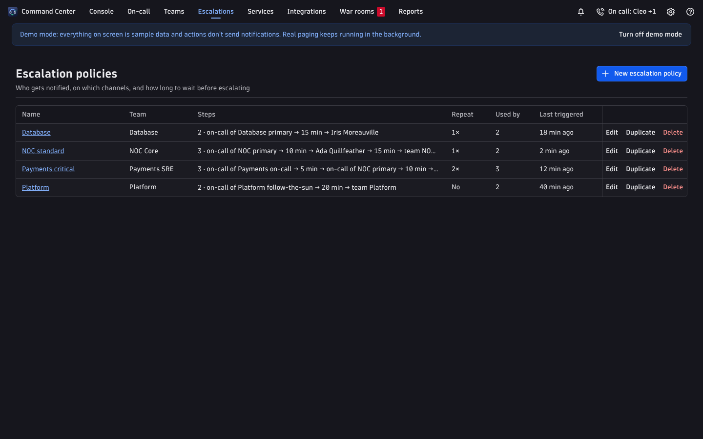 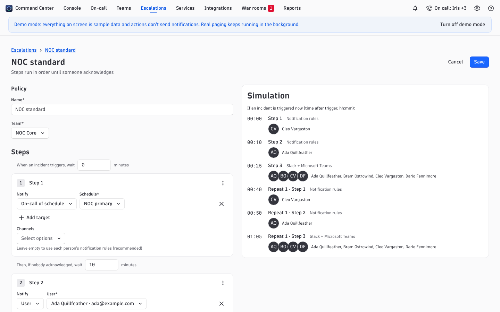

- **Lista**: nome, equipe, passos (`N · summary`), repetição, usada por, último disparo. Excluir uma política faz os
  seus incidentes voltarem para a política padrão definida em Settings.
- **Editor**: os passos rodam em ordem até alguém reconhecer. Cada passo espera um número de minutos (0–1440)
  **contados a partir do passo anterior** e então notifica os seus alvos: *On-call of schedule*, *Team (all
  responders)*, que significa todos que não são observadores, incluindo os admins, ou um *User*. *Channels* são
  opcionais: deixe vazio para usar as regras de notificação de cada pessoa (recomendado). Canais sem um provedor
  configurado ficam desabilitados.
- **Repetição**: *Repeat policy if nobody acknowledges* de 1 a 5 vezes. Cada repetição começa após o atraso do último
  passo (5 minutos se esse atraso for 0). Quando todas as repetições terminam, a política fica **esgotada (exhausted)**
  e o incidente continua triggered.
- **Simulação**: *If an incident is triggered now* lista, minuto a minuto, quem seria acionado e em quais canais, e
  avisa quando um passo não aciona ninguém (uma lacuna na escala ou uma equipe vazia).

A precisão do timing é igual ao intervalo do motor: um passo dispara na primeira execução do motor depois de vencido.
No ambiente trial, com intervalo de 1 minuto, cada passo de uma política de teste de quatro passos disparou dentro de
um minuto após o vencimento.

## Services e roteamento

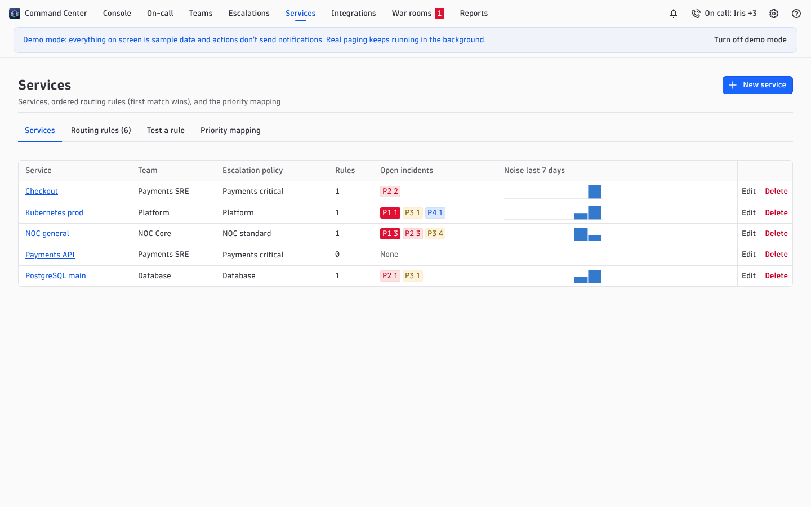 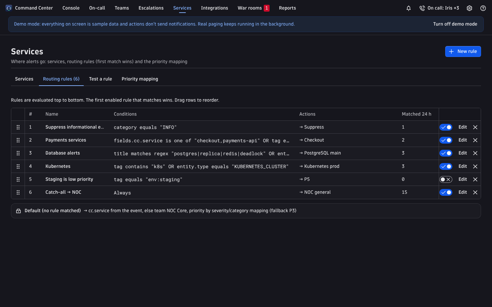

| Aba | Conteúdo |
| --- | --- |
| Services | Serviço, equipe, política de escalonamento (ou *Team default*), regras, incidentes abertos, ruído nos últimos 7 dias |
| Routing rules (N) | Regras ordenadas (arraste para reordenar). **A primeira regra habilitada que corresponder vence.** Colunas: #, nome, condições, ações, habilitada, correspondências em 24 h. A última linha, fixa, é a rota padrão. |
| Test a rule | Carregue um alerta recente ou um exemplo, edite o JSON, **Run test**: mostra a regra correspondente (ou a mais próxima), cada condição ✔/✖ e o serviço, a equipe, a política e a prioridade resultantes, com a sua origem |
| Priority mapping | Prioridade por categoria do Davis e por severidade, mais o fallback |

**Editor de regra**: nome, habilitada, *Match all / any*, condições (campo, operador, valor, *Not*) e **Then**:
serviço, equipe, política de escalonamento, prioridade (ou *Use priority mapping*), adicionar tags e *Suppress*. Os
campos, os operadores e a ordem de roteamento estão listados na
[referência de alertas](alerts-reference.md#como-um-alerta-vira-um-incidente).

**Serviço**: nome (os eventos o referenciam pelo nome ou ID em `cc.service`), descrição, equipe responsável, política
de escalonamento (vazio = a padrão da equipe) e prioridade padrão.

## Integrations (integrações)

| Aba | Conteúdo |
| --- | --- |
| Inbound 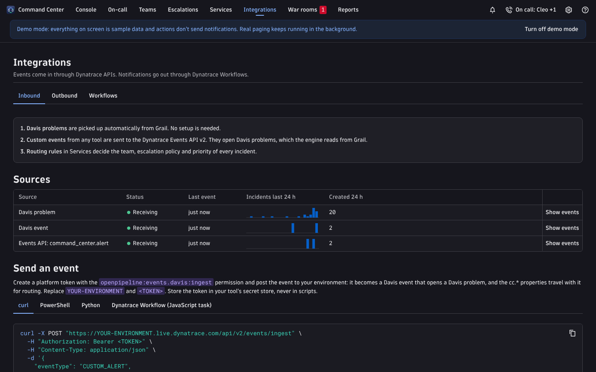 | Cada origem com o seu status (*Receiving*, *Quiet > 1 h*, *Turned off*, *Never seen*), último evento, incidentes em 24 h e **Show events**. Snippets prontos para copiar (curl, PowerShell, Python, Dynatrace Workflow) e os campos que o app lê. |
| Outbound  | Os oito provedores: *Not configured*, *Configured* ou *Last delivery failed*, contagens de enviados/falhos, **Configure** (ID da entrada do vault, habilitado, parâmetros) e **Send test**. |
| Workflows 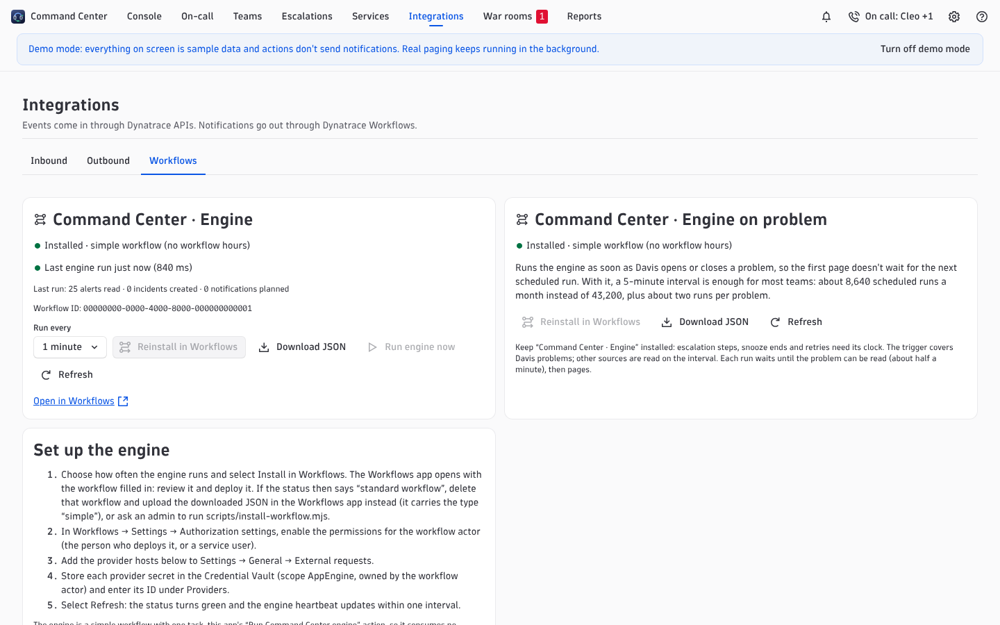 | Status do motor (*Not installed*, *Installed · simple workflow*, *Update available*, *Installed as a standard workflow…*), a última execução do motor, **Run every**, **Install in Workflows**, **Download JSON**, **Run engine now**, **Refresh**, os passos de configuração e os hosts a liberar. |

Detalhes: [integrações](integrations.md) e [primeiros passos](getting-started.md).

## Reports (relatórios)

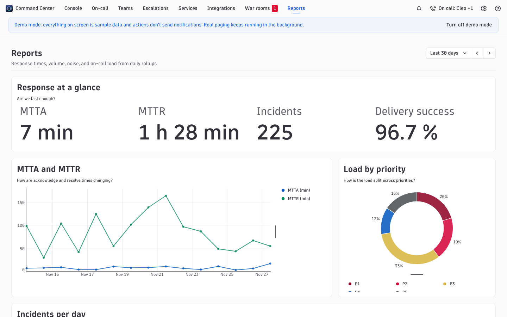

Construídos a partir de consolidações diárias (mantidas por 90 dias). O intervalo de tempo padrão é os últimos 30 dias.

| Painel | Pergunta que responde |
| --- | --- |
| Response at a glance | MTTA, MTTR, incidentes, sucesso de entrega |
| MTTA and MTTR | *How are acknowledge and resolve times changing?* (como os tempos de reconhecimento e de resolução estão mudando?) |
| Load by priority | *How is the load split across priorities?* (como a carga se divide entre as prioridades?) |
| Incidents per day | *When do incidents arrive, and how urgent are they?* (quando os incidentes chegam, e quão urgentes eles são?) |
| Incidents by team | *Which teams get the most incidents?* (quais equipes recebem mais incidentes?) |
| Noisiest services and sources | *Where do incidents come from?* (de onde vêm os incidentes?) (top 10) |
| Time to acknowledge | Distribuição em minutos (0, 1, 2, 5, 10, 15, 30, 60, 120, 240+) |
| Notification delivery | Proporção de notificações que os provedores aceitaram |
| On-call load | Por pessoa: horas de plantão, acionamentos, acionamentos fora do horário, acionamentos noturnos (00–06), reconhecimentos, tempo médio para reconhecer |

*Fora do horário (off-hours)* significa antes das 08:00, a partir das 18:00, ou em fim de semana; *noturno (night)*
significa antes das 06:00. Ambos usam o fuso horário do seu navegador.

## Help (ajuda)

**Get started** se marca sozinho a partir dos seus dados: criar uma equipe, uma escala, uma política de
escalonamento, configurar um provedor, instalar o workflow do motor (existe um heartbeat) e enviar um evento de teste
(existe um incidente). Depois vêm conceitos, fluxo de trabalho no Console, envio de eventos, notificações, atalhos de
teclado, solução de problemas e privacidade.
