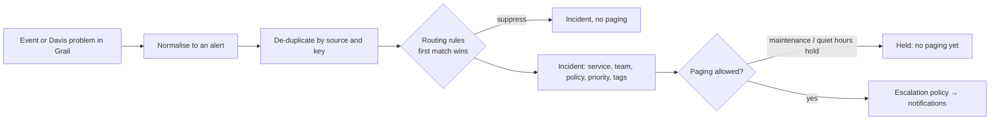

# Referencia de alertas — cómo enviar eventos a Command Center

Command Center **no tiene un endpoint de entrada propio**. Todo llega a través de Dynatrace: problemas de Davis, eventos
de Davis y eventos genéricos almacenados en Grail. El motor los lee con DQL en cada ejecución y los convierte en
**incidentes**. Esta página explica las tres vías, los formatos JSON, cada campo que lee la app y las propiedades
`cc.*` que funcionan como marcadores para el enrutamiento.

## Las tres vías de entrada

| Vía | Ajuste (Settings → Event sources) | Predeterminado | Tabla de Grail | Cómo se resuelve un incidente |
| --- | --- | --- | --- | --- |
| **1. Problemas de Davis** | *Davis problems* | **activado** | `dt.davis.problems` | Cuando Davis cierra el problema, o un operador lo resuelve |
| **2. Eventos de Davis que no abren un problema** | *Davis events that don't open a problem (Events API v2)* | desactivado | `dt.davis.events` | Cuando el evento se cierra (timeout) o llega un nuevo evento con `cc.action: "resolve"` y el mismo `cc.dedup_key` |
| **3. Eventos genéricos** | *Generic events (OpenPipeline)* | desactivado | `events` | Un evento con `cc.action: "resolve"` y el mismo `cc.dedup_key` |

Cualquier herramienta de monitoreo, script o job de CI usa la **vía 1** de forma predeterminada: envía un evento de
Davis, Davis abre un problema y el problema se convierte en el incidente. Las vías 2 y 3 son para herramientas que
quieren controlar por sí mismas la deduplicación y la resolución.

Un incidente **nunca** se resuelve porque su alerta haya desaparecido de una consulta. Una consulta fallida o vacía no
significa "todo en orden": solo un registro CLOSED explícito, `cc.action: "resolve"` o un operador resuelven un
incidente.

## Vía 1 — Evento de Davis → problema de Davis (recomendada)

**Endpoint** (documentado en *OpenPipeline → API ingestion reference*, verificado en un tenant trial: HTTP 201 y Davis
abrió un problema):

```
POST https://YOUR-ENVIRONMENT.live.dynatrace.com/api/v2/events/ingest
Authorization: Bearer <PLATFORM-TOKEN>
Content-Type: application/json
```

- Token: un **platform token** con el scope `openpipeline:events.davis:ingest`. La misma página documenta la
  alternativa clásica (un access token con `events.ingest`, header `Authorization: Api-Token …`).
- La documentación de Dynatrace clasifica este endpoint bajo el encabezado *Classic environment API*, aunque acepta un
  platform token y OpenPipeline procesa los eventos. Es la única API documentada que crea eventos de Davis, y por eso
  Command Center la usa.
- Dentro de un workflow de Dynatrace, una tarea de JavaScript puede llamar a la ruta relativa
  `/platform/classic/environment-api/v2/events/ingest`. Se autentica como el actor del workflow. El simulador de
  alertas, solo para entornos trial, en `workflow-templates/` hace esto.

**Cuerpo**

```json
{
  "eventType": "CUSTOM_ALERT",
  "title": "Checkout latency above 2 s",
  "entitySelector": "type(SERVICE),entityName.equals(checkout)",
  "timeout": 30,
  "properties": {
    "cc.priority": "P2",
    "cc.service": "checkout",
    "cc.tags": "team:payments,env:prod",
    "runbook": "https://wiki.example.com/checkout"
  }
}
```

| Campo | Obligatorio | Significado |
| --- | --- | --- |
| `eventType` | sí | `CUSTOM_ALERT`, `ERROR_EVENT`, `AVAILABILITY_EVENT`, `PERFORMANCE_EVENT` o `RESOURCE_CONTENTION_EVENT` abren un problema de Davis. Otros tipos (por ejemplo `CUSTOM_INFO`) no lo abren: usa la vía 2 para esos. |
| `title` | sí | Se convierte en el título del incidente, como máximo 500 caracteres. |
| `entitySelector` | no | Vincula el evento a entidades. Se muestran en la pestaña **Entities** del incidente y las reglas de enrutamiento pueden evaluarlas (`entity.name`, `entity.type`, `entity.id`). |
| `timeout` | no | Minutos que el evento permanece abierto a menos que se envíe de nuevo. Cuando expira, Davis cierra el problema y el incidente se resuelve. Vuelve a enviar el mismo evento para mantenerlo abierto. |
| `properties` | no | Cadenas clave/valor libres. Quedan como campos en el evento de Davis. El motor copia las propiedades `cc.*` al problema (ver más abajo), excepto `cc.action` y `cc.dedup_key`. |

**Qué pasa después:** dentro de un intervalo del motor (1, 2 o 5 minutos, elegido al instalar), el motor lee el
problema (consulta Q1), busca las propiedades `cc.*` de sus eventos (consulta Q4) y crea el incidente. Si esa búsqueda
falla o supera su límite (500 IDs de eventos por ejecución), un problema con menos de 3 minutos de antigüedad se retiene
para una ejecución posterior, para que no se enrute sin sus propiedades.

## Vía 2 — Eventos de Davis que no abren un problema (opcional)

Activa **Settings → Event sources → Davis events that don't open a problem** y lista los tipos de evento que se deben
leer (predeterminado `CUSTOM_ALERT, ERROR_EVENT`). Usa el mismo endpoint y el mismo cuerpo que en la vía 1 y agrega:

| Propiedad | Significado |
| --- | --- |
| `cc.dedup_key` | Misma clave → mismo incidente. Sin ella, la clave es el `event.id` de Davis. |
| `cc.action` | `trigger` (predeterminado) o `resolve`. |

Los eventos de Davis que pertenecen a un problema se integran en el incidente de ese problema, para que la misma alerta
no se cuente dos veces. Los eventos que Davis marca como *frecuentes* (`dt.davis.is_frequent_event`) se descartan.

## Vía 3 — Eventos genéricos a través de OpenPipeline (opcional)

Activa **Settings → Event sources → Generic events (OpenPipeline)**. El tipo de evento predeterminado es
`command_center.alert`.

**Endpoint** (documentado en *OpenPipeline → Ingest API → Generic events*, verificado en un tenant trial: HTTP 202 y
el evento se almacenó en la tabla `events` con sus campos `cc.*`):

```
POST https://YOUR-ENVIRONMENT.live.dynatrace.com/platform/ingest/v1/events
Authorization: Bearer <PLATFORM-TOKEN>
Content-Type: application/json
```

Token: un platform token con el scope `openpipeline:events:ingest`.

**Disparar**

```json
{
  "event.type": "command_center.alert",
  "event.name": "Disk almost full on db-01",
  "event.description": "Free space 3% on /var/lib/postgresql",
  "cc.dedup_key": "disk-db-01",
  "cc.action": "trigger",
  "cc.priority": "P2",
  "cc.service": "database",
  "cc.tags": "env:prod,tier:data"
}
```

**Resolver** (misma clave):

```json
{
  "event.type": "command_center.alert",
  "event.name": "Disk almost full on db-01",
  "cc.dedup_key": "disk-db-01",
  "cc.action": "resolve"
}
```

El motor lee las últimas 24 horas de estos eventos (consulta Q3), los agrupa por `cc.dedup_key` y conserva la última
acción, título, descripción, prioridad, servicio y tags. En esta vía solo se leen esos campos. Las demás propiedades,
entidades, categoría y severidad no se leen, así que las reglas de enrutamiento solo pueden evaluar `title`,
`description`, `tag`, `source` y los campos `cc.*` listados arriba. Un trigger después de un resolve reabre el
incidente.

## Las propiedades `cc.*` (marcadores)

Las tres vías entienden el mismo vocabulario reducido. Son cadenas simples en las `properties` del evento (vías 1 y 2)
o campos de nivel superior (vía 3).

| Propiedad | Valores | Efecto | Vías |
| --- | --- | --- | --- |
| `cc.service` | **ID o nombre** del servicio tal como está definido en **Services** | Elige el servicio y, a través de él, el equipo, la política de escalamiento y la prioridad predeterminada | 1, 2, 3 |
| `cc.priority` | `P1` … `P5` | Prioridad del incidente. Una regla de enrutamiento que define una prioridad tiene precedencia. | 1, 2, 3 |
| `cc.tags` | Separados por comas, por ejemplo `team:payments,env:prod` | Tags del incidente, evaluables por las reglas de enrutamiento con el campo `tag` | 1, 2, 3 |
| `cc.dedup_key` | Cualquier cadena que elijas | Misma clave → mismo incidente | 2, 3 (se ignora en problemas) |
| `cc.action` | `trigger` (predeterminado) o `resolve` | Abre, reabre o resuelve el incidente con esa clave | 2, 3 (se ignora en problemas) |
| `cc.category`, `cc.severity` | Nombre de categoría; `1`–`5` | Se usan para la prioridad predeterminada cuando la fuente no tiene categoría ni severidad de Davis | 1, 2 |
| cualquier otra `cc.<name>` o propiedad | Cadena | Evaluable en las reglas de enrutamiento como `fields.<name>`, por ejemplo `fields.cc.region` | 1, 2 |

En la vía 1 el motor copia `cc.*` de los eventos del problema al problema. Cuando varios eventos tienen la misma
propiedad, gana el primero que se encuentra. `cc.action` y `cc.dedup_key` nunca se copian, porque cambiarían la
identidad o el estado del problema.

## Cómo una alerta se convierte en incidente



**Campos normalizados** (lo que pueden evaluar las reglas de enrutamiento):

| Campo de regla | Proviene de |
| --- | --- |
| `title` | `event.name` (título del problema/evento de Davis, `event.name` genérico) |
| `description` | `event.description` |
| `category` | `event.category` o `cc.category`. Valores conocidos: `AVAILABILITY`, `ERROR`, `SLOWDOWN`, `RESOURCE_CONTENTION`, `CUSTOM_ALERT`, `MONITORING_UNAVAILABLE`, `INFO`. Cualquier otro valor se convierte en `OTHER`. |
| `severity` | `event.severity` o `cc.severity`, 1 (más severo) … 5 |
| `source` | `davis-problem`, `davis-event` o `generic-event` |
| `sourceStatus` | `ACTIVE` o `CLOSED` |
| `displayId` | Display ID de Davis, por ejemplo `P-26112613` |
| `entity.name`, `entity.type`, `entity.id` | Entidades afectadas. Varios valores: la condición coincide cuando coincide cualquiera de ellos. |
| `tag` | Tags de las entidades más `cc.tags` |
| `rootCause.name`, `rootCause.id` | Entidad de causa raíz de Davis |
| `fields.<name>` | Cualquier otro campo de nivel superior del registro como cadena, por ejemplo `fields.cc.region` o `fields.event.provider` |

**Operadores:** `equals`, `contains`, `in` (lista separada por comas) no distinguen mayúsculas de minúsculas. `regex`
no distingue mayúsculas de minúsculas, admite como máximo 500 caracteres, y se rechazan los patrones que podrían
colgarse. `exists` significa que el campo tiene un valor. `lte` y `gte` comparan números. Cada condición se puede
negar, y una regla coincide con **todas** (all) o **cualquiera** (any) de sus condiciones.

**Decisión de enrutamiento**

| Decisión | Orden (gana el primero que aplica) |
| --- | --- |
| Servicio | regla *then service* → `cc.service` |
| Equipo | regla *then team* → equipo del servicio → *Settings → Routing defaults → Default team* |
| Política de escalamiento | regla *then policy* → política del servicio → política predeterminada del equipo → *Default escalation policy* |
| Prioridad | regla *then priority* → `cc.priority` → prioridad predeterminada del servicio → prioridad por **severidad** → prioridad por **categoría** → *Fallback priority* (P3) |
| Tags | tags de la alerta + *add tags* de la regla |
| Supresión | una regla con *suppress*: el incidente se crea y se muestra, pero no se avisa a nadie |

Mapeo de prioridad predeterminado (**Services → Priority mapping**): severidad 1–5 → P1–P5. Por categoría:
`AVAILABILITY` P1, `ERROR` P2, `MONITORING_UNAVAILABLE` P2, `SLOWDOWN` P3, `RESOURCE_CONTENTION` P3, `CUSTOM_ALERT` P3,
`INFO` P5, `OTHER` P4.

**Condiciones para avisar**

- **Ventanas de mantenimiento:** no se avisa por un problema de Davis en mantenimiento a menos que *Page during
  maintenance windows* esté activado (Settings → Event sources).
- **Horas de silencio** (Teams → equipo → Quiet hours): los incidentes menos urgentes que la prioridad elegida se
  **retienen** (sin avisos hasta que termina la ventana) o se avisan con **baja urgencia** (solo Slack, Teams,
  Telegram, IFTTT y webhook, nunca SMS, voz o WhatsApp).
- **Silenciar (mute)** un problema de Davis no detiene los avisos en Command Center. Para eso usa una regla de
  enrutamiento con *suppress*.

## Identidad y límites del incidente

- ID del incidente: `dp-…` (problema de Davis), `de-…` (evento de Davis) o `ge-…` (evento genérico), derivado de la
  clave de la fuente. La misma clave siempre corresponde al mismo incidente.
- Título de hasta 500 caracteres, descripción de hasta 4,000. Se conservan como máximo 120 campos adicionales de hasta
  500 caracteres por alerta. Los tags están limitados a 100 por alerta.
- Los problemas más antiguos que la ventana de look-back de problemas (predeterminado 72 horas, Settings → Event
  sources) ya no se leen. Un incidente que todavía esté abierto en ese momento permanece abierto hasta que un operador
  lo resuelva.

## Probar un evento de punta a punta

1. Envía el ejemplo de la vía 1 con `cc.service` configurado con uno de tus servicios.
2. Espera un intervalo del motor. Luego revisa **Integrations → Inbound**: la fuente muestra *Receiving*.
3. Abre la **Console**: el incidente aparece con la prioridad, el servicio y el equipo elegidos por el enrutamiento.
4. **Services → Test a rule** muestra qué regla coincidió con las alertas recientes y por qué.

Si no aparece nada, consulta *Resolución de problemas* en la [guía de operaciones](operations.md).
