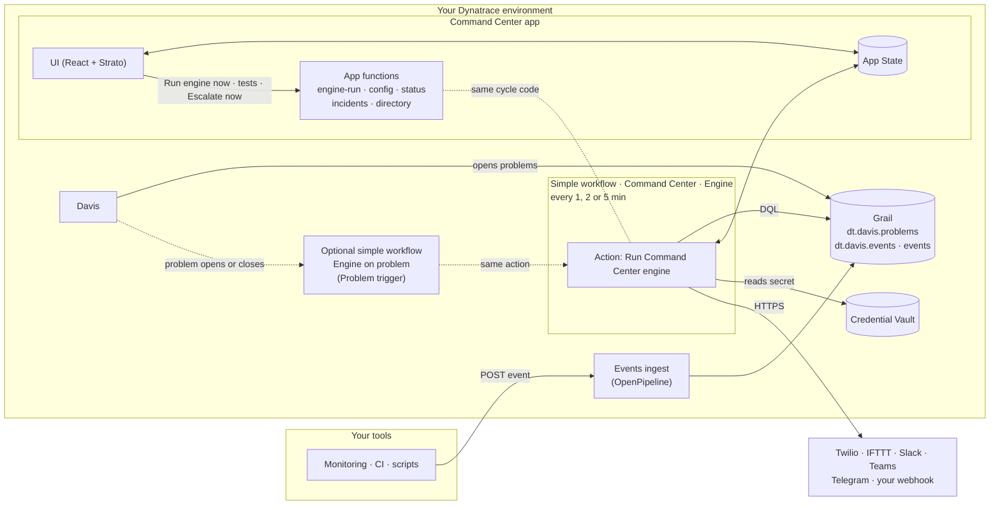

# Operaciones — arquitectura, costo, resolución de problemas y límites

## Arquitectura



**Un ciclo del motor** (la acción, o `engine-run` bajo demanda):

1. Tomar el lease del motor (`lock.engine`) para que dos ejecuciones nunca avisen dos veces. Si otra ejecución lo
   tiene, esta ejecución se omite (se cuenta como `skippedLocked` en el heartbeat).
2. Ejecutar las consultas DQL de las fuentes habilitadas (Q1–Q4), normalizar los registros en alertas, deduplicarlas y
   enrutarlas. Un problema nuevo cuyos eventos de Davis todavía no se pueden leer se retiene hasta 90 segundos (ver
   [Comportamiento que debes conocer](#comportamiento-que-debes-conocer)).
3. Crear o actualizar incidentes, aplicar en orden las acciones de los operadores, terminar las posposiciones que
   vencen, evaluar las políticas de escalamiento contra los calendarios, planificar las notificaciones y los reintentos
   (fallidas o sin resultado) en el registro de notificaciones (ledger), archivar los incidentes resueltos antiguos y
   actualizar el resumen diario. Escribir el heartbeat (`hb.engine`) y liberar el lease.
4. Leer cada secreto de proveedor necesario desde el Credential Vault y enviar (o ejecutar tu custom workflow).
   Escribir `sent` o `failed` en el registro de notificaciones.

Toda la lógica de enrutamiento, calendarios, escalamiento y planificación es TypeScript simple en `ui/app/domain/`. La
UI usa el mismo código, así que lo que muestra la Console justo después de una acción coincide con lo que hará el
motor.

## Por qué un único simple workflow

- Versión 2 antes de este cambio: un **standard** workflow `tick` → 8 emisores → `report`
  - *Horas de workflow*: 1 por hora de vida del workflow, haga algo o no
  - *Invocaciones de función*: Medido: cerca de 690 por hora (≈ 11.5 por minuto)
  - *Veredicto*: Reemplazado
- **Un simple workflow, una acción, trigger de intervalo** (actual)
  - *Horas de workflow*: **ninguna**
  - *Invocaciones de función*: Medido: **1 por ejecución** (60 por hora con 1 minuto)
  - *Veredicto*: El motor también envía, así que una notificación no agrega ninguna invocación.
- Un segundo simple workflow con **Problem trigger** y la misma acción (opcional)
  - *Horas de workflow*: ninguna
  - *Invocaciones de función*: Medido: **1 por disparo**, cerca de 2 por problema (se abre, se cierra)
  - *Veredicto*: Opcional. El primer aviso no espera al intervalo, así que un intervalo más largo se vuelve práctico. Ver [Ejecución en cada problema](#ejecución-en-cada-problema).
- Un **simple** workflow por integración, ejecutado por el motor por cada notificación (opcional, por integración)
  - *Horas de workflow*: ninguna
  - *Invocaciones de función*: Medido: **1 por notificación** de esa integración (la tarea del workflow), incluidos los envíos que fallan
  - *Veredicto*: Opcional desde la 2.3.0 (era lo predeterminado en la 2.1 y la 2.2). Cada entrega es una ejecución de workflow que puedes ver. El motor recurre a un envío directo cuando ese workflow no se puede ejecutar.

Fuentes: *Create a simple workflow* ("without consuming workflow hours") y *Workflows concepts* (los simple workflows
"do not generate any consumption of workflow hours") en la documentación de Dynatrace. Los simple workflows permiten
exactamente una tarea, y esa tarea no puede ser *Run JavaScript*, *Run workflow* ni una aprobación. Por eso el motor es
una acción personalizada de la app (`actions/run-engine.action.ts`) y no un script.

Medido en el entorno trial, a partir de los eventos de facturación en `dt.system.events` (`AppEngine Functions - Small`):

| Ventana de 10 minutos (UTC) | Motor anterior todavía instalado | Solo el motor nuevo |
| --- | --- | --- |
| Invocaciones | 00:50 → 105, 01:00 → 120, 01:10 → 114 | 01:30 → 21, 01:40 → 11, 01:50 → 18 |
| de las cuales `ACTION` (el motor) | — | 10 por ventana = 1 por minuto |

Las invocaciones restantes en la columna nueva son un generador de alertas de prueba que ejecutamos en el entorno trial
(un standard workflow que ejecuta JavaScript, que no forma parte de la app) y nuestras propias llamadas de prueba a las funciones de la app.

Horas de workflow, a partir de los eventos de facturación `Automation Workflow`: en la hora 01:00–02:00 UTC solo se
facturó ese generador de alertas de prueba (un standard workflow). El motor basado en simple workflow, que se ejecutó cada minuto
en esa hora, no generó ningún evento de facturación de workflow.

### Por qué los workflows de integración se inician bajo demanda

El workflow del motor tiene un disparador de intervalo. Los workflows de integración y el custom workflow tienen el
disparador **On demand**: el motor los inicia por la API de Workflows y pasa la notificación como parámetros de la
ejecución. La documentación de Dynatrace describe *On demand* como el disparador para un workflow que "should run
exclusively via API" (debe ejecutarse exclusivamente por API).

Un **disparador de evento** (*Problem*, *Davis event* o *Event*) solo se activa cuando se ingiere un evento que
coincide. Un aviso es una decisión del motor (quién está de guardia, qué paso del escalamiento, todavía sin
reconocer), no un evento que Dynatrace produce. Con un disparador de evento, el motor tendría que ingerir primero un
evento por notificación, con el destinatario y el texto.

El disparador no cambia el costo. Cada ejecución corre su tarea como una llamada de función, sea cual sea el
disparador. La documentación de licenciamiento de Dynatrace da el ejemplo de un simple workflow que notifica en cada
problema nuevo: ninguna hora de workflow, una llamada de función por notificación. Medido en el entorno trial: la
acción *Send Command Center notification* de la app y la acción *HTTP request* de la propia Dynatrace (el ejemplo del
custom workflow) se facturaron con una invocación por ejecución cada una, incluidos los envíos que fallaron. La
llamada de API que inicia una ejecución no generó un evento de facturación propio.

Por eso el motor envía una integración directamente, a menos que le des un workflow propio (**Configure →
Delivery**): el envío ocurre dentro de la ejecución que el motor ya está haciendo, sin invocación adicional. El
workflow propio agrega una invocación por notificación. A cambio, cada entrega es una ejecución que puedes ver en la
app Workflows, y los envíos no comparten el límite de tiempo de la ejecución del motor (100 segundos; lo que no se
envía a tiempo espera a una ejecución posterior).

### Ejecución en cada problema

El workflow opcional **Command Center · Engine on problem** es donde sí encaja un disparador de evento: un problema
de Davis que se abre o se cierra es un evento que Dynatrace produce por sí misma. Es un simple workflow con un
**Problem trigger** (el problema se abre o se cierra; todas las categorías) y una tarea, la misma acción del motor.
El disparador le pasa a la acción el ID y el estado del problema.

Medido en el entorno trial con problemas de prueba (2026-11-27):

| Qué | Medido |
| --- | --- |
| El disparador se activa después del evento del problema | 1–4 s para un cierre o una actualización vista por primera vez, 11–12 s para un problema nuevo |
| El registro del problema se puede consultar en Grail | Unos 30–40 s después de su timestamp. Ejecuciones 24 s y 29 s después todavía no encontraron el registro. |
| Incidente creado por la ejecución iniciada por el problema | 34 s, 40 s y 34 s después del timestamp del problema, en tres pruebas. Contando desde el envío del evento de prueba: 49 s, 65 s y 54 s, porque Davis abrió el problema 15–25 s después del evento. |
| Comparado solo con las ejecuciones programadas | La ganancia va de nada a un intervalo: sin el disparador, un incidente espera a la primera ejecución programada después de que el problema se puede leer. En estas pruebas, cronometradas para que una ejecución programada (intervalo de 1 minuto) cayera justo antes de ese momento, fue de 50 s, 34 s y 45 s. |
| Incidente resuelto después de que el problema se cerró | Dentro de los 30 s del evento de cierre (tres cierres) |
| Enrutamiento | El incidente recibió el equipo de su servicio a partir de `cc.service`: el evento de Davis del problema ya se podía leer |
| Facturación | Una invocación `ACTION` por disparo (ejecuciones de 23–30 s). El disparador se activó una vez cuando el problema se abrió y una vez cuando se cerró, y no en la actualización intermedia. |

Como el disparador se activa antes de que el registro se pueda consultar, la ejecución **espera**. Cada 5 segundos
revisa el incidente en App State y una consulta pequeña (el estado más reciente del problema), durante un máximo de
40 segundos. En cuanto el problema se puede leer, ejecuta un ciclo normal, y como máximo uno más si el incidente
todavía no existe. Si otra ejecución fue más rápida, termina sin ciclo. Si el problema no se puede leer a tiempo,
también termina, y la ejecución programada toma el problema como antes. La espera queda dentro de la misma invocación, y una llamada de función de hasta 60 segundos es una invocación
facturada.

Qué te da: el incidente deja de esperar a la siguiente ejecución programada. Se crea cerca de medio minuto después
de que el problema se abre, sea cual sea el intervalo, y sus primeras notificaciones se planifican y se envían en ese
mismo ciclo. Eso vuelve práctico un intervalo de 5 minutos: unas 8,640 ejecuciones programadas al mes en lugar de 43,200, más
unas dos ejecuciones por problema. No reemplaza al workflow del motor. Los pasos de escalamiento, el fin de las
posposiciones, los reintentos y las otras fuentes (eventos de Davis, eventos genéricos) se atienden en el intervalo.

Límites:

- Dynatrace limita cada workflow a 1,000 ejecuciones iniciadas por evento por hora y aplica throttling más allá de
  eso; la ejecución programada cubre la diferencia.
- Un disparador nuevo necesita tiempo para quedar activo. En el entorno trial, un problema creado 52 segundos después
  del workflow no lo inició; los eventos a partir de dos minutos y medio, sí.
- Después de la instalación, el disparador también se activa una vez por cada problema que ya está abierto, en su
  siguiente actualización. Esas ejecuciones terminan de inmediato, porque el incidente ya existe.
- Solo se ejercitó la creación de este workflow por API. **Install in Workflows** y la carga de su JSON no se
  recorrieron haciendo clic.

## Costo y consumo

> Lee esto antes de ejecutar la app en producción. El motor se ejecuta todo el día, independientemente de cuántas
> personas usen la app.

| Elemento | Por mes con 1 min | con 2 min | con 5 min |
| --- | --- | --- | --- |
| Ejecuciones del motor = invocaciones de función (`ACTION`) | ≈ 43,200 | ≈ 21,600 | ≈ 8,640 |
| Horas de workflow | 0 | 0 | 0 |
| Consultas a Grail | 1–8 por ejecución (más abajo) | igual | igual |
| Ejecuciones de *Engine on problem* (opcional) = invocaciones de función (`ACTION`) | cerca de 2 por problema: se abre, se cierra | igual | igual |
| Ejecuciones de workflows de integración (opcional) = invocaciones de función (`ACTION`) | una por notificación de una integración que tiene workflow propio, incluidos los envíos que fallan y los reintentos; ninguna de forma predeterminada | igual | igual |

Una invocación es una llamada de función de hasta 60 segundos; una llamada que dura de 61 a 120 segundos cuenta como
dos (documentación de licenciamiento de Dynatrace). Las ejecuciones del motor medidas en el entorno trial duraron de
3 a 10 segundos.

**Consultas a Grail por ejecución**: Q1 problemas (cuando la fuente Davis problems está activada, el valor
predeterminado), Q4 propiedades de eventos de los problemas que devolvió Q1 (una
por cada 100 IDs de eventos, como máximo 5), Q2 eventos de Davis y Q3 eventos genéricos (solo cuando están activados).
La UI **no** ejecuta DQL: las pestañas abiertas solo leen App State.

| Factor | Efecto |
| --- | --- |
| Intervalo de ejecución | Lineal en ejecuciones. Un intervalo más largo también significa un tiempo de escalamiento menos preciso. |
| Fuentes habilitadas | Q2 y Q3 agregan una consulta cada una por ejecución |
| Look-back de problemas (72 h) | Una ventana más amplia escanea más datos |
| Volumen de datos | Más problemas y eventos, más bytes escaneados |
| Pestañas abiertas del navegador | Sin costo de Grail. Cada pestaña lee App State cada minuto de forma predeterminada. |

**Límite de escaneo (protección de costo).** Cada consulta del motor lleva un límite de escaneo, *Grail scan limit per
query* en Settings → Event sources (predeterminado 1 GB, de 1 a 100 GB enteros; Grail no acepta un valor menor). En el
entorno trial, una consulta del motor escaneó como máximo 1,4 MB y una ejecución completa unos 2 MB, así que 1 GB nunca
recorta una ejecución normal; limita lo que puede costar una ejecución si los datos crecen de forma inesperada. El
límite es por consulta: el peor caso de una ejecución es su número de consultas (1 a 8) por el límite. Una consulta que
lo alcanza cuenta como recortada: su fuente queda incompleta en esa ejecución (no se archiva nada de ella) y el último
error del motor lo indica. Settings → Event sources muestra lo que escaneó la última ejecución y la estimación diaria
con el intervalo actual.

Cómo medir en tu entorno:

- Eventos de facturación: `fetch dt.system.events | filter event.kind == "BILLING_USAGE_EVENT"`, agrupados por
  `event.type` y, para las funciones, por `function.type`.
- **Account Management → Cost & usage** para las consultas a Grail, las funciones de AppEngine y los workflows después
  de un día de ejecución.
- La documentación de Dynatrace señala que los simple workflows, aunque no consumen horas de workflow, todavía pueden
  disparar otras capacidades facturables: aquí, las invocaciones de función y las consultas a Grail.

Cómo reducir el costo: mantén Q2 y Q3 desactivadas a menos que envíes eventos que no abren problemas; reduce el
look-back; elige un intervalo de 2 o 5 minutos si las demoras de tus escalamientos son largas, e instala *Engine on problem*
para que el primer aviso no lo espere. Deja las integraciones en **By the engine** (lo predeterminado): un workflow
propio cuesta una invocación por notificación.

**Las consultas** (`ui/app/data/dql.ts`, todas ejecutadas en el entorno trial):

```
// Q1 — Davis problems
fetch dt.davis.problems, from: now() - 72h
| filter not(dt.davis.is_duplicate)
| dedup event.id, sort: { timestamp desc }
| filter event.status == "ACTIVE" or event.end >= now() - 2h
| fields timestamp, event.id, display_id, event.name, event.description, event.category, event.severity,
         event.status, event.start, event.end, dt.davis.last_reopen_timestamp, dt.davis.event_ids,
         dt.davis.affected_users_count, dt.davis.mute.status, maintenance.is_under_maintenance,
         smartscape.affected_entities, root_cause.smartscape_entity, affected_entity_ids,
         affected_entity_names, root_cause_entity_name, entity_tags
| sort event.start desc
| limit 1000

// Q2 — Davis events (optional)
fetch dt.davis.events, from: now() - 24h
| filter in(event.type, array("CUSTOM_ALERT", "ERROR_EVENT"))
| dedup event.id, sort: { timestamp desc }
| filter event.status == "ACTIVE" or event.end >= now() - 2h
| fieldsKeep timestamp, event.id, event.name, event.description, event.type, event.category, event.severity,
             event.status, event.start, event.end, event.provider, dt.davis.is_frequent_event,
             maintenance.is_under_maintenance, dt.source_entity, entity_tags, "cc.*"
| limit 1000

// Q3 — generic events (optional)
fetch events, from: now() - 24h
| filter event.type == "command_center.alert"
| filter isNotNull(cc.dedup_key)
| sort timestamp asc
| summarize { last_action = takeLast(cc.action), title = takeLast(event.name),
              description = takeLast(event.description), priority = takeLast(cc.priority),
              service = takeLast(cc.service), tags = takeLast(cc.tags),
              first_seen = min(timestamp), last_seen = max(timestamp) },
            by: { cc.dedup_key }
| limit 1000

// Q4 — cc.* properties of the events behind active problems (up to 100 IDs per query)
fetch dt.davis.events, from: now() - 72h
| filter in(event.id, array("<event id>", "…"))
| dedup event.id, sort: { timestamp desc }
| fieldsKeep event.id, event.type, event.provider, "cc.*"
| limit 1000

// Q5 — one problem's newest status (only the run started by the Problem trigger: one per 5-second check)
fetch dt.davis.problems, from: now() - 2h
| filter event.id == "<problem id>"
| filter not(dt.davis.is_duplicate)
| sort timestamp desc
| limit 1
| fields event.id, event.status, dt.davis.event_ids
```

## Salud y monitoreo

- **Banner de la Console**: el motor está *atrasado* (late) después de dos intervalos más un minuto sin una ejecución
  (3 minutos con el intervalo predeterminado), o cuando la última ejecución reportó un error. La **campana** avisa solo
  cuando el motor está atrasado.
- **Integrations → Workflows**: última ejecución, su duración y conteos, el último error y el estado de instalación.
- **Monitoreo externo**: llama a la función de la app `status`. Devuelve el heartbeat, el lease y los conteos de
  abiertos/triggered (consulta [configuración](configuration.md#funciones-de-la-app-automatización-y-scripts)).
- Los simple workflows conservan solo metadatos de ejecución: los resultados y los logs de las tareas no se almacenan.
  Por lo tanto, los diagnósticos del motor están en el heartbeat, no en el log de ejecución de Workflows.

## Comportamiento que debes conocer

- **Nunca se resuelve por ausencia.** Una consulta fallida o vacía nunca resuelve nada. Solo un registro CLOSED,
  `cc.action: "resolve"` o un operador resuelven un incidente.
- **Un resultado incompleto no prueba ausencia.** Cuando Grail recorta el resultado de una consulta (límite de
  registros, límite de escaneo, muestreo), el motor sigue usando los registros recibidos, pero trata esa fuente como
  incompleta en la ejecución: ningún incidente resuelto de esa fuente se archiva, y el último error del heartbeat
  indica la consulta y el aviso de Grail, por ejemplo `Q1 problems: result truncated (…)`.
- **Una ejecución que se cae bloquea pocas ejecuciones.** El lease del motor dura de 130 a 180 segundos, más de lo
  que puede tardar una ejecución (120 s). Si una ejecución muere sin liberarlo, las siguientes ejecuciones programadas
  se omiten hasta que expire: como máximo 2 con un intervalo de 1 minuto, 1 con 2 minutos, ninguna con 5 minutos. Una
  ejecución de *Run engine now* o *Engine on problem* que muere justo antes de una ejecución programada puede costar
  una más.
- **Avisos al menos una vez.** El registro de notificaciones evita duplicados en la operación normal. En carreras poco
  frecuentes (una ejecución que se superpone con una ejecución anterior lenta, un resultado que llega después del
  timeout) una persona puede ser notificada dos veces.
- **Precisión de tiempo = intervalo.** Un paso se dispara en la primera ejecución después de su vencimiento. Lo mismo
  aplica al fin de las posposiciones.
- **Un problema nuevo espera a sus eventos.** El registro de un problema puede volverse consultable antes que los
  eventos de Davis a los que se vincula. El enrutamiento ocurre una sola vez, cuando se crea el incidente, y las
  propiedades `cc.*` están en esos eventos. Por eso un problema cuyos eventos todavía no se pueden leer se retiene
  hasta 90 segundos, y luego sigue tal como está.
- **Un aviso nunca es más rápido que Grail.** En el entorno trial, un problema se podía consultar unos 30–40 segundos
  después de abrirse. Ningún disparador o intervalo avisa antes de eso.
- **La configuración es de tipo última-escritura-gana.** Dos personas que guardan el mismo equipo en el mismo momento:
  gana el guardado posterior.
- **Los roles son orientativos.** Cualquier usuario de la app puede cambiar la configuración. IAM decide quién puede
  abrir la app.
- **El modo demo es por navegador** y nunca mezcla datos de ejemplo con datos reales (consulta [configuración](configuration.md#general)).

## Seguridad y privacidad

- **Sin secretos en la app.** Las credenciales de los proveedores permanecen en el Credential Vault. App State guarda
  solo los IDs de las entradas. Los textos de error enmascaran secretos y URLs.
- **Los datos de contacto son visibles para todos los usuarios de la app.** App State no tiene permisos por clave.
  Avísales a las personas antes de que ingresen números personales. Los correos electrónicos no se almacenan; se leen
  en vivo desde IAM.
- **El workflow del motor no necesita ser privado.** No expone datos personales: sus ejecuciones conservan solo
  metadatos y la acción devuelve solo conteos, así que no aparecen números de teléfono ni textos de mensajes en
  Workflows. Un custom workflow recibe la notificación completa (incluida la dirección) como parámetros de ejecución:
  decide tú quién puede verla.
- **El tráfico de salida** está limitado por la lista de hosts permitidos de External requests: permite solo los hosts
  de los proveedores que uses.
- **Tokens de entrada**: dale a tus herramientas un platform token con solo `openpipeline:events.davis:ingest` (o
  `openpipeline:events:ingest`), guárdalo en su almacén de secretos y rótalo.
- **Los textos de los mensajes** contienen el título y la descripción de la alerta, que se envían a terceros.
- **La identidad de auditoría** proviene de la información de modificación de App State, no de lo que afirma el
  navegador.

## Resolución de problemas

| Síntoma | Causa y solución |
| --- | --- |
| *The paging engine hasn't run yet / is late* | El workflow no está instalado, no está desplegado o está fallando. Revisa Integrations → Workflows. Lo más frecuente es que a las **Authorization settings** de Workflows les falte un permiso para el actor. |
| Pestaña Workflows: *Installed as a standard workflow* | El intent create-workflow no tiene campo de tipo. Elimina ese workflow y sube el JSON descargado, o ejecuta `scripts/install-workflow.mjs`. |
| Pestaña Workflows: *Update available* | La app se actualizó. Reinstala y luego elimina el workflow anterior. |
| No aparecen incidentes | Settings → Event sources; verifica que el evento llegó a Grail (`fetch dt.davis.events` en un Notebook) y que su tipo abre un problema. Si no, activa la fuente de eventos de Davis. |
| Un incidente queda sin equipo y no se avisa a nadie | Ninguna regla de enrutamiento coincidió y no hay equipo predeterminado. Los problemas que Davis detecta por sí solo no traen equipo (solo los eventos que tú envías pueden nombrar un servicio en `cc.service`). Abre el equipo y selecciona *Receive all unrouted alerts* en su lista de verificación **Ready to page?** (o defínelo en Settings → Routing defaults), o agrega una regla de enrutamiento. La lista también muestra qué más le falta al equipo. |
| *Engine on problem* está instalado pero parece no ejecutarse | Los simple workflows no muestran lista de ejecuciones: revisa **Integrations → Workflows → Last engine run** justo después de que se abra un problema. Un disparador nuevo necesita unos minutos antes de activarse. Su actor necesita los mismos permisos que el del motor, y el disparador tiene que estar encendido. |
| El enrutamiento ignora `cc.service` | El nombre o el ID no coincide con un servicio, o una regla anterior definió otro servicio. Usa Services → Test a rule. |
| *Host not allowed: &lt;host&gt;* en una notificación o en la tarjeta de un proveedor | Dynatrace rechazó la llamada porque el host no está en la lista de hosts permitidos. Agrega el host en Settings → General → Environment management → External requests (Integrations → Configure muestra cuál), luego **Send test**. La app no puede cambiar esa lista por sí misma. |
| Una notificación **falló** | Incidente → Notifications muestra el error del proveedor. Causas habituales: falta el host en External requests, una entrada del vault que el actor no puede leer, tipo de credencial incorrecto, teléfono que no está en E.164, API key de Twilio sin *Account SID*. |
| Una notificación muestra **No result** | La ejecución terminó antes de que la llamada respondiera. Se reintenta hasta *Delivery attempts*. |
| *Run engine now* dice *Engine is already running* | Una ejecución programada tiene el lease. Espera unos segundos y vuelve a intentarlo. |
| El selector de usuarios no encuentra a nadie | Escribe al menos 3 caracteres. Solo se devuelven usuarios **activos**; las personas invitadas deben iniciar sesión una vez. *User search is unavailable (IAM returned 403)*: tu usuario debe pertenecer a la cuenta propietaria del entorno y tener permiso para ver usuarios. |
| Despliegue rechazado por la versión | `app.version` debe ser mayor que la versión instalada. |
| Configuración perdida | Se borró App State o se desinstaló la app. Importa tu última exportación. |

## Verificado y no verificado

Verificado en un entorno trial (latest Dynatrace):

- Ingesta de eventos de Davis (endpoint en vivo, platform token) → problema de Davis → motor → enrutamiento por
  `cc.service` → calendario → pasos de escalamiento → **webhook genérico** entregado → registro de notificaciones
  actualizado. Una política de cuatro pasos disparó cada paso dentro del minuto siguiente a su vencimiento.
- Eventos genéricos a través de `/platform/ingest/v1/events`: trigger y resolve por `cc.dedup_key`.
- El motor como **simple workflow** con la acción personalizada de la app: todas las ejecuciones exitosas, lecturas de
  App State, Grail y Credential Vault, HTTPS de salida. Facturación: una invocación `ACTION` por ejecución.
- La integración **Custom workflow**: una prueba y un escalamiento programado ejecutaron un simple workflow con una
  tarea HTTP request, y la expresión `{{ execution().params | to_json }}` entregó el JSON completo de la notificación.
- Funciones de la app `engine-run`, `config` (export, import, dry run), `status` e `incidents`. Notebooks de war rooms
  creados a través de la Document API.
- **Engine on problem**: un simple workflow con Problem trigger y la acción del motor, creado por la Automation API.
  Se activó cuando problemas de prueba se abrieron y se cerraron; la ejecución esperó hasta que el problema se pudo
  leer, creó el incidente con el equipo correcto y lo resolvió al cierre, con una invocación facturada por disparo.
  Los números están en [Ejecución en cada problema](#ejecución-en-cada-problema).

No verificado, o solo en parte:

- Emisores de **Twilio, IFTTT, Slack, Microsoft Teams y Telegram**: implementados a partir de la documentación de los
  proveedores, no ejercitados en vivo. Las pruebas unitarias cubren las solicitudes de Twilio SMS y voz, Slack y
  Telegram.
- **Install in Workflows** (intent) y el **Upload** del JSON en la app Workflows: no los recorrimos haciendo clic
  nosotros, ni para el motor, ni para *Engine on problem*, ni para el workflow propio de una integración. La
  instalación por API de las mismas definiciones está verificada.
- **Configure → Delivery** (la elección entre el motor y el workflow propio de una integración) se ejercitó solo en la
  vista previa sin conexión.
- **Una notificación enviada por una ejecución iniciada por un problema**: ningún proveedor estaba encendido durante
  esas pruebas. Las ejecuciones crearon y resolvieron incidentes; no se envió nada. El envío usa el mismo código de
  ciclo que la ejecución programada.
- **Permisos mínimos** del actor del workflow: en el entorno trial se habilitaron todos los permisos.
- La **búsqueda de usuarios** no devolvió a nadie para usuarios que acababan de ser invitados. Una búsqueda de usuarios
  activos en una sesión iniciada no se confirmó en el entorno trial. Con un platform token, IAM respondió *User not
  authorized*.
- **Configuración inicial** (equipo nuevo → *Ready to page?* → métodos de contacto → calendario → política): se
  recorrió en la vista previa sin conexión, empezando sin datos, y no en una sesión iniciada en un entorno. Que un
  problema que Davis detecta por sí solo va al equipo predeterminado se comprobó ahí con el probador de reglas y está
  cubierto por una prueba unitaria; no se observó con un problema real.
- **Add people → tu propio usuario**: se ofrece a partir del ID del usuario que inició sesión. Que ese ID sea el ID
  de usuario de IAM que usa la pertenencia a equipos no se confirmó en una sesión iniciada.
- Los **problemas abiertos por más tiempo que el look-back** (72 h) ya no se leen; su incidente permanece abierto hasta
  que se resuelva manualmente.
- Las **respuestas bidireccionales** (reconocer por SMS o chat) no están implementadas.
