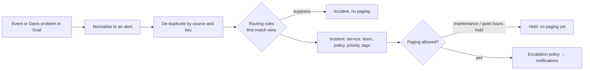

# Referência de alertas — enviando eventos para o Command Center

O Command Center **não tem endpoint de entrada próprio**. Tudo chega pelo Dynatrace: Davis problems, Davis events e
eventos genéricos armazenados no Grail. O motor os lê com DQL a cada execução e os transforma em **incidentes**. Esta
página explica os três caminhos, os formatos JSON, cada campo que o app lê e as propriedades `cc.*` que funcionam como
placeholders para o roteamento.

## Os três caminhos de entrada

| Caminho | Configuração (Settings → Event sources) | Padrão | Tabela do Grail |
| --- | --- | --- | --- |
| **1. Davis problems** | *Davis problems* | **ativado** | `dt.davis.problems` |
| **2. Davis events que não abrem um problem** | *Davis events that don't open a problem (Events API v2)* | desativado | `dt.davis.events` |
| **3. Eventos genéricos** | *Generic events (OpenPipeline)* | desativado | `events` |

| Caminho | Como um incidente é resolvido |
| --- | --- |
| **1. Davis problems** | Quando o Davis fecha o problem, ou um operador o resolve |
| **2. Davis events que não abrem um problem** | Quando o evento fecha (timeout) ou chega um novo evento com `cc.action: "resolve"` e o mesmo `cc.dedup_key` |
| **3. Eventos genéricos** | Um evento com `cc.action: "resolve"` e o mesmo `cc.dedup_key` |

Qualquer ferramenta de monitoramento, script ou job de CI usa o **caminho 1** por padrão: ela publica um Davis event,
o Davis abre um problem e o problem vira o incidente. Os caminhos 2 e 3 são para ferramentas que querem controlar a
deduplicação e a resolução por conta própria.

Um incidente **nunca** é resolvido porque o seu alerta sumiu de uma consulta. Uma consulta com falha ou vazia não
significa "tudo normal": somente um registro CLOSED explícito, `cc.action: "resolve"` ou um operador resolve um
incidente.

## Caminho 1 — Davis event → Davis problem (recomendado)

**Endpoint** (documentado em *OpenPipeline → API ingestion reference*, verificado em um tenant trial: HTTP 201 e o
Davis abriu um problem):

```
POST https://YOUR-ENVIRONMENT.live.dynatrace.com/api/v2/events/ingest
Authorization: Bearer <PLATFORM-TOKEN>
Content-Type: application/json
```

- Token: um **platform token** com o escopo `openpipeline:events.davis:ingest`. A mesma página documenta a alternativa
  clássica (um access token com `events.ingest`, header `Authorization: Api-Token …`).
- A documentação da Dynatrace classifica este endpoint sob o título *Classic environment API*, embora ele aceite um
  platform token e o OpenPipeline processe os eventos. É a única API documentada que cria Davis events, e é por isso
  que o Command Center a usa.
- Dentro de um workflow do Dynatrace, uma tarefa JavaScript pode chamar o caminho relativo
  `/platform/classic/environment-api/v2/events/ingest`. Ela é autenticada como o ator do workflow.

**Corpo**

```json
{
  "eventType": "CUSTOM_ALERT",
  "title": "Checkout latency above 2 s",
  "entitySelector": "type(SERVICE),entityName.equals(checkout)",
  "timeout": 30,
  "properties": {
    "cc.priority": "P2",
    "cc.service": "checkout",
    "cc.tags": "team:payments,env:prod",
    "runbook": "https://wiki.example.com/checkout"
  }
}
```

| Campo | Obrigatório | Significado |
| --- | --- | --- |
| `eventType` | sim | `CUSTOM_ALERT`, `ERROR_EVENT`, `AVAILABILITY_EVENT`, `PERFORMANCE_EVENT` ou `RESOURCE_CONTENTION_EVENT` abrem um Davis problem. Outros tipos (por exemplo `CUSTOM_INFO`) não abrem: use o caminho 2 para esses. |
| `title` | sim | Vira o título do incidente, com no máximo 500 caracteres. |
| `entitySelector` | não | Associa o evento a entidades. Elas aparecem na aba **Entities** do incidente e podem ser usadas nas regras de roteamento (`entity.name`, `entity.type`, `entity.id`). |
| `timeout` | não | Minutos que o evento fica aberto, a menos que seja enviado novamente. Quando expira, o Davis fecha o problem e o incidente é resolvido. Reenvie o mesmo evento para mantê-lo aberto. |
| `properties` | não | Strings livres de chave/valor. Elas viram campos do Davis event. O motor copia as propriedades `cc.*` para o problem (veja abaixo), exceto `cc.action` e `cc.dedup_key`. |

**O que acontece em seguida:** dentro de um intervalo do motor (1, 2 ou 5 minutos, escolhido na instalação), o motor
lê o problem (consulta Q1), busca as propriedades `cc.*` dos seus eventos (consulta Q4) e cria o incidente. Se essa
busca falhar ou exceder o seu limite (500 IDs de eventos por execução), um problem com menos de 3 minutos é retido para
uma execução posterior, para que não seja roteado sem as suas propriedades.

## Caminho 2 — Davis events que não abrem um problem (opcional)

Ative **Settings → Event sources → Davis events that don't open a problem** e liste os tipos de evento a serem lidos
(padrão `CUSTOM_ALERT, ERROR_EVENT`). Use o mesmo endpoint e o mesmo corpo do caminho 1 e adicione:

| Propriedade | Significado |
| --- | --- |
| `cc.dedup_key` | Mesma chave → mesmo incidente. Sem ela, o `event.id` do Davis é a chave. |
| `cc.action` | `trigger` (padrão) ou `resolve`. |

Davis events que pertencem a um problem são incorporados ao incidente desse problem, para que o mesmo alerta não seja
contado duas vezes. Eventos que o Davis marca como *frequent* (`dt.davis.is_frequent_event`) são descartados.

## Caminho 3 — Eventos genéricos pelo OpenPipeline (opcional)

Ative **Settings → Event sources → Generic events (OpenPipeline)**. O tipo de evento padrão é
`command_center.alert`.

**Endpoint** (documentado em *OpenPipeline → Ingest API → Generic events*, verificado em um tenant trial: HTTP 202 e
o evento foi armazenado na tabela `events` com os seus campos `cc.*`):

```
POST https://YOUR-ENVIRONMENT.live.dynatrace.com/platform/ingest/v1/events
Authorization: Bearer <PLATFORM-TOKEN>
Content-Type: application/json
```

Token: um platform token com o escopo `openpipeline:events:ingest`.

**Disparo (trigger)**

```json
{
  "event.type": "command_center.alert",
  "event.name": "Disk almost full on db-01",
  "event.description": "Free space 3% on /var/lib/postgresql",
  "cc.dedup_key": "disk-db-01",
  "cc.action": "trigger",
  "cc.priority": "P2",
  "cc.service": "database",
  "cc.tags": "env:prod,tier:data"
}
```

**Resolução (resolve)** (mesma chave):

```json
{
  "event.type": "command_center.alert",
  "event.name": "Disk almost full on db-01",
  "cc.dedup_key": "disk-db-01",
  "cc.action": "resolve"
}
```

O motor lê as últimas 24 horas desses eventos (consulta Q3), agrupa-os por `cc.dedup_key` e mantém a última ação,
título, descrição, prioridade, serviço e tags. Somente esses campos são lidos neste caminho. Outras propriedades,
entidades, categoria e severidade não são lidas, então as regras de roteamento só podem usar `title`, `description`,
`tag`, `source` e os campos `cc.*` listados acima. Um trigger depois de um resolve reabre o incidente.

## As propriedades `cc.*` (placeholders)

Os três caminhos entendem o mesmo vocabulário reduzido. São strings simples nas `properties` do evento (caminhos 1 e
2) ou campos de nível superior (caminho 3).

| Propriedade | Valores | Efeito | Caminhos |
| --- | --- | --- | --- |
| `cc.service` | **ID ou nome** do serviço, como definido em **Services** | Escolhe o serviço e, por meio dele, a equipe, a política de escalonamento e a prioridade padrão | 1, 2, 3 |
| `cc.priority` | `P1` … `P5` | Prioridade do incidente. Uma regra de roteamento que define uma prioridade tem precedência. | 1, 2, 3 |
| `cc.tags` | Separadas por vírgula, por exemplo `team:payments,env:prod` | Tags do incidente, usáveis nas regras de roteamento com o campo `tag` | 1, 2, 3 |
| `cc.dedup_key` | Qualquer string que você escolher | Mesma chave → mesmo incidente | 2, 3 (ignorada em problems) |
| `cc.action` | `trigger` (padrão) ou `resolve` | Abre, reabre ou resolve o incidente com essa chave | 2, 3 (ignorada em problems) |
| `cc.category`, `cc.severity` | Nome da categoria; `1`–`5` | Usadas para a prioridade padrão quando a origem não tem categoria ou severidade do Davis | 1, 2 |
| qualquer outra `cc.<name>` ou propriedade | String | Usável nas regras de roteamento como `fields.<name>`, por exemplo `fields.cc.region` | 1, 2 |

No caminho 1, o motor copia as `cc.*` dos eventos do problem para o problem. Quando vários eventos carregam a mesma
propriedade, vale a primeira encontrada. `cc.action` e `cc.dedup_key` nunca são copiadas, porque mudariam a identidade
ou o status do problem.

## Como um alerta vira um incidente



**Campos normalizados** (o que as regras de roteamento podem avaliar):

| Campo da regra | Origem |
| --- | --- |
| `title` | `event.name` (título do Davis problem/event, `event.name` genérico) |
| `description` | `event.description` |
| `category` | `event.category` ou `cc.category`. Valores conhecidos: `AVAILABILITY`, `ERROR`, `SLOWDOWN`, `RESOURCE_CONTENTION`, `CUSTOM_ALERT`, `MONITORING_UNAVAILABLE`, `INFO`. Qualquer outro valor vira `OTHER`. |
| `severity` | `event.severity` ou `cc.severity`, 1 (mais severo) … 5 |
| `source` | `davis-problem`, `davis-event` ou `generic-event` |
| `sourceStatus` | `ACTIVE` ou `CLOSED` |
| `displayId` | Display ID do Davis, por exemplo `P-26112613` |
| `entity.name`, `entity.type`, `entity.id` | Entidades afetadas. Vários valores: a condição é atendida quando qualquer valor atende. |
| `tag` | Tags das entidades mais `cc.tags` |
| `rootCause.name`, `rootCause.id` | Entidade de causa raiz do Davis |
| `fields.<name>` | Qualquer outro campo de nível superior do registro, como string, por exemplo `fields.cc.region` ou `fields.event.provider` |

**Operadores:** `equals`, `contains` e `in` (lista separada por vírgula) não diferenciam maiúsculas de minúsculas.
`regex` não diferencia maiúsculas de minúsculas, tem no máximo 500 caracteres, e padrões que poderiam travar são
rejeitados. `exists` significa que o campo tem um valor. `lte` e `gte` comparam números. Toda condição pode ser negada,
e uma regra é atendida com **todas** ou **qualquer uma** das suas condições.

**Decisão de roteamento**

| Decisão | Ordem (a primeira que se aplica vence) |
| --- | --- |
| Serviço | *then service* da regra → `cc.service` |
| Equipe | *then team* da regra → equipe do serviço → *Settings → Routing defaults → Default team* |
| Política de escalonamento | *then policy* da regra → política do serviço → política padrão da equipe → *Default escalation policy* |
| Prioridade | *then priority* da regra → `cc.priority` → prioridade padrão do serviço → prioridade por **severidade** → prioridade por **categoria** → *Fallback priority* (P3) |
| Tags | tags do alerta + *add tags* da regra |
| Supressão | uma regra com *suppress*: o incidente é criado e exibido, mas ninguém é acionado |

Mapeamento de prioridade padrão (**Services → Priority mapping**): severidade 1–5 → P1–P5. Por categoria:
`AVAILABILITY` P1, `ERROR` P2, `MONITORING_UNAVAILABLE` P2, `SLOWDOWN` P3, `RESOURCE_CONTENTION` P3, `CUSTOM_ALERT` P3,
`INFO` P5, `OTHER` P4.

**Bloqueios de acionamento**

- **Janelas de manutenção:** um Davis problem em manutenção não é acionado, a menos que *Page during maintenance
  windows* esteja ativado (Settings → Event sources).
- **Quiet hours (horário de silêncio)** (Teams → equipe → Quiet hours): incidentes menos urgentes que a prioridade
  escolhida são **retidos** (nenhum acionamento até a janela terminar) ou acionados com **baixa urgência** (somente
  Slack, Teams, Telegram, IFTTT e webhook, nunca SMS, voz ou WhatsApp).
- **Silenciar (mute)** um Davis problem não interrompe o acionamento no Command Center. Use uma regra de roteamento com
  *suppress* para isso.

## Identidade do incidente e limites

- ID do incidente: `dp-…` (Davis problem), `de-…` (Davis event) ou `ge-…` (evento genérico), derivado da chave da
  origem. A mesma chave sempre corresponde ao mesmo incidente.
- Título com até 500 caracteres, descrição com até 4.000. No máximo 120 campos extras de até 500 caracteres são
  mantidos por alerta. As tags são limitadas a 100 por alerta.
- Problems mais antigos que o look-back de problems (padrão 72 horas, Settings → Event sources) deixam de ser lidos.
  Um incidente que ainda esteja aberto nesse momento continua aberto até que um operador o resolva.

## Testando um evento de ponta a ponta

1. Envie o exemplo do caminho 1 com `cc.service` definido como um dos seus serviços.
2. Aguarde um intervalo do motor. Depois confira **Integrations → Inbound**: a origem mostra *Receiving*.
3. Abra o **Console**: o incidente aparece com a prioridade, o serviço e a equipe escolhidos pelo roteamento.
4. **Services → Test a rule** mostra qual regra correspondeu aos alertas recentes e por quê.

Se nada aparecer, veja *Solução de problemas* no [guia de operações](operations.md).
