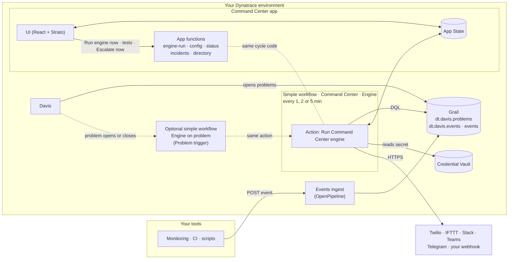

# Operações — arquitetura, custo, solução de problemas e limites

## Arquitetura



**Um ciclo do motor** (a ação, ou `engine-run` sob demanda):

1. Obter o lease do motor (`lock.engine`) para que duas execuções nunca acionem duas vezes. Se outra execução estiver
   com ele, esta execução é ignorada (contada como `skippedLocked` no heartbeat).
2. Executar as consultas DQL das origens habilitadas (Q1–Q4), normalizar os registros em alertas, deduplicá-los e
   roteá-los. Um problema novo cujos eventos do Davis ainda não podem ser lidos é retido por até 90 segundos (veja
   [Comportamentos que você deve conhecer](#comportamentos-que-você-deve-conhecer)).
3. Criar ou atualizar incidentes, aplicar as ações dos operadores em ordem, encerrar os snoozes vencidos, avaliar as
   políticas de escalonamento contra as escalas, planejar notificações e novas tentativas (com falha ou sem resultado)
   no registro (ledger), arquivar incidentes resolvidos antigos e atualizar a consolidação diária. Gravar o heartbeat
   (`hb.engine`) e liberar o lease.
4. Ler no Credential Vault cada segredo de provedor necessário e enviar (ou executar o seu custom workflow). Gravar
   `sent` ou `failed` no registro.

Toda a lógica de roteamento, escalas, escalonamento e planejamento é TypeScript puro em `ui/app/domain/`. A UI usa o
mesmo código, então o que o Console mostra logo após uma ação corresponde ao que o motor vai fazer.

## Por que um único simple workflow

- Versão 2 antes desta mudança: um workflow **standard** `tick` → 8 remetentes → `report`
  - *Workflow hours*: 1 por hora de vida do workflow, faça ele algo ou não
  - *Invocações de função*: Medido: cerca de 690 por hora (≈ 11,5 por minuto)
  - *Veredito*: Substituído
- **Um simple workflow, uma ação, gatilho de intervalo** (atual)
  - *Workflow hours*: **nenhuma**
  - *Invocações de função*: Medido: **1 por execução** (60 por hora a 1 minuto)
  - *Veredito*: O motor também envia, então uma notificação não acrescenta invocação.
- Um segundo simple workflow com **Problem trigger** e a mesma ação (opcional)
  - *Workflow hours*: nenhuma
  - *Invocações de função*: Medido: **1 por disparo**, cerca de 2 por problema (ele abre, ele fecha)
  - *Veredito*: Opcional. O primeiro acionamento não espera o intervalo, então um intervalo maior se torna viável. Veja [Rodando a cada problema](#rodando-a-cada-problema).
- Um **simple workflow** por integração, executado pelo motor a cada notificação (opcional, por integração)
  - *Workflow hours*: nenhuma
  - *Invocações de função*: Medido: **1 por notificação** daquela integração (a tarefa do workflow), incluindo os envios que falham
  - *Veredito*: Opcional desde a 2.3.0 (era o padrão na 2.1 e na 2.2). Cada entrega é uma execução de workflow que você vê. O motor recorre a um envio direto quando esse workflow não pode ser executado.

Fontes: *Create a simple workflow* ("without consuming workflow hours") e *Workflows concepts* (simple workflows "do
not generate any consumption of workflow hours") na documentação da Dynatrace. Simple workflows permitem exatamente
uma tarefa, e essa tarefa não pode ser *Run JavaScript*, *Run workflow* nem uma aprovação. É por isso que o motor é uma
ação customizada do app (`actions/run-engine.action.ts`) e não um script.

Medido no ambiente trial, a partir dos eventos de billing em `dt.system.events` (`AppEngine Functions - Small`):

| Janela de 10 minutos (UTC) | Motor antigo ainda instalado | Somente o motor novo |
| --- | --- | --- |
| Invocações | 00:50 → 105, 01:00 → 120, 01:10 → 114 | 01:30 → 21, 01:40 → 11, 01:50 → 18 |
| das quais `ACTION` (o motor) | — | 10 por janela = 1 por minuto |

As invocações restantes na coluna nova são de um gerador de alertas de teste que rodamos no ambiente trial (um
workflow standard executando JavaScript, que não faz parte do app) e das nossas próprias chamadas de teste às funções do app.

Workflow hours, a partir dos eventos de billing `Automation Workflow`: na hora 01:00–02:00 UTC, somente esse gerador de
alertas de teste (um workflow standard) foi cobrado. O motor baseado em simple workflow, que rodou a cada minuto nessa hora, não
produziu nenhum evento de billing de workflow.

### Por que os workflows de integração são iniciados sob demanda

O workflow do motor tem um gatilho de intervalo. Os workflows de integração e o custom workflow têm o gatilho **On
demand**: o motor os inicia pela API do Workflows e passa a notificação como parâmetros da execução. A documentação
da Dynatrace descreve *On demand* como o gatilho para um workflow que "should run exclusively via API" (deve rodar
exclusivamente via API).

Um **gatilho de evento** (*Problem*, *Davis event* ou *Event*) só dispara quando um evento correspondente é ingerido.
Um acionamento é uma decisão do motor (quem está de plantão, qual passo do escalonamento, ainda sem reconhecimento), e
não um evento que a Dynatrace produz. Com um gatilho de evento, o motor teria primeiro que ingerir um evento por
notificação, levando o destinatário e o texto.

O gatilho não muda o custo. Cada execução roda a sua tarefa como uma chamada de função, seja qual for o gatilho. A
documentação de licenciamento da Dynatrace dá o exemplo de um simple workflow que notifica a cada novo problema:
nenhuma workflow hour, uma chamada de função por notificação. Medido no ambiente trial: a ação *Send Command Center
notification* do app e a ação *HTTP request* da própria Dynatrace (o exemplo do custom workflow) foram cobradas em uma
invocação por execução cada, incluindo os envios que falharam. A chamada de API que inicia uma execução não gerou
evento de billing próprio.

Por isso o motor envia uma integração diretamente, a menos que você dê a ela um workflow próprio (**Configure →
Delivery**): o envio acontece dentro da execução que o motor já está fazendo, sem invocação extra. O workflow próprio
acrescenta uma invocação por notificação. Em troca, cada entrega é uma execução que você vê no app Workflows, e os
envios não dividem o limite de tempo da execução do motor (100 segundos; o que não é enviado a tempo fica para uma
execução posterior).

### Rodando a cada problema

O workflow opcional **Command Center · Engine on problem** é onde um gatilho de evento se encaixa: um problema do
Davis que abre ou fecha é um evento que a própria Dynatrace produz. Ele é um simple workflow com um **Problem
trigger** (o problema abre ou fecha; todas as categorias) e uma tarefa, a mesma ação do motor. O gatilho passa o ID e
o estado do problema para a ação.

Medido no ambiente trial com problemas de teste (2026-11-27):

| O quê | Medido |
| --- | --- |
| O gatilho dispara depois do evento do problema | 1–4 s para um fechamento ou uma atualização vista pela primeira vez, 11–12 s para um problema novo |
| O registro do problema pode ser consultado no Grail | Cerca de 30–40 s depois do timestamp dele. Execuções 24 s e 29 s depois ainda não encontraram o registro. |
| Incidente criado pela execução acionada pelo problema | 34 s, 40 s e 34 s depois do timestamp do problema, em três testes. Contando do envio do evento de teste: 49 s, 65 s e 54 s, porque o Davis abriu o problema 15–25 s depois do evento. |
| Comparado só com as execuções agendadas | O ganho fica entre nada e um intervalo: sem o gatilho, um incidente espera a primeira execução agendada depois que o problema fica legível. Nesses testes, cronometrados para que uma execução agendada (intervalo de 1 minuto) caísse logo antes desse momento, ele foi de 50 s, 34 s e 45 s. |
| Incidente resolvido depois que o problema fechou | Em até 30 s do evento de fechamento (três fechamentos) |
| Roteamento | O incidente recebeu a equipe do serviço a partir de `cc.service`: o evento do Davis do problema já podia ser lido |
| Billing | Uma invocação `ACTION` por disparo (execuções de 23–30 s). O gatilho disparou uma vez quando o problema abriu e uma vez quando fechou, e não na atualização entre os dois. |

Como o gatilho dispara antes de o registro poder ser consultado, a execução **espera**. A cada 5 segundos ela confere
o incidente no App State e uma consulta pequena (o estado mais recente do problema), por até 40 segundos. Assim que o
problema pode ser lido, ela roda um ciclo normal, e no máximo mais um se o incidente ainda não existir. Se outra
execução foi mais rápida, ela termina sem ciclo. Se o problema não fica legível a tempo, ela também termina, e a
execução agendada pega o problema como antes. A espera
fica dentro da mesma invocação, e uma chamada de função de até 60 segundos é uma invocação cobrada.

O que isso entrega: o incidente deixa de esperar a próxima execução agendada. Ele é criado cerca de meio minuto
depois que o problema abre, seja qual for o intervalo, e as primeiras notificações dele são planejadas e enviadas
nesse mesmo ciclo. Isso torna viável um intervalo de 5 minutos: cerca de 8.640 execuções agendadas por mês em vez de 43.200,
mais cerca de duas execuções por problema. Ele não substitui o workflow do motor. Passos de escalonamento, fim de
snooze, novas tentativas e as outras origens (eventos do Davis, eventos genéricos) são tratados no intervalo.

Limites:

- A Dynatrace limita cada workflow a 1.000 execuções acionadas por evento por hora e aplica throttling além disso; a
  execução agendada cobre a diferença.
- Um gatilho novo precisa de tempo para ficar ativo. No ambiente trial, um problema criado 52 segundos depois do
  workflow não o disparou; eventos a partir de dois minutos e meio, sim.
- Depois da instalação, o gatilho também dispara uma vez para cada problema que já está aberto, na próxima
  atualização dele. Essas execuções terminam na hora, porque o incidente já existe.
- Só a criação deste workflow pela API foi exercitada. **Install in Workflows** e o upload do JSON dele não foram
  clicados de ponta a ponta.

## Custo e consumo

> Leia isto antes de rodar o app em produção. O motor roda o dia inteiro, independentemente de quantas pessoas usam o
> app.

| Item | Por mês a 1 min | a 2 min | a 5 min |
| --- | --- | --- | --- |
| Execuções do motor = invocações de função (`ACTION`) | ≈ 43.200 | ≈ 21.600 | ≈ 8.640 |
| Workflow hours | 0 | 0 | 0 |
| Consultas ao Grail | 1–8 por execução (abaixo) | igual | igual |
| Execuções do *Engine on problem* (opcional) = invocações de função (`ACTION`) | cerca de 2 por problema: ele abre, ele fecha | igual | igual |
| Execuções de workflows de integração (opcional) = invocações de função (`ACTION`) | uma por notificação de uma integração que tem workflow próprio, incluindo envios que falham e novas tentativas; nenhuma por padrão | igual | igual |

Uma invocação é uma chamada de função de até 60 segundos; uma chamada que roda de 61 a 120 segundos conta como duas
(documentação de licenciamento da Dynatrace). As execuções do motor medidas no ambiente trial levaram de 3 a 10
segundos.

**Consultas ao Grail por execução**: Q1 problems (quando a origem Davis problems está ativada, o padrão), Q4
propriedades de eventos dos problems que a Q1 retornou (uma a cada
100 IDs de eventos, no máximo 5), Q2 Davis events e Q3 eventos genéricos (somente quando ativados). A UI **não**
executa DQL: as abas abertas leem apenas o App State.

| Fator | Efeito |
| --- | --- |
| Intervalo de execução | Linear no número de execuções. Um intervalo mais longo também significa um timing de escalonamento menos preciso. |
| Origens habilitadas | Q2 e Q3 adicionam uma consulta cada por execução |
| Look-back de problems (72 h) | Uma janela mais ampla varre mais dados |
| Volume de dados | Mais problems e eventos, mais bytes varridos |
| Abas abertas no navegador | Sem custo de Grail. Cada aba lê o App State a cada minuto por padrão. |

**Limite de varredura (proteção de custo).** Toda consulta do motor leva um limite de varredura, *Grail scan limit per
query* em Settings → Event sources (padrão 1 GB, de 1 a 100 GB inteiros; o Grail não aceita valor menor). No ambiente
trial, uma consulta do motor varreu no máximo 1,4 MB e uma execução inteira cerca de 2 MB, então 1 GB nunca corta uma
execução normal; ele limita quanto uma execução pode custar se os dados crescerem inesperadamente. O limite é por
consulta: o pior caso de uma execução é o número de consultas (1 a 8) vezes o limite. Uma consulta que o atinge conta
como cortada: sua origem fica incompleta naquela execução (nada dela é arquivado) e o último erro do motor informa
isso. Settings → Event sources mostra o que a última execução varreu e a estimativa diária no intervalo atual.

Como medir no seu ambiente:

- Eventos de billing: `fetch dt.system.events | filter event.kind == "BILLING_USAGE_EVENT"`, agrupados por
  `event.type` e, para funções, por `function.type`.
- **Account Management → Cost & usage** para consultas ao Grail, funções do AppEngine e workflows depois de um dia
  rodando.
- A documentação da Dynatrace observa que simple workflows, embora não consumam workflow hours, ainda podem acionar
  outras capacidades cobradas: aqui, as invocações de função e as consultas ao Grail.

Como reduzir o custo: mantenha Q2 e Q3 desativadas, a menos que você envie eventos que não abrem problems; reduza o
look-back; escolha um intervalo de 2 ou 5 minutos se os atrasos de escalonamento forem longos, e instale o *Engine on problem*
para que o primeiro acionamento não espere por ele. Deixe as integrações em **By the engine** (o padrão): um workflow
próprio custa uma invocação por notificação.

**As consultas** (`ui/app/data/dql.ts`, todas executadas no ambiente trial):

```
// Q1 — Davis problems
fetch dt.davis.problems, from: now() - 72h
| filter not(dt.davis.is_duplicate)
| dedup event.id, sort: { timestamp desc }
| filter event.status == "ACTIVE" or event.end >= now() - 2h
| fields timestamp, event.id, display_id, event.name, event.description, event.category, event.severity,
         event.status, event.start, event.end, dt.davis.last_reopen_timestamp, dt.davis.event_ids,
         dt.davis.affected_users_count, dt.davis.mute.status, maintenance.is_under_maintenance,
         smartscape.affected_entities, root_cause.smartscape_entity, affected_entity_ids,
         affected_entity_names, root_cause_entity_name, entity_tags
| sort event.start desc
| limit 1000

// Q2 — Davis events (optional)
fetch dt.davis.events, from: now() - 24h
| filter in(event.type, array("CUSTOM_ALERT", "ERROR_EVENT"))
| dedup event.id, sort: { timestamp desc }
| filter event.status == "ACTIVE" or event.end >= now() - 2h
| fieldsKeep timestamp, event.id, event.name, event.description, event.type, event.category, event.severity,
             event.status, event.start, event.end, event.provider, dt.davis.is_frequent_event,
             maintenance.is_under_maintenance, dt.source_entity, entity_tags, "cc.*"
| limit 1000

// Q3 — generic events (optional)
fetch events, from: now() - 24h
| filter event.type == "command_center.alert"
| filter isNotNull(cc.dedup_key)
| sort timestamp asc
| summarize { last_action = takeLast(cc.action), title = takeLast(event.name),
              description = takeLast(event.description), priority = takeLast(cc.priority),
              service = takeLast(cc.service), tags = takeLast(cc.tags),
              first_seen = min(timestamp), last_seen = max(timestamp) },
            by: { cc.dedup_key }
| limit 1000

// Q4 — cc.* properties of the events behind active problems (up to 100 IDs per query)
fetch dt.davis.events, from: now() - 72h
| filter in(event.id, array("<event id>", "…"))
| dedup event.id, sort: { timestamp desc }
| fieldsKeep event.id, event.type, event.provider, "cc.*"
| limit 1000

// Q5 — one problem's newest status (only the run started by the Problem trigger: one per 5-second check)
fetch dt.davis.problems, from: now() - 2h
| filter event.id == "<problem id>"
| filter not(dt.davis.is_duplicate)
| sort timestamp desc
| limit 1
| fields event.id, event.status, dt.davis.event_ids
```

## Saúde e monitoramento

- **Banner do Console**: o motor fica *late* (atrasado) após dois intervalos mais um minuto sem execução (3 minutos no
  intervalo padrão), ou quando a última execução reportou um erro. O **sino** notifica apenas quando o motor está
  atrasado.
- **Integrations → Workflows**: última execução, sua duração e contagens, o último erro e o status de instalação.
- **Monitoramento externo**: chame a função do app `status`. Ela retorna o heartbeat, o lease e as contagens de
  abertos/disparados (veja [configuração](configuration.md#funções-do-app-automação-e-scripts)).
- Simple workflows guardam apenas metadados de execução: resultados de tarefas e logs não são armazenados. Os
  diagnósticos do motor ficam, portanto, no heartbeat, e não no log de execução do Workflows.

## Comportamentos que você deve conhecer

- **Nunca resolvido por ausência.** Uma consulta com falha ou vazia nunca resolve nada. Somente um registro CLOSED,
  `cc.action: "resolve"` ou um operador resolve um incidente.
- **Um resultado incompleto não prova ausência.** Quando o Grail corta o resultado de uma consulta (limite de
  registros, limite de varredura, amostragem), o motor ainda usa os registros recebidos, mas trata essa fonte como
  incompleta na execução: nenhum incidente resolvido dessa fonte é arquivado, e o último erro do heartbeat informa a
  consulta e o aviso do Grail, por exemplo `Q1 problems: result truncated (…)`.
- **Uma execução que cai bloqueia poucas execuções.** O lease do motor dura de 130 a 180 segundos, mais do que uma
  execução pode levar (120 s). Se uma execução morre sem liberá-lo, as próximas execuções agendadas são puladas até
  ele expirar: no máximo 2 com intervalo de 1 minuto, 1 com 2 minutos, nenhuma com 5 minutos. Uma execução de *Run
  engine now* ou *Engine on problem* que morre logo antes de uma execução agendada pode custar mais uma.
- **Acionamento pelo menos uma vez (at least once).** O registro (ledger) impede duplicatas na operação normal. Em
  raras condições de corrida (uma execução que se sobrepõe a uma execução anterior lenta, um resultado que chega depois
  do timeout), uma pessoa pode ser notificada duas vezes.
- **Precisão de timing = intervalo.** Um passo dispara na primeira execução depois de vencido. O mesmo vale para o fim
  dos snoozes.
- **Um problema novo espera pelos seus eventos.** O registro de um problema pode ficar consultável antes dos eventos
  do Davis aos quais ele se liga. O roteamento acontece uma única vez, quando o incidente é criado, e as propriedades
  `cc.*` estão nesses eventos. Por isso um problema cujos eventos ainda não podem ser lidos é retido por até 90
  segundos, e depois segue como está.
- **Um acionamento nunca é mais rápido que o Grail.** No ambiente trial, um problema podia ser consultado cerca de
  30–40 segundos depois de abrir. Nenhum gatilho ou intervalo aciona antes disso.
- **Configuração: a última gravação vence.** Duas pessoas salvando a mesma equipe no mesmo momento: vale o salvamento
  mais tardio.
- **Papéis são orientações.** Qualquer usuário do app pode alterar a configuração. O IAM decide quem pode abrir o app.
- **O modo demo é por navegador** e nunca mistura dados de exemplo com dados reais (veja
  [configuração](configuration.md#general-geral)).

## Segurança e privacidade

- **Nenhum segredo no app.** As credenciais dos provedores ficam no Credential Vault. O App State guarda apenas IDs de
  entradas. Os textos de erro mascaram segredos e URLs.
- **Os dados de contato ficam visíveis para todos os usuários do app.** O App State não tem permissões por chave. Avise
  as pessoas antes que elas cadastrem números pessoais. Emails não são armazenados; eles são lidos ao vivo do IAM.
- **O workflow do motor não precisa ser privado.** Ele não expõe dados pessoais: suas execuções guardam apenas
  metadados e a ação retorna apenas contagens, então nenhum número de telefone ou texto de mensagem aparece no
  Workflows. Um custom workflow recebe a notificação completa (incluindo o endereço) como parâmetros de execução:
  decida você mesmo quem pode vê-la.
- **O tráfego de saída** é limitado pela lista de permissões de External requests: libere apenas os hosts dos
  provedores que você usa.
- **Tokens de entrada**: dê às suas ferramentas um platform token apenas com `openpipeline:events.davis:ingest` (ou
  `openpipeline:events:ingest`), guarde-o no cofre de segredos delas e faça a rotação dele.
- **Os textos das mensagens** contêm o título e a descrição do alerta, que são enviados a terceiros.
- **A identidade para auditoria** vem das informações de modificação do App State, e não do que o navegador alega.

## Solução de problemas

| Sintoma | Causa e correção |
| --- | --- |
| *The paging engine hasn't run yet / is late* | O workflow não está instalado, não está implantado ou está falhando. Confira Integrations → Workflows. Na maioria das vezes, falta uma permissão para o ator nas **Authorization settings** do Workflows. |
| Aba Workflows: *Installed as a standard workflow* | O intent create-workflow não tem campo de tipo. Exclua esse workflow e faça o upload do JSON baixado, ou execute `scripts/install-workflow.mjs`. |
| Aba Workflows: *Update available* | O app foi atualizado. Reinstale e depois exclua o workflow antigo. |
| Nenhum incidente aparece | Settings → Event sources; confira se o evento chegou ao Grail (`fetch dt.davis.events` em um Notebook) e se o seu tipo abre um problem. Caso contrário, ative a origem de Davis events. |
| Um incidente fica sem equipe e ninguém é acionado | Nenhuma regra de roteamento correspondeu e não há equipe padrão. Os problemas que o Davis detecta sozinho não trazem equipe (só os eventos que você envia podem citar um serviço em `cc.service`). Abra a equipe e selecione *Receive all unrouted alerts* na checklist **Ready to page?** dela (ou defina em Settings → Routing defaults), ou adicione uma regra de roteamento. A checklist também mostra o que mais falta para a equipe. |
| O *Engine on problem* está instalado, mas parece não rodar | Simple workflows não mostram lista de execuções: confira **Integrations → Workflows → Last engine run** logo depois que um problema abrir. Um gatilho novo precisa de alguns minutos antes de disparar. O ator dele precisa das mesmas permissões do ator do motor, e o gatilho tem que estar ligado. |
| O roteamento ignora `cc.service` | O nome ou ID não corresponde a um serviço, ou uma regra anterior definiu outro serviço. Use Services → Test a rule. |
| *Host not allowed: &lt;host&gt;* numa notificação ou no card de um provedor | A Dynatrace recusou a chamada porque o host não está na lista de permissões. Adicione o host em Settings → General → Environment management → External requests (Integrations → Configure mostra qual), depois **Send test**. O app não consegue alterar essa lista sozinho. |
| Uma notificação **falhou** (Failed) | Incidente → Notifications mostra o erro do provedor. Causas comuns: host ausente em External requests, uma entrada do vault que o ator não consegue ler, tipo de credencial errado, telefone fora do padrão E.164, API key do Twilio sem *Account SID*. |
| Uma notificação mostra **No result** | A execução terminou antes de a chamada retornar. Ela é tentada novamente até *Delivery attempts*. |
| *Run engine now* diz *Engine is already running* | Uma execução agendada está com o lease. Aguarde alguns segundos e tente de novo. |
| O seletor de usuários não encontra ninguém | Digite pelo menos 3 caracteres. Somente usuários **ativos** são retornados; pessoas convidadas precisam entrar uma vez. *User search is unavailable (IAM returned 403)*: o seu usuário precisa pertencer à conta dona do ambiente e ter permissão para ver usuários. |
| Um membro da equipe aparece como id, não como nome | Ninguém foi perdido: a participação na equipe, os meios de contato e os acionamentos nunca dependem do nome. A aba **Members** diz o motivo. *Names can't be shown (403)*: o seu usuário não pode ver os usuários da conta. *Not an active user of this account*: a pessoa foi desativada ou o id nunca foi de um usuário da conta (por exemplo, gravado por uma importação de configuração); remova-a da equipe. Os nomes também ficam guardados no app: cada gravação de equipe, escala, política ou contato guarda os nomes conhecidos naquele momento, e eles continuam aparecendo quando o diretório de usuários não pode ser consultado. |
| Implantação rejeitada por causa da versão | `app.version` precisa ser maior que a versão instalada. |
| Configuração perdida | O App State foi limpo ou o app foi desinstalado. Importe a sua última exportação. |

## Verificado e não verificado

Verificado em um ambiente trial (Dynatrace mais recente):

- Ingestão de Davis event (endpoint ao vivo, platform token) → Davis problem → motor → roteamento por `cc.service` →
  escala → passos de escalonamento → **webhook genérico** entregue → registro atualizado. Uma política de quatro passos
  disparou cada passo dentro de um minuto após o vencimento.
- Eventos genéricos por `/platform/ingest/v1/events`: trigger e resolve por `cc.dedup_key`.
- O motor como **simple workflow** com a ação customizada do app: todas as execuções com sucesso, leituras de App
  State, Grail e Credential Vault, HTTPS de saída. Billing: uma invocação `ACTION` por execução.
- A integração **Custom workflow**: um teste e um escalonamento agendado executaram um simple workflow com uma tarefa
  HTTP request, e a expressão `{{ execution().params | to_json }}` entregou o JSON completo da notificação.
- Funções do app `engine-run`, `config` (export, import, dry run), `status` e `incidents`. Notebooks de war room
  criados pela Document API.
- **Engine on problem**: um simple workflow com Problem trigger e a ação do motor, criado pela Automation API. Ele
  disparou quando problemas de teste abriram e fecharam; a execução esperou até o problema ficar legível, criou o
  incidente com a equipe certa e o resolveu no fechamento, com uma invocação cobrada por disparo. Os números estão em
  [Rodando a cada problema](#rodando-a-cada-problema).

Não verificado, ou apenas parcialmente:

- Remetentes de **Twilio, IFTTT, Slack, Microsoft Teams e Telegram**: implementados a partir da documentação dos
  fornecedores, não exercitados ao vivo. Testes unitários cobrem as requisições de Twilio SMS e voz, Slack e Telegram.
- **Install in Workflows** (intent) e o **Upload** do JSON no app Workflows: não foram clicados por nós de ponta a
  ponta, nem para o motor, nem para o *Engine on problem*, nem para o workflow próprio de uma integração. A instalação
  pela API das mesmas definições está verificada.
- **Configure → Delivery** (a escolha entre o motor e o workflow próprio de uma integração) foi exercitada somente na
  prévia offline.
- **Uma notificação enviada por uma execução acionada por problema**: nenhum provedor estava ligado durante esses
  testes. As execuções criaram e resolveram incidentes; nada foi enviado. O envio usa o mesmo código de ciclo da
  execução agendada.
- **Permissões mínimas** do ator do workflow: todas as permissões estavam habilitadas no ambiente trial.
- A **busca de usuários** não retornou ninguém para usuários que tinham acabado de ser convidados. Uma busca por
  usuários ativos em uma sessão conectada não foi confirmada no ambiente trial. Com um platform token, o IAM respondeu
  *User not authorized*.
- **Configuração inicial** (nova equipe → *Ready to page?* → métodos de contato → escala → política): percorrida na
  prévia offline, começando sem dados, e não em uma sessão conectada em um ambiente. Que um problema detectado pelo
  próprio Davis vai para a equipe padrão foi conferido ali com o testador de regras e está coberto por um teste
  unitário; não foi observado com um problema real.
- **Add people → o seu próprio usuário**: ele é oferecido a partir do ID do usuário conectado. Que esse ID é o ID de
  usuário do IAM usado na participação em equipes não foi confirmado em uma sessão conectada.
- **Problems abertos há mais tempo que o look-back** (72 h) deixam de ser lidos; o incidente deles continua aberto até
  ser resolvido manualmente.
- **Respostas bidirecionais** (reconhecer por SMS ou chat) não estão implementadas.
